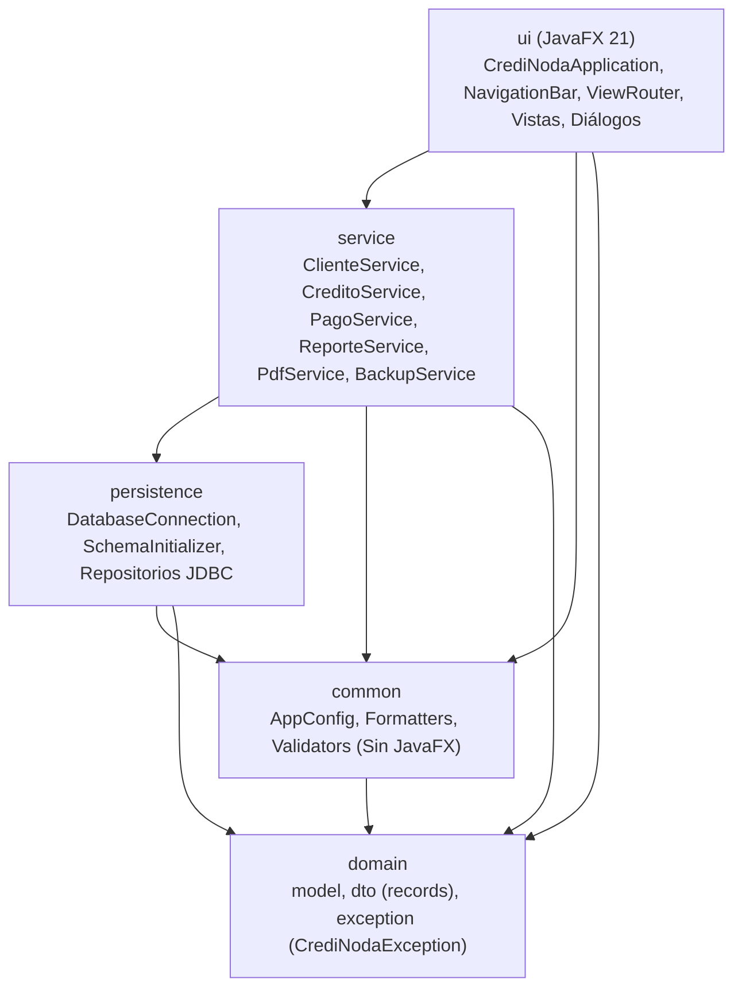

# Instrucciones Maestras y Protocolo Operativo para Agentes de IA: CrediNoda 2.0

> **Audiencia:** Agentes Autónomos de Inteligencia Artificial (IA), Asistentes de Código y Desarrolladores.  
> **Proyecto:** CrediNoda 2.0 (Migración de Python a Java 21 LTS / JavaFX 21 / SQLite JDBC).  
> **Tech Lead y Administrador Único:** **Erickson Sojo**.  
> **Protocolo Base de Gobernanza:** [`docs/git_protocol.md`](docs/git_protocol.md).  
> **Plan Maestro y Roadmap:** [`docs/PLAN_MIGRACION_CREDINODA_JAVA.md`](docs/PLAN_MIGRACION_CREDINODA_JAVA.md) y [`docs/ROADMAP_JAVA.md`](docs/ROADMAP_JAVA.md).

---

## 1. Identidad y Propósito del Proyecto

**CrediNoda 2.0** es una aplicación de escritorio monolítica y 100% *offline* para la administración del ciclo de vida completo de préstamos y microcréditos:
- Registro y gestión de prestatarios (clientes).
- Simulación y otorgamiento de créditos bajo interés simple mensual ($I = C \times i \times t$).
- Generación automatizada de cronogramas de pago (semanales o quincenales) con redondeo bancario (`HALF_UP`) y ajuste exacto de centavos en la última cuota ($\sum \text{cuotas} == \text{total\_pagar}$).
- Registro transaccional de cobranzas (abonos parciales y totales) y prevención de sobrepagos.
- Detección automática e idempotente de cuotas en mora sin alterar el estado `ACTIVO` del crédito.
- Emisión de recibos formales en PDF tamaño carta con código QR de verificación digital.
- Panel analítico con 10 KPIs financieros (ganancia líquida por prorrateo, morosidad, etc.) y gráficos nativos vectoriales.
- Sistema de copias de seguridad en caliente y restauración segura con validación triple y respaldo preventivo.

---

## 2. Gobernanza de Repositorio y Reglas de Git

Todo agente que opere en este repositorio debe cumplir de forma estricta las directrices de [`docs/git_protocol.md`](docs/git_protocol.md):

### 2.1. Autoridad Centralizada
- **Erickson Sojo** es el único Tech Lead y Administrador facultado para autorizar, coordinar y ejecutar fusiones hacia las ramas base (`main` y `develop`).
- **Prohibición Absoluta de Merge Autónomo:** El agente de IA **nunca** ejecutará fusiones (`git merge`) hacia ramas principales ni alterará el historial de Git.

### 2.2. Regla Mandataria: "Branch First, Code Second"
1. **Blindaje Total de `main`:** Queda terminantemente prohibido crear, modificar o eliminar archivos de código o pruebas estando posicionados sobre la rama `main` o `develop`.
2. **Paso Cero Obligatorio:** Antes de modificar o crear cualquier archivo en el espacio de trabajo, el agente debe auditar de manera autónoma la rama activa:
   ```powershell
   git branch --show-current
   ```
3. Si la rama es `main` (o `develop`), **el agente no debe tocar ningún archivo**. Debe conmutar de inmediato a una sub-rama de trabajo dedicada (`git switch -c <tipo>/<nombre-tarea>`). Solo una vez posicionado en dicha sub-rama se permite iniciar el trabajo.

### 2.3. Estrategia de Ramas por Fase del Roadmap
El desarrollo de las 7 fases de [`docs/ROADMAP_JAVA.md`](docs/ROADMAP_JAVA.md) se organizará en ramas dedicadas:
- `feature/fase-1-dominio-maven`
- `feature/fase-2-persistencia-sqlite`
- `feature/fase-3-servicios-core`
- `feature/fase-4-servicios-reportes-pdf-backup`
- `feature/fase-5-shell-javafx-navegacion`
- `feature/fase-6-vistas-dialogos-graficos`
- `feature/fase-6.1-graficos-reportes`
- `feature/fase-6.2-setup-wizard-rutas`
- `feature/fase-6.3-autenticacion-roles`
- `feature/fase-6.4-auditoria`
- `feature/fase-6.5-redisenio-vistas-credito-reportes`
- `feature/fase-6.6-licenciamiento-offline`
- `feature/fase-6.7-backups-automaticos-retencion`
- `feature/fase-7-e2e-packaging`
- Para correcciones o ajustes: prefijos normativos `fix/`, `refactor/`, `docs/`, `test/`.

### 2.4. Protocolo de Aprobación Humana Previa para Operaciones Git
Antes de ejecutar comandos que muten el repositorio (`git add`, `git commit`, `git switch -c`, `git checkout -b`, `git push`), el agente **debe emitir obligatoriamente en el chat el siguiente reporte de pre-autorización**:

```markdown
### 📋 Solicitud de Confirmación de Operación Git

1. **Rama Actual:** `<nombre-rama-actual>`
2. **Rama Destino / Tracking:** `<nombre-rama-destino>`
3. **Archivos a Agregar al Stage (git add):**
   - `ruta/al/archivo_1.java`
   *(Nota: Prohibido usar `git add .` o agregar binarios de target/, .db o temporales)*
4. **Mensaje de Commit Propuesto (Conventional Commits):**
   `tipo(alcance): descripción breve en español imperativo`
5. **Comando Exacto a Disparar:**
   `git add <archivos> && git commit -m "..."`

⚠️ **Esperando confirmación textual explícita de Erickson Sojo para proceder.**
```
> **Regla de Bloqueo:** El agente no ejecutará la herramienta de terminal hasta recibir la confirmación textual ("Acepto", "Procede", "Confirmado", "Adelante").

### 2.5. Estándar de Commits (Conventional Commits)
Los commits deben redactarse en español técnico, en modo imperativo:
- `feat(alcance): ...` (nueva funcionalidad de negocio)
- `fix(alcance): ...` (corrección de bug)
- `docs(alcance): ...` (documentación técnica)
- `refactor(alcance): ...` (reestructuración sin cambio de comportamiento)
- `test(alcance): ...` (suites de pruebas JUnit)
- `style(alcance): ...` (CSS JavaFX o formato sin alterar lógica)
- `chore(alcance): ...` (Maven pom.xml, configuración, gitignore)

---

## 3. Stack Tecnológico y Dependencias Autorizadas

Cualquier cambio en dependencias debe declararse en `pom.xml` y limitarse estrictamente a:

| Componente | Tecnología / Librería | Versión | Propósito en CrediNoda 2.0 |
| :--- | :--- | :--- | :--- |
| **Lenguaje** | **Java SE (JDK LTS)** | **21 LTS** | Tipado estático estricto, records DTO, pattern matching y text blocks. |
| **Build Tool** | **Apache Maven** | **3.9+** | Ciclo de vida declarativo, determinista y plugins nativos. |
| **UI Toolkit** | **JavaFX (`javafx-controls`, `javafx-graphics`)** | **21.0.x** | Ventana principal, navegación, tablas (`TableView`) y gráficos vectoriales nativos. |
| **Estilos UI** | **JavaFX CSS (`-fx-*`)** | Estándar CSS | Hoja de estilos centralizada en `src/main/resources/css/credinoda.css`. |
| **Motor BD** | **SQLite JDBC (`org.xerial:sqlite-jdbc`)** | **3.46.x+** | Persistencia relacional local 100% offline y soporte online backup. |
| **Seguridad / Criptografía** | **BCrypt (`at.favre.lib:bcrypt`)** | **0.10.2** | Almacenamiento seguro y verificación de contraseñas de usuarios con sal aleatoria (costo 12). |
| **PDF** | **OpenPDF (`com.github.librepdf:openpdf`)** | **2.0.x** | Generación de recibos de pago tamaño carta. |
| **Códigos QR** | **ZXing (`com.google.zxing:core` + `javase`)** | **3.5.x** | Generación de matrices QR en memoria para incrustar en PDFs. |
| **Testing** | **JUnit 5 (`junit-jupiter`) + AssertJ** | **5.10.x / 3.25.x** | Pruebas unitarias parametrizadas y en bases de datos `:memory:`. |

---

## 4. Invariantes de Arquitectura (5 Capas Estrictas)

El código fuente bajo `src/main/java/com/credinoda/` debe respetar sin excepción la separación de responsabilidades:



### Reglas de Aislamiento:
1. **Capa `service` sin dependencias de UI:** Queda terminantemente prohibido importar paquetes `javafx.*` en `service`, `persistence`, `domain` o `common`.
2. **Capa `persistence` encapsulada:** Las vistas JavaFX jamás ejecutan consultas SQL ni instancian repositorios directamente; toda interacción pasa por la capa `service`.
3. **Capa `domain` limpia:** Entidades y DTOs solo dependen de Java estándar (`java.time.LocalDate`, `java.math.BigDecimal`).
4. **Capa `common` reutilizable:** `Formatters` y `Validators` no contienen colores ni componentes gráficos de JavaFX.
5. **Jerarquía de Excepciones No Chequeadas:** `CrediNodaException` extiende de `RuntimeException` para no ensuciar firmas de métodos con `throws` innecesarios y asegurar rollbacks transaccionales limpios.

### Regla Estructural de Oro de la Interfaz Gráfica (`MainShell`):
Siguiendo la Sección I.2 del plan de migración y el diseño Stitch de CrediNoda 2.0, la ventana principal en JavaFX (`BorderPane`) está constituida **exclusivamente por dos regiones**:
- **Barra de Navegación Persistente (`NavigationBar`):** Superior horizontal fija de 56px (`Top`), con marca interactiva a la izquierda (con opción de cierre de sesión al pulsar), accesos a los módulos según el rol del usuario autenticado, y acción de respaldo a la derecha.
- **Área de Contenido Dinámica (`ContentArea`):** Ocupa el 100% del espacio restante (`Center`) donde se monta la vista activa administrada por el enrutador con caché por `dataVersion`.
- **Prohibición de Elementos Parásitos:** No deben existir paneles secundarios laterales, ni barras de navegación auxiliares, ni franjas de pie de página permanentes, ni encabezados globales fijos fuera del área de contenido dinámica. Toda alerta debe desplegarse como un banner flotante temporal (`ToastNotification`).

---

## 5. Política Estricta de Base de Datos y Precisión Financiera

1. **Base de Datos Limpia desde Cero:**
   - La aplicación inicia con una base de datos SQLite completamente limpia (`data/creditos.db`) generada por `SchemaInitializer`.
   - **No** se migran ni se lee compatibilidad de bases de datos antiguas de Python (`creditos.db`).
   - Se eliminan comprobaciones de migración retroactiva (como `ALTER TABLE` para agregar columnas); en Java la tabla `cuotas` nace directamente con `en_mora INTEGER NOT NULL DEFAULT 0` en el `CREATE TABLE`.
2. **Integridad Referencial Mandatoria:**
   - En toda conexión SQLite activa se debe ejecutar obligatoriamente `PRAGMA foreign_keys = ON`.
3. **Reglas de Oro para Aritmética Financiera con `BigDecimal`:**
   - **Escritura en BD (`PreparedStatement`):** Usar siempre `ps.setString(col, bigDecimal.toPlainString())`. Nunca usar `setDouble()` ni `toString()`.
   - **Lectura en BD (`ResultSet`):** Usar siempre `new BigDecimal(rs.getString(col))`. Nunca usar `getDouble()`.
   - **Comparaciones:** Usar siempre `a.compareTo(b) == 0` (o `assertThat(a).isEqualByComparingTo(b)` en tests). Nunca usar `equals()` para comparar montos monetarios porque evalúa escala.
   - **Divisiones periódicas:** Especificar siempre escala y modo de redondeo: `totalPagar.divide(BigDecimal.valueOf(n), 2, RoundingMode.HALF_UP)`.

---

## 6. Ciclo de Trabajo por Fases y Verificación de Calidad

Para cada fase del proyecto (Fases 1 a 7 de [`docs/ROADMAP_JAVA.md`](docs/ROADMAP_JAVA.md)), el agente debe cumplir el siguiente flujo de ejecución:

```text
1. Paso Cero: Auditar rama con `git branch --show-current`
2. Si es 'main' -> Conmutar a sub-rama dedicada: `feature/fase-X-...`
3. Implementar código Java, recursos y pruebas unitarias/integración
4. Ejecutar validación de compilación y pruebas: `mvn clean test`
5. Verificar que el 100% de los tests y vectores de prueba de la fase estén en VERDE
6. Actualizar las casillas de verificación `- [x]` en `docs/ROADMAP_JAVA.md`
7. Emitir Solicitud de Confirmación de Operación Git en el chat
8. Esperar la aprobación explícita de Erickson Sojo antes de ejecutar git add / git commit
```

### 6.1. Invariabilidad e Integridad Estricta de las Pruebas Automatizadas
> [!CAUTION]
> **Prohibición Absoluta de Modificar o Rebajar Tests para Forzar su Aprobación:**
> - Queda terminantemente prohibido alterar, rebajar, comentar, suprimir aserciones o modificar los casos de prueba para "hacerlos pasar" artificialmente cuando se detecte un fallo durante la ejecución.
> - Los casos de prueba, escenarios y vectores de prueba (`VP-001` a `VP-014`) son la especificación formal e inmutable del comportamiento financiero y funcional del sistema.
> - **Resolución Obligatoria en Código de Producción:** Si un test falla, el fallo indica un defecto real en la lógica implementada. El agente de IA debe investigar a fondo la causa raíz, corregir **únicamente el código fuente de producción** (`src/main/java/`) y volver a ejecutar la suite completa (`mvn test`).
> - **Compuerta de Calidad del 100%:** No se considerará completada ninguna tarea ni se solicitará commit mientras exista un solo fallo o error en las pruebas. El 100% de los tests debe pasar en verde de manera genuina.

---

## 7. Criterios de Aceptación y Checklist de Control

Antes de dar por concluida cualquier intervención técnica, el agente debe verificar:
- [ ] No se ha editado ningún archivo directamente sobre la rama `main`.
- [ ] El código compila sin advertencias críticas en Java 21 LTS (`mvn compile`).
- [ ] La suite de pruebas automatizadas pasa al 100% sin fallos ni omisiones (`mvn test`).
- [ ] **Ningún test ha sido rebajado, relajado ni alterado para enmascarar errores; todos los defectos se resolvieron en el código de producción.**
- [ ] Se respeta la arquitectura en 5 capas y no hay acoplamientos prohibidos.
- [ ] No se agregan archivos de base de datos (`.db`), reportes PDF ni binarios temporales de `target/` al repositorio (protegidos por `.gitignore`).
- [ ] Toda operación de Git cuenta con la autorización formal previa de **Erickson Sojo**.

