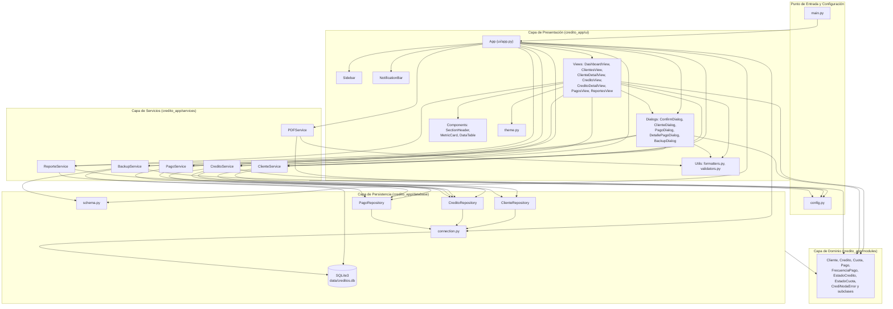
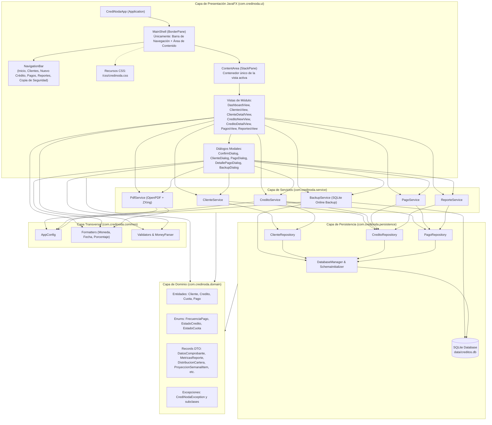
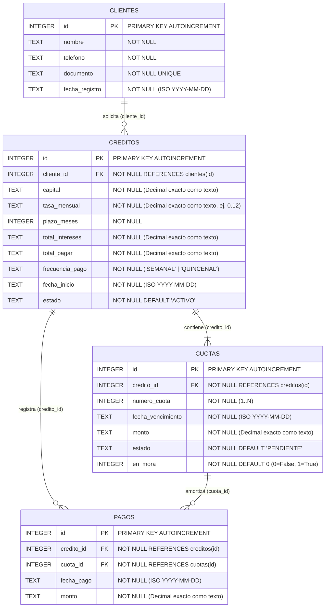
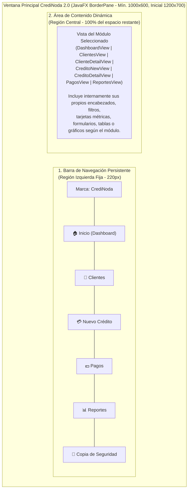
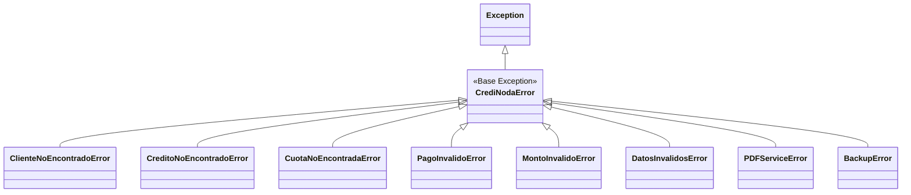
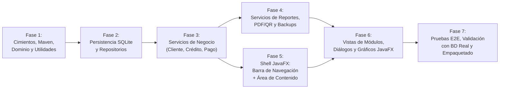

# Especificación Maestra y Plan de Migración: CrediNoda (Python → Java / JavaFX)

**Documento:** `PLAN_MIGRACION_CREDINODA_JAVA.md`  
**Proyecto Origen:** CrediNoda v1.0 (Python 3.10+ / CustomTkinter / SQLite3 / ReportLab / Matplotlib)  
**Proyecto Objetivo:** CrediNoda 2.0 (Java 21 LTS / JavaFX / CSS / SQLite JDBC)  
**Rol del Autor:** Arquitecto de Software y Analista de Requisitos  
**Fecha de Emisión:** 16 de octubre de 2026  
**Estado:** Especificación Técnica Base para Migración (Sin modificación del sistema origen)

---

## Tabla de Contenidos

- [A. Propósito y alcance](#a-propósito-y-alcance)
- [B. Inventario funcional del sistema actual](#b-inventario-funcional-del-sistema-actual)
- [C. Casos de uso](#c-casos-de-uso)
- [D. Reglas de negocio](#d-reglas-de-negocio)
- [E. Arquitectura actual](#e-arquitectura-actual)
- [F. Arquitectura propuesta para Java](#f-arquitectura-propuesta-para-java)
- [G. Matriz de trazabilidad Python → Java](#g-matriz-de-trazabilidad-python--java)
- [H. Modelo de datos y persistencia](#h-modelo-de-datos-y-persistencia)
- [I. Interfaz gráfica: análisis actual y diseño objetivo en JavaFX](#i-interfaz-gráfica-análisis-actual-y-diseño-objetivo-en-javafx)
- [J. Seguridad, integridad y manejo de errores](#j-seguridad-integridad-y-manejo-de-errores)
- [K. Estrategia de pruebas](#k-estrategia-de-pruebas)
- [L. Plan de migración por etapas](#l-plan-de-migración-por-etapas)
- [M. Riesgos y decisiones pendientes](#m-riesgos-y-decisiones-pendientes)
- [N. Criterios de finalización](#n-criterios-de-finalización)

---

## A. Propósito y alcance

### A.1. ¿Qué es CrediNoda y qué problema resuelve?

**CrediNoda** es una aplicación de escritorio monolítica y 100% *offline* diseñada para administrar el ciclo de vida completo de préstamos personales y microcréditos: registro de prestatarios, simulación y otorgamiento de créditos bajo interés simple mensual, generación automatizada de cronogramas de amortización (semanales o quincenales), registro de cobranzas (totales y parciales), emisión de recibos de pago en formato PDF con código QR de verificación, monitoreo automático de cartera en mora, análisis estadístico de rentabilidad/recaudo y gestión de copias de seguridad locales.

El sistema resuelve cinco problemas operativos habituales en la gestión manual (cuadernos físicos o libros de Excel desarticulados):

1. **Pérdida o corrupción de registros contables:** Centraliza clientes, créditos, cuotas y pagos en una base de datos relacional SQLite (`creditos.db`) con integridad referencial activa (`PRAGMA foreign_keys = ON`) y respaldos verificados en caliente.
2. **Descuadres de centavos en cronogramas de pago:** Al dividir un monto total en $N$ cuotas periódicas, las divisiones inexactas producen diferencias acumuladas. CrediNoda aplica redondeo financiero `ROUND_HALF_UP` a dos decimales e imputa la diferencia residual exactamente en la última cuota para garantizar que $\sum \text{cuotas} = \text{total\_pagar}$.
3. **Falta de soporte documental ante abonos:** Emite comprobantes de caja formales en PDF (`REC-00001`) con el saldo anterior de la cuota, el monto abonado, el saldo remanente de la cuota, el balance global del crédito y un código QR con los metadatos de la operación.
4. **Falta de trazabilidad sobre cuotas atrasadas:** Detecta automáticamente al iniciar la aplicación y en cada cambio de fecha del sistema las cuotas vencidas no pagadas, marcándolas con el indicador `en_mora` sin destruir su estado de avance (`PENDIENTE` o `PARCIAL`).
5. **Opacidad sobre el flujo de caja y rentabilidad real:** Distingue entre el capital colocado, los intereses proyectados y la ganancia líquida efectivamente cobrada (calculada por prorrateo de cada abono), además de contrastar la proyección semanal frente al recaudo real.

### A.2. Usuarios y contexto de uso

- **Perfil de usuario:** Prestamistas independientes, gestores de fondos familiares, pequeñas cooperativas locales o comercios que otorgan microcréditos directos.
- **Contexto operativo:**
  - Ejecución en equipo de escritorio local (principalmente Windows, con soporte multiplataforma en el código para macOS y Linux).
  - Operación **monousuario y sin conexión a internet** (100% local, sin servidores externos ni autenticación de múltiples roles).
  - Uso diario e intensivo de consulta rápida de cobros próximos, registro ágil de abonos, generación de recibos PDF para envío digital (p. ej., WhatsApp) o impresión física, y creación de respaldos al cierre de la jornada.

### A.3. Objetivos de la migración a Java (CrediNoda 2.0)

1. **Tipado estático estricto y robustez en tiempo de compilación:** Migrar de Python (tipado dinámico con *type hints* opcionales) a Java con verificación estricta de tipos en compilación, eliminando errores por discrepancia de tipos en tiempo de ejecución (como comparaciones entre `Enum` y `str` documentadas en sesiones previas del proyecto Python).
2. **Modernización y simplificación estructural de la interfaz gráfica con JavaFX:** Reemplazar CustomTkinter + Matplotlib embebido por **JavaFX** nativo con estilizado CSS (`-fx-*`), adoptando un diseño minimalista basado exclusivamente en una **barra de navegación persistente** y un **área de contenido dinámica**.
3. **Preservación absoluta de la lógica financiera y compatibilidad de datos:** Conservar intactas todas las fórmulas financieras, reglas de redondeo (`BigDecimal` con `RoundingMode.HALF_UP`), transiciones de estado y el esquema relacional SQLite (`creditos.db`), permitiendo leer y operar bases de datos existentes sin pérdida ni alteración de un solo centavo.
4. **Ecosistema maduro de pruebas y empaquetado nativo:** Estandarizar la construcción mediante Maven/Gradle, pruebas automatizadas (JUnit 5) y generación de instaladores/ejecutables nativos (`jpackage` / `jlink`) sin depender del empaquetado de un intérprete Python completo con PyInstaller.

### A.4. Funcionalidades que deben conservarse obligatoriamente

Todas las funcionalidades verificadas en el código fuente de Python deben conservarse en CrediNoda 2.0:

- **Gestión de Clientes:** Creación, edición, listado general, búsqueda por nombre o documento, validación de campos obligatorios y unicidad de documento, y vista de detalle de cliente con sus tarjetas de créditos asociados.
- **Simulación y Creación de Créditos:** Cálculo de interés simple mensual, soporte de frecuencia `SEMANAL` (4 cuotas/mes, cada 7 días) y `QUINCENAL` (2 cuotas/mes, cada 15 días), tasa mensual por defecto del 12% configurable por operación, previsualización/resumen previo, diálogo de confirmación y generación transaccional de cuotas con ajuste de centavos en la última cuota.
- **Gestión de Cuotas y Detección de Mora:** Visualización del plan de pagos por crédito, cálculo automático e idempotente de `en_mora` al iniciar la aplicación y al cambiar de día (cada 60 segundos), conservando el estado `PENDIENTE` o `PARCIAL` y mostrando la etiqueta `<ESTADO> (EN MORA)`.
- **Registro y Consulta de Pagos:** Abonos totales o parciales sobre cualquier cuota `PENDIENTE` o `PARCIAL`, bloqueo de montos $\le 0$ o superiores al saldo pendiente de la cuota, actualización automática del estado de la cuota (`PARCIAL` / `PAGADA`) y del crédito (`ACTIVO` $\to$ `PAGADO`), listado histórico de pagos y buscador manual con heurística diferenciada para números (`#crédito` / `id`) y texto (nombre de cliente o código de recibo `REC-xxxxx`).
- **Comprobantes PDF con Código QR:** Generación automática opcional al registrar un pago o bajo demanda desde el historial de pagos (ver/imprimir en carpeta `comprobantes/` o guardar en ruta personalizada), incluyendo todos los bloques informativos, código QR y apertura en el visor del sistema operativo.
- **Dashboard (Inicio):** Métricas de créditos activos, capital prestado en créditos activos y saldo pendiente de créditos activos, junto con la tabla de las próximas 10 cuotas pendientes/parciales ordenadas por fecha de vencimiento ascendente.
- **Reportes e Inteligencia Financiera:** Filtros temporales (`Todos`, `Hoy`, `Esta Semana`, `Este Mes`, `Año en curso`, `Personalizado`), 10 indicadores clave (incluyendo tasa de morosidad, ganancia líquida por prorrateo de intereses cobrados, ticket promedio y plazo promedio), gráfico de barras de recaudos cobrados vs. proyección semanal esperada y gráfico circular (donut) de distribución de cartera (`Al día`, `En mora`, `Saldados`).
- **Copias de Seguridad y Restauración en Caliente:** Respaldo rápido en carpeta `backups/`, guardado en ubicación personalizada, validación triple de archivos `.db` (cabecera binaria SQLite, `PRAGMA integrity_check`, presencia de las 4 tablas requeridas), creación automática de respaldo preventivo (`pre_restauracion_*.db`) y restauración en caliente con refresco inmediato de la interfaz.

### A.5. Mejoras potenciales separadas (NO forman parte de los requisitos actuales)

> [!IMPORTANT]
> Los siguientes elementos **no existen** como funcionalidades completas en el sistema Python actual (o solo aparecen mencionados como ideas futuras en bitácoras antiguas) y **no deben implementarse durante la migración base** salvo aprobación expresa posterior:

1. **Exportación de tablas y reportes a Excel (`.xlsx`) o CSV:** Mencionada en sesiones antiguas de documentación, pero no existe en el código fuente (`requirements.txt` no incluye `openpyxl` ni `pandas`, ni hay métodos de exportación tabular).
2. **Generación de Contratos / Pagarés en PDF:** Aunque el docstring de `PDFService` e `ARCHITECTURE.md` mencionan "contratos y pagarés", `PDFService` únicamente implementa `generar_comprobante_pago()`.
3. **Anulación / Cancelación de créditos desde la interfaz gráfica:** El enum `EstadoCredito.CANCELADO` existe en el modelo de dominio y es respetado por `determinar_estado_credito()`, pero no existe ningún botón en la UI ni método de servicio de negocio para cancelar un crédito activo.
4. **Eliminación física o lógica de clientes, créditos o pagos:** No existe operación `DELETE` expuesta en repositorios ni servicios (por diseño de auditoría e integridad referencial).
5. **Intereses moratorios (recargos monetarios por atraso):** La mora en CrediNoda es estrictamente un estado/indicador de alerta y clasificación (`en_mora = True`); **no** incrementa el valor monetario de la cuota ni del crédito.
6. **Pantalla de configuración de parámetros globales:** Los valores por defecto (`DEFAULT_MONTHLY_RATE = 0.12`, `WEEKS_PER_MONTH = 4`, `FORTNIGHTS_PER_MONTH = 2`) son constantes en `config.py`, no una pantalla editable en base de datos.

---

## B. Inventario funcional del sistema actual

### B.1. Verificación de archivos del repositorio y discrepancias documentales

Se inspeccionó la totalidad del árbol de directorios en `c:\Users\ASUS VIVO\Documents\CrediNoda`. A continuación se dejan asentadas las observaciones de verificación:

1. **Archivos de código fuente y pruebas verificados al 100%:** Todos los archivos `.py` bajo `credito_app/` (`config.py`, `main.py`, `build_exe.py`, `modules/`, `database/`, `services/`, `ui/`, `tests/`), archivos de configuración (`pyproject.toml`, `requirements.txt`, `CrediNoda.spec`, `installer.iss`) y documentos Markdown (`credito_app/README.md`, `docs/ARCHITECTURE.md`, `docs/ROADMAP.md`, `docs/sessions/*.md`) fueron leídos y analizados íntegramente.
2. **Archivos no utilizados como fuente de requisitos de código:**
   - `credito_app/data/creditos.db` y `credito_app/comprobantes/*.pdf`: Contienen datos locales de ejecución; por regla de privacidad no se extraen datos personales y el esquema se verificó directamente desde `credito_app/database/schema.py` y las pruebas automatizadas.
   - `guia_exposicion/Guia_Maestra_Exposicion_CrediNoda.docx`: Archivo binario de apoyo para presentación oral, ajeno a la lógica ejecutable.
3. **Contradicciones detectadas entre la documentación existente y el código real (el código es la fuente de verdad):**
   - **`modules/cuota.py` inexistente:** En [`credito_app/README.md`](file:///c:/Users/ASUS%20VIVO/Documents/CrediNoda/credito_app/README.md#L180) se lista `credito_app/modules/cuota.py` en el árbol del proyecto. Dicho archivo **no existe**; la clase `Cuota` y el enum `EstadoCuota` están definidos dentro de [`credito_app/modules/credito.py`](file:///c:/Users/ASUS%20VIVO/Documents/CrediNoda/credito_app/modules/credito.py#L20-L61).
   - **`README.md` de raíz inexistente:** La bitácora `2026-09-13` menciona un `README.md` en la raíz del repositorio y una redirección en `credito_app/README.md`. En el estado actual del repositorio, el único `README.md` existe en [`credito_app/README.md`](file:///c:/Users/ASUS%20VIVO/Documents/CrediNoda/credito_app/README.md) y contiene la documentación completa.
   - **Desactualización parcial en `docs/ARCHITECTURE.md`:** El diagrama y texto de [`docs/ARCHITECTURE.md`](file:///c:/Users/ASUS%20VIVO/Documents/CrediNoda/docs/ARCHITECTURE.md#L34-L206) omiten los servicios `ReporteService` y `BackupService`, los diálogos `DetallePagoDialog`, `BackupDialog` y `ConfirmDialog`, y la columna `en_mora INTEGER NOT NULL DEFAULT 0` en la tabla `cuotas`.
   - **Inconsistencia menor en `docs/ROADMAP.md`:** La tabla resumen en [`docs/ROADMAP.md`](file:///c:/Users/ASUS%20VIVO/Documents/CrediNoda/docs/ROADMAP.md#L17) indica `Fase 7: Empaquetado y Despliegue | Pendiente (0%)`, mientras que todas las casillas de las secciones `3.4` y `3.5` (líneas 93-102) están marcadas como completadas `[x]` y los artefactos (`backup_service.py`, `build_exe.py`, `installer.iss`, `test_backup.py`, `test_integracion_e2e.py`) están completamente implementados.
   - **Dependencia `qrcode` no listada directamente en `requirements.txt`:** [`credito_app/services/pdf_service.py`](file:///c:/Users/ASUS%20VIVO/Documents/CrediNoda/credito_app/services/pdf_service.py#L20-L25) importa `qrcode` dentro de un bloque `try/except ImportError` (`QRCODE_AVAILABLE`), pero `qrcode` no figura explícitamente en [`requirements.txt`](file:///c:/Users/ASUS%20VIVO/Documents/CrediNoda/requirements.txt).

---

### B.2. Inventario detallado por módulo y archivo

#### 1. Configuración y Punto de Entrada

| Atributo | Detalle Verificado |
| :--- | :--- |
| **Módulo / Archivos** | [`credito_app/config.py`](file:///c:/Users/ASUS%20VIVO/Documents/CrediNoda/credito_app/config.py), [`credito_app/main.py`](file:///c:/Users/ASUS%20VIVO/Documents/CrediNoda/credito_app/main.py), [`credito_app/build_exe.py`](file:///c:/Users/ASUS%20VIVO/Documents/CrediNoda/credito_app/build_exe.py), [`credito_app/installer.iss`](file:///c:/Users/ASUS%20VIVO/Documents/CrediNoda/credito_app/installer.iss) |
| **Responsabilidad** | Definir constantes financieras globales, resolver rutas dinámicas de archivos (modo código fuente vs. ejecutable congelado PyInstaller `--onefile`), iniciar el bucle principal de la interfaz y automatizar el empaquetado. |
| **Funcionalidades** | 1. Define `DEFAULT_MONTHLY_RATE = Decimal("0.12")`, `WEEKS_PER_MONTH = 4`, `FORTNIGHTS_PER_MONTH = 2`.<br>2. Detecta `getattr(sys, "frozen", False)` para separar `BASE_DIR` (directorio persistente junto al `.exe` para `data/creditos.db` y `backups/`) de `BUNDLE_DIR` (`sys._MEIPASS` para `assets/icon.ico` e `icon.png`).<br>3. `main.py` inyecta el directorio raíz en `sys.path`, instancia `App()` y ejecuta `app.mainloop()`.<br>4. `build_exe.py` invoca PyInstaller y empaqueta `CrediNoda_Portable_Windows.zip`. |
| **Datos que administra** | Rutas de sistema de archivos (`DATABASE_PATH`, `BACKUPS_DIR`, `ASSETS_DIR`, `ICON_PATH`, `ICON_PNG_PATH`) y parámetros financieros constantes. |
| **Servicios con los que interactúa** | `main.py` instancia `ui.app.App`. `config.py` es consumido por `database/connection.py`, `services/credito_service.py`, `services/pdf_service.py`, `services/backup_service.py`, `ui/app.py`, `ui/components/sidebar.py`, `ui/components/dialogs.py` y `ui/views/credito_view.py`. |
| **Dependencias relevantes** | `sys`, `pathlib.Path`, `decimal.Decimal`, `PyInstaller` (en `build_exe.py`). |

#### 2. Capa de Dominio (`credito_app/modules/`)

| Atributo | Detalle Verificado |
| :--- | :--- |
| **Módulo / Archivos** | [`credito_app/modules/__init__.py`](file:///c:/Users/ASUS%20VIVO/Documents/CrediNoda/credito_app/modules/__init__.py), [`cliente.py`](file:///c:/Users/ASUS%20VIVO/Documents/CrediNoda/credito_app/modules/cliente.py), [`credito.py`](file:///c:/Users/ASUS%20VIVO/Documents/CrediNoda/credito_app/modules/credito.py), [`pago.py`](file:///c:/Users/ASUS%20VIVO/Documents/CrediNoda/credito_app/modules/pago.py), [`excepciones.py`](file:///c:/Users/ASUS%20VIVO/Documents/CrediNoda/credito_app/modules/excepciones.py) |
| **Responsabilidad** | Representar las entidades de negocio en memoria, enumeraciones de estados/frecuencias y la jerarquía de excepciones de dominio. |
| **Funcionalidades** | 1. Entidad `@dataclass Cliente`: `nombre: str`, `telefono: str`, `documento: str`, `id: Optional[int] = None`, `fecha_registro: date = field(default_factory=date.today)`.<br>2. Enumeraciones en `credito.py`: `FrecuenciaPago` (`SEMANAL`, `QUINCENAL`), `EstadoCredito` (`ACTIVO`, `PAGADO`, `VENCIDO`, `CANCELADO`), `EstadoCuota` (`PENDIENTE`, `PAGADA`, `PARCIAL`, `VENCIDA`).<br>3. Entidad `@dataclass Credito`: `cliente_id: int`, `capital: Decimal`, `tasa_mensual: Decimal`, `plazo_meses: int`, `total_intereses: Decimal`, `total_pagar: Decimal`, `frecuencia_pago: FrecuenciaPago`, `fecha_inicio: date`, `estado: EstadoCredito`, `id: Optional[int]`.<br>4. Entidad `@dataclass Cuota`: `credito_id: int`, `numero_cuota: int`, `fecha_vencimiento: date`, `monto: Decimal`, `estado: EstadoCuota`, `id: Optional[int]`, `en_mora: bool = False`, y propiedad calculada `etiqueta_estado` que devuelve `f"{self.estado.value} (EN MORA)"` si `en_mora` es `True` y `estado` es `PENDIENTE` o `PARCIAL`, o `self.estado.value` en caso contrario.<br>5. Entidad `@dataclass Pago`: `credito_id: int`, `cuota_id: int`, `monto: Decimal`, `fecha_pago: date = field(default_factory=date.today)`, `id: Optional[int] = None`.<br>6. Jerarquía de excepciones en `excepciones.py`: `CrediNodaError(Exception)` y sus subclases directas `ClienteNoEncontradoError`, `CreditoNoEncontradoError`, `CuotaNoEncontradaError`, `PagoInvalidoError`, `MontoInvalidoError`, `DatosInvalidosError`. |
| **Datos que administra** | Objetos de valor y entidades de dominio en memoria con tipos nativos (`int`, `str`, `bool`, `datetime.date`, `decimal.Decimal`, `enum.Enum`). |
| **Servicios con los que interactúa** | Es utilizado transversalmente por todas las capas (`database`, `services`, `ui`, `tests`). No depende de ninguna otra capa. |
| **Dependencias relevantes** | Biblioteca estándar de Python (`dataclasses`, `datetime.date`, `decimal.Decimal`, `enum.Enum`, `typing.Optional`). |

#### 3. Capa de Persistencia y Base de Datos (`credito_app/database/`)

| Atributo | Detalle Verificado |
| :--- | :--- |
| **Módulo / Archivos** | [`connection.py`](file:///c:/Users/ASUS%20VIVO/Documents/CrediNoda/credito_app/database/connection.py), [`schema.py`](file:///c:/Users/ASUS%20VIVO/Documents/CrediNoda/credito_app/database/schema.py), [`repositories/cliente_repository.py`](file:///c:/Users/ASUS%20VIVO/Documents/CrediNoda/credito_app/database/repositories/cliente_repository.py), [`repositories/credito_repository.py`](file:///c:/Users/ASUS%20VIVO/Documents/CrediNoda/credito_app/database/repositories/credito_repository.py), [`repositories/pago_repository.py`](file:///c:/Users/ASUS%20VIVO/Documents/CrediNoda/credito_app/database/repositories/pago_repository.py) |
| **Responsabilidad** | Gestionar la conexión a SQLite3, aprovisionar y migrar el esquema DDL de tablas, y ejecutar todas las consultas SQL encapsuladas bajo el patrón Repositorio. |
| **Funcionalidades** | 1. **`connection.py`**: `get_db_path()` crea la carpeta `data/` si no existe; `get_connection(db_path)` abre la conexión SQLite, ejecuta `PRAGMA foreign_keys = ON` y configura `conn.row_factory = sqlite3.Row`.<br>2. **`schema.py`**: `crear_tablas(conn)` ejecuta `CREATE TABLE IF NOT EXISTS` para `clientes`, `creditos`, `cuotas` y `pagos`, y verifica mediante `PRAGMA table_info(cuotas)` si existe la columna `en_mora`; si no existe, ejecuta `ALTER TABLE cuotas ADD COLUMN en_mora INTEGER NOT NULL DEFAULT 0`. `inicializar_base_datos(db_path)` abre conexión, crea tablas, hace `commit()` y cierra la conexión.<br>3. **`ClienteRepository`**: `crear`, `obtener_por_id`, `obtener_por_documento`, `buscar_por_nombre` (`LIKE %nombre%`), `actualizar` (`UPDATE nombre, telefono, documento WHERE id = ?`), `listar_todos`, `buscar_general` (`WHERE nombre LIKE ? OR documento LIKE ?`).<br>4. **`CreditoRepository`**: `crear`, `obtener_por_id`, `obtener_por_cliente`, `actualizar_estado`, `crear_cuota`, `obtener_cuotas_por_credito` (`ORDER BY numero_cuota ASC`), `obtener_cuota_por_id`, `actualizar_estado_cuota` (si el nuevo estado es `'PAGADA'`, pone `en_mora = 0`), `actualizar_mora_cuotas(fecha_referencia)` (actualiza masivamente `en_mora` en SQLite sólo en las filas cuyo valor cambie y retorna `cursor.rowcount`), `listar_todos`, `listar_todas_las_cuotas` (`ORDER BY fecha_vencimiento ASC, numero_cuota ASC`), `obtener_cuotas_pendientes(limite=10)` (JOIN de `cuotas`, `creditos` y `clientes` donde `estado IN ('PENDIENTE', 'PARCIAL') ORDER BY fecha_vencimiento ASC LIMIT ?`).<br>5. **`PagoRepository`**: `crear`, `obtener_por_credito`, `obtener_por_cuota`, `obtener_total_pagado_cuota` (suma en Python con `Decimal`), `obtener_total_pagado_credito` (suma en Python con `Decimal`), `listar_todos` (`ORDER BY fecha_pago DESC`), `listar_todos_con_detalle` (JOIN con `creditos`, `cuotas`, `clientes`, `ORDER BY p.fecha_pago DESC, p.id DESC`), `obtener_por_id`, `obtener_detalle_pago(pago_id)` (JOIN completo incluyendo subconsulta `(SELECT COUNT(*) FROM cuotas WHERE credito_id = cr.id) as cuotas_total`). |
| **Datos que administra** | Tablas `clientes`, `creditos`, `cuotas` y `pagos` en SQLite (`creditos.db` o `:memory:`). Convierte `Decimal` $\leftrightarrow$ `TEXT` y `date` $\leftrightarrow$ `TEXT` (formato ISO `YYYY-MM-DD`). |
| **Servicios con los que interactúa** | Es consumido por `ClienteService`, `CreditoService`, `PagoService`, `ReporteService`, `BackupService` y `ui/app.py`. |
| **Dependencias relevantes** | `sqlite3`, `decimal.Decimal`, `datetime.date`, `credito_app.modules`, `credito_app.config`. |

#### 4. Capa de Servicios y Lógica de Negocio (`credito_app/services/`)

| Atributo | Detalle Verificado |
| :--- | :--- |
| **Módulo / Archivos** | [`cliente_service.py`](file:///c:/Users/ASUS%20VIVO/Documents/CrediNoda/credito_app/services/cliente_service.py), [`credito_service.py`](file:///c:/Users/ASUS%20VIVO/Documents/CrediNoda/credito_app/services/credito_service.py), [`pago_service.py`](file:///c:/Users/ASUS%20VIVO/Documents/CrediNoda/credito_app/services/pago_service.py), [`reporte_service.py`](file:///c:/Users/ASUS%20VIVO/Documents/CrediNoda/credito_app/services/reporte_service.py), [`pdf_service.py`](file:///c:/Users/ASUS%20VIVO/Documents/CrediNoda/credito_app/services/pdf_service.py), [`backup_service.py`](file:///c:/Users/ASUS%20VIVO/Documents/CrediNoda/credito_app/services/backup_service.py) |
| **Responsabilidad** | Implementar los casos de uso, validaciones de negocio, cálculos financieros, agregaciones estadísticas, generación de documentos PDF con QR y administración de copias de seguridad. |
| **Funcionalidades** | 1. **`ClienteService`**: Sanitiza cadenas con `.strip()`, valida no vacíos y unicidad de documento en `crear_cliente` y `actualizar_cliente`; consulta clientes por ID (`obtener_cliente`), por documento (`obtener_por_documento`), búsqueda general por término (`buscar_clientes`), y lista créditos de un cliente (`obtener_creditos_cliente`).<br>2. **`CreditoService`**: Calcula interés simple (`calcular_intereses`), monto total (`calcular_total`), número de cuotas (`calcular_numero_cuotas`), crea crédito y sus cuotas (`crear_credito`, `generar_plan_pagos`), consulta crédito y plan de pagos (`obtener_credito`, `obtener_plan_pagos`), calcula saldo pendiente (`calcular_saldo_pendiente`), evalúa y actualiza el estado del crédito (`determinar_estado_credito`), lista créditos (`listar_creditos`), sincroniza mora (`actualizar_cuotas_en_mora`) y obtiene próximos cobros (`obtener_proximos_pagos`).<br>3. **`PagoService`**: Valida y registra pagos parciales o totales (`registrar_pago`), actualiza estado de la cuota a `PARCIAL` o `PAGADA`, consulta historiales (`obtener_historial_pagos`, `obtener_pagos_cuota`, `listar_pagos`, `listar_pagos_con_detalle`, `obtener_pago`) y construye el diccionario financiero completo para recibos (`obtener_datos_comprobante`).<br>4. **`ReporteService`**: Resuelve rangos de fechas predefinidos (`calcular_rango_fechas`), calcula KPIs básicos y avanzados (`obtener_metricas`), clasifica la cartera en `al_dia`, `en_mora` y `saldados` (`obtener_distribucion_cartera`), y calcula series semanales de recaudo vs. proyección (`obtener_recaudo_vs_proyeccion_semanal`).<br>5. **`PDFService`**: Sanitiza nombres de archivo (`_sanitizar_nombre_archivo`), maqueta y genera recibos PDF tamaño carta con ReportLab Platypus y código QR opcional (`generar_comprobante_pago`, `_construir_elementos_comprobante`), y abre el documento en el visor del sistema operativo (`abrir_documento`). Define la excepción `PDFServiceError(CrediNodaError)`.<br>6. **`BackupService`**: Crea respaldos en caliente con `sqlite3.Connection.backup()` (`crear_backup`), valida integridad binaria, `PRAGMA integrity_check` y tablas requeridas (`validar_archivo_backup`), restaura en caliente creando primero un respaldo `pre_restauracion` y ejecutando `crear_tablas` post-restauración (`restaurar_backup`), y lista respaldos existentes ordenados por fecha de modificación descendente (`listar_backups`). Define la excepción `BackupError(CrediNodaError)`. |
| **Datos que administra** | Entidades de dominio, diccionarios de proyecciones/métricas/comprobantes, archivos `.pdf` en `comprobantes/` y archivos `.db` en `backups/`. |
| **Servicios con los que interactúa** | Interactúan con `ClienteRepository`, `CreditoRepository`, `PagoRepository`, `schema.crear_tablas` y utilidades de formato (`formato_moneda`, `formato_fecha`, `formato_porcentaje`). |
| **Dependencias relevantes** | `sqlite3`, `decimal`, `datetime`, `calendar`, `reportlab`, `qrcode` (opcional), `platform`, `subprocess`, `os`, `re`. |

#### 5. Capa de Presentación: Utilidades y Componentes Reutilizables (`credito_app/ui/`)

| Atributo | Detalle Verificado |
| :--- | :--- |
| **Módulo / Archivos** | [`ui/app.py`](file:///c:/Users/ASUS%20VIVO/Documents/CrediNoda/credito_app/ui/app.py), [`ui/theme.py`](file:///c:/Users/ASUS%20VIVO/Documents/CrediNoda/credito_app/ui/theme.py), [`ui/utils/formatters.py`](file:///c:/Users/ASUS%20VIVO/Documents/CrediNoda/credito_app/ui/utils/formatters.py), [`ui/utils/validators.py`](file:///c:/Users/ASUS%20VIVO/Documents/CrediNoda/credito_app/ui/utils/validators.py), [`ui/components/sidebar.py`](file:///c:/Users/ASUS%20VIVO/Documents/CrediNoda/credito_app/ui/components/sidebar.py), [`ui/components/header.py`](file:///c:/Users/ASUS%20VIVO/Documents/CrediNoda/credito_app/ui/components/header.py), [`ui/components/cards.py`](file:///c:/Users/ASUS%20VIVO/Documents/CrediNoda/credito_app/ui/components/cards.py), [`ui/components/tables.py`](file:///c:/Users/ASUS%20VIVO/Documents/CrediNoda/credito_app/ui/components/tables.py), [`ui/components/notifications.py`](file:///c:/Users/ASUS%20VIVO/Documents/CrediNoda/credito_app/ui/components/notifications.py), [`ui/components/dialogs.py`](file:///c:/Users/ASUS%20VIVO/Documents/CrediNoda/credito_app/ui/components/dialogs.py) |
| **Responsabilidad** | Proveer el contenedor principal de la aplicación, enrutamiento de vistas, tokens de estilo, formateadores de presentación, validadores de entrada de usuario y componentes visuales reutilizables. |
| **Funcionalidades** | 1. **`App` (`ui/app.py`)**: Ventana `ctk.CTk` (1200x700, mín. 1000x600, modo `light`). Inicializa BD y los 6 servicios, sincroniza mora al arrancar y programa un temporizador cada 60s (`_verificar_cambio_dia`), administra caché de vistas persistentes (`dashboard`, `clientes`, `pagos`, `reportes`) y vistas dinámicas (`cliente_detail`, `credito_new`, `credito_detail`), lleva el contador `data_version`, centraliza `generar_comprobante_pago()` y `abrir_dialogo_backup()`, y cierra ordenadamente recursos en `on_closing()`.<br>2. **`theme.py`**: Diccionarios `COLORS` (20 claves cromáticas) y `FONTS` (18 configuraciones tipográficas basadas en `Segoe UI`).<br>3. **`formatters.py`**: `formato_moneda` (separador de miles `.` y decimal `,` solo si tiene decimales no nulos, ej. `$1.000.000` o `$113.333,33`), `formato_fecha` (`dd/mm/YYYY`), `formato_porcentaje` (`int(valor * 100)%`), `color_estado_credito`, `color_estado_cuota`.<br>4. **`validators.py`**: `parsear_monto` (analizador sintáctico tolerante a `$`, espacios, puntos y comas como separadores de miles o decimales), `validar_monto`, `validar_texto_no_vacio`, `validar_entero_positivo`.<br>5. **`Sidebar`**: Barra lateral izquierda (ancho 220px) con logo/título, 5 botones de navegación (`dashboard`, `clientes`, `credito_new`, `pagos`, `reportes`) y 1 botón inferior de acción (`Copia de Seguridad`).<br>6. **`SectionHeader`**: Cabecera de vista con título, subtítulo opcional y botón de acción derecho opcional.<br>7. **`MetricCard`**: Tarjeta KPI con barra superior de color de acento (3px), icono opcional, etiqueta y valor actualizable.<br>8. **`DataTable`**: Tabla desplazable con encabezados alineados, filas con *zebra striping* (`#FFFFFF` / `#F1F5F9`), efecto *hover* (`#DBEAFE`) y evento `on_row_click`.<br>9. **`NotificationBar`**: Barra superior temporal (se oculta a los 4000 ms) para alertas `success`, `error` y `warning`, compatible con contenedores `pack` y `grid`.<br>10. **`dialogs.py`**: `BaseDialog` (modal centrado respecto a la ventana principal sin parpadeo), `ConfirmDialog`, `ClienteDialog` (crear/editar cliente), `PagoDialog` (seleccionar cuota pendiente/parcial, prellenar saldo pendiente, registrar abono y opción de abrir PDF), `DetallePagoDialog` (ver resumen de recibo, abrir PDF, guardar PDF como, ir al crédito) y `BackupDialog` (respaldo rápido, guardar copia como, seleccionar y restaurar con confirmación). |
| **Datos que administra** | Estado visual de la sesión (`current_view`, `cached_views`, `data_version`, `_fecha_ultima_verificacion_mora`) y entradas de formularios. |
| **Servicios con los que interactúa** | Todos los servicios a través de `App` o inyección directa a los diálogos. |
| **Dependencias relevantes** | `customtkinter`, `tkinter.filedialog`, `PIL.Image` (Pillow). |

#### 6. Capa de Presentación: Vistas de Módulos (`credito_app/ui/views/`)

| Vista / Archivo | Responsabilidad y Funcionalidades | Datos que Muestra / Administra | Servicios que Invoca |
| :--- | :--- | :--- | :--- |
| **`DashboardView`**<br>[`dashboard_view.py`](file:///c:/Users/ASUS%20VIVO/Documents/CrediNoda/credito_app/ui/views/dashboard_view.py) | Pantalla de inicio con resumen operativo de cartera activa y tabla de próximas cuotas por cobrar. Al hacer clic en una fila, navega a `credito_detail`. Se actualiza en `on_show()` según `data_version`. | 3 `MetricCard` (*Créditos Activos*, *Capital Prestado*, *Saldo Pendiente* de créditos activos) y `DataTable` con hasta 10 cuotas pendientes/parciales. | `CreditoService.listar_creditos()`, `calcular_saldo_pendiente()`, `obtener_proximos_pagos(limite=10)`. |
| **`ClientesView`**<br>[`clientes_view.py`](file:///c:/Users/ASUS%20VIVO/Documents/CrediNoda/credito_app/ui/views/clientes_view.py) | Directorio de clientes con buscador por nombre o documento, botón `+ Nuevo Cliente` (abre `ClienteDialog`) y tabla de resultados. Clic en fila navega a `cliente_detail`. | Término de búsqueda y tabla con columnas: *Nombre*, *Documento*, *Teléfono*, *Créditos* (cantidad), *Registro* (fecha). | `ClienteService.buscar_clientes()`, `obtener_creditos_cliente()`. |
| **`ClienteDetailView`**<br>[`cliente_detail_view.py`](file:///c:/Users/ASUS%20VIVO/Documents/CrediNoda/credito_app/ui/views/cliente_detail_view.py) | Ficha individual de un cliente con botón de retorno a `clientes`, botón `Editar` (abre `ClienteDialog` en modo edición), botón `+ Nuevo Crédito` (navega a `credito_new` con `cliente_id` preseleccionado) y lista desplazable de tarjetas por cada crédito del cliente con botón `Ver Detalles`. | Datos del cliente y, por cada crédito: `#id`, badge de estado con color, *Capital*, *Total*, *Pagado*, *Pendiente*, frecuencia, plazo y fecha de inicio. | `ClienteService.obtener_cliente()`, `obtener_creditos_cliente()`; `CreditoService.calcular_saldo_pendiente()`. |
| **`CreditoView`**<br>[`credito_view.py`](file:///c:/Users/ASUS%20VIVO/Documents/CrediNoda/credito_app/ui/views/credito_view.py) | Formulario desplazable para simular y otorgar un nuevo crédito. Selecciona cliente, ingresa capital, tasa mensual (por defecto `12`), plazo en meses y frecuencia (`Semanal` / `Quincenal`). El botón `Calcular` despliega el panel *Resumen del Crédito*; el botón `Crear Crédito` abre `ConfirmDialog` y tras confirmar crea el crédito y navega a `credito_detail`. | Entradas del formulario y diccionario `_calculated_data` (`capital`, `tasa`, `plazo`, `frecuencia`, `intereses`, `total`, `num_cuotas`, `cuota_aprox`). | `ClienteService.buscar_clientes("")`; `CreditoService.calcular_intereses()`, `calcular_total()`, `calcular_numero_cuotas()`, `crear_credito()`. |
| **`CreditoDetailView`**<br>[`credito_detail_view.py`](file:///c:/Users/ASUS%20VIVO/Documents/CrediNoda/credito_app/ui/views/credito_detail_view.py) | Ficha detallada de un crédito. Muestra cabecera con estado, enlace al cliente (`cliente_detail`), condiciones pactadas, 4 `MetricCard` (*Capital*, *Total*, *Pagado*, *Saldo Pendiente*), botón `Registrar Pago` y tabla del plan de pagos. Hacer clic en una cuota `PENDIENTE` o `PARCIAL` abre `PagoDialog` preseleccionado en esa cuota. | Entidades `Credito`, `Cliente`, lista de `Cuota` y desglose por cuota (*#*, *Vencimiento*, *Cuota*, *Pagado*, *Pendiente*, *Estado* con marca de mora). | `CreditoService.obtener_credito()`, `obtener_plan_pagos()`, `calcular_saldo_pendiente()`, `determinar_estado_credito()`; `ClienteService.obtener_cliente()`; `PagoService.obtener_pagos_cuota()`. |
| **`PagosView`**<br>[`pagos_view.py`](file:///c:/Users/ASUS%20VIVO/Documents/CrediNoda/credito_app/ui/views/pagos_view.py) | Historial consolidado de todos los pagos registrados, con filtro manual (botón `Buscar`, tecla `Enter` y botón `Limpiar`) y tabla de recaudos. Hacer clic en cualquier fila abre `DetallePagoDialog`. | Lista `pagos_detalle` y tabla con columnas: *Fecha*, *Cliente*, *Crédito* (`#id`), *Cuota* (`numero_cuota`), *Monto Abonado*. | `PagoService.listar_pagos_con_detalle()`. |
| **`ReportesView`**<br>[`reportes_view.py`](file:///c:/Users/ASUS%20VIVO/Documents/CrediNoda/credito_app/ui/views/reportes_view.py) | Panel analítico desplazable con selector de preajustes temporales (`Todos`, `Hoy`, `Esta Semana`, `Este Mes`, `Año en curso`, `Personalizado`), campos `Desde`/`Hasta` (`AAAA-MM-DD`), 10 `MetricCard` distribuidas en 3 filas y 2 gráficos `matplotlib` embebidos (`FigureCanvasTkAgg`): barras agrupadas y donut de cartera. | Rango `(current_desde, current_hasta)`, diccionario de métricas, distribución de cartera y serie semanal de proyección vs. recaudo. | `ReporteService.calcular_rango_fechas()`, `obtener_metricas()`, `obtener_distribucion_cartera()`, `obtener_recaudo_vs_proyeccion_semanal()`. |

---

## C. Casos de uso

A continuación se documentan todos los casos de uso reales del sistema extraídos del código fuente y verificados contra la suite de pruebas. Al final de la sección se listan expresamente aquellos casos de uso o funcionalidades cuya existencia es parcial o no existe en el sistema actual.

### C.1. Catálogo de casos de uso confirmados

| ID | Nombre del Caso de Uso | Módulo Principal | Estado |
| :--- | :--- | :--- | :--- |
| **CU-001** | Registrar nuevo cliente | Clientes | Confirmado |
| **CU-002** | Consultar y buscar clientes | Clientes | Confirmado |
| **CU-003** | Actualizar datos de un cliente | Clientes | Confirmado |
| **CU-004** | Consultar ficha detallada de un cliente y sus créditos | Clientes / Créditos | Confirmado |
| **CU-005** | Simular condiciones y previsualizar resumen de un crédito | Créditos | Confirmado |
| **CU-006** | Otorgar (crear) crédito y generar su plan de pagos | Créditos | Confirmado |
| **CU-007** | Consultar detalle de un crédito, saldos y plan de pagos | Créditos / Cuotas | Confirmado |
| **CU-008** | Detectar y actualizar automáticamente cuotas en mora | Créditos / Cuotas | Confirmado |
| **CU-009** | Registrar pago total o parcial sobre una cuota | Pagos / Cuotas | Confirmado |
| **CU-010** | Consultar y filtrar el historial general de pagos | Pagos | Confirmado |
| **CU-011** | Generar, visualizar y exportar comprobante de pago en PDF con QR | Pagos / PDF | Confirmado |
| **CU-012** | Consultar panel de inicio (Dashboard) y próximas cuotas por cobrar | Dashboard | Confirmado |
| **CU-013** | Consultar reportes financieros, KPIs y gráficos por período | Reportes | Confirmado |
| **CU-014** | Crear copia de seguridad de la base de datos (rápida o personalizada) | Backups | Confirmado |
| **CU-015** | Validar y restaurar copia de seguridad en caliente | Backups | Confirmado |

---

### C.2. Especificación detallada de casos de uso confirmados

#### `CU-001` — Registrar nuevo cliente

1. **Identificador:** `CU-001`
2. **Nombre:** Registrar nuevo cliente.
3. **Actor:** Usuario (Gestor de créditos / Prestamista).
4. **Objetivo:** Dar de alta un nuevo cliente en el sistema validando que sus datos de identificación y contacto estén completos y que su documento no esté duplicado.
5. **Descripción:** El usuario ingresa el nombre completo, documento de identidad y teléfono de un cliente a través de la ventana modal de creación; el sistema valida los campos, persiste el registro con la fecha actual y refresca el directorio de clientes.
6. **Precondiciones:** La aplicación está iniciada y la base de datos SQLite está operativa.
7. **Flujo principal paso a paso:**
   1. En la vista `ClientesView`, el usuario pulsa el botón `+ Nuevo Cliente`.
   2. El sistema abre el diálogo modal `ClienteDialog` en modo creación (`title="Nuevo Cliente"`).
   3. El usuario introduce `Nombre Completo`, `Documento de Identidad` y `Teléfono`, y pulsa `Guardar`.
   4. `ClienteDialog._save()` limpia los espacios extremos (`.strip()`) y valida con `validar_texto_no_vacio` que ninguno de los 3 campos esté vacío.
   5. `ClienteDialog` invoca `ClienteService.crear_cliente(nombre, telefono, documento)`.
   6. `ClienteService` vuelve a aplicar `.strip()`, verifica que ningún campo sea vacío y consulta `ClienteRepository.obtener_por_documento(documento)`.
   7. Al comprobar que no existe otro cliente con ese documento, `ClienteService` instancia `Cliente(nombre, telefono, documento, fecha_registro=date.today())` y llama a `ClienteRepository.crear(cliente)`.
   8. El repositorio inserta la fila en la tabla `clientes`, realiza `commit()` y asigna `cursor.lastrowid` a `cliente.id`.
   9. `ClientesView._on_cliente_guardado()` incrementa `app.data_version` (`notificar_cambio_datos()`), recarga la tabla de clientes y `ClienteDialog` se cierra.
8. **Flujos alternativos:**
   - **FA-1 (Cancelar):** El usuario pulsa `Cancelar` o cierra el modal; no se realiza ningún cambio en la base de datos.
9. **Excepciones y errores esperados:**
   - Campo `Nombre`, `Documento` o `Teléfono` vacío en la UI: se muestra `"El campo <Campo> es obligatorio."` debajo del campo correspondiente (`err_nombre`, `err_doc` o `err_tel`).
   - `DatosInvalidosError("El nombre no puede estar vacío.")` / `"El teléfono no puede estar vacío."` / `"El documento no puede estar vacío."` si se invoca el servicio directamente con cadenas vacías.
   - `DatosInvalidosError("Ya existe un cliente con el documento: <documento>")` si el documento ya está registrado; `ClienteDialog` lo muestra en `self.err_doc`.
10. **Reglas de negocio involucradas:** `RN-001` (Obligatoriedad y sanitización de campos de cliente), `RN-002` (Unicidad de documento de identidad).
11. **Datos de entrada y resultados esperados:**
    - *Entrada:* `nombre="Juan Perez"`, `telefono="123456789"`, `documento="CC123"`.
    - *Salida esperada:* Objeto `Cliente` persistido con `id >= 1`, `fecha_registro = date.today()`, visible en `ClientesView`.
12. **Módulos y servicios participantes:** `ClientesView`, `ClienteDialog`, `validators.validar_texto_no_vacio`, `ClienteService.crear_cliente`, `ClienteRepository.obtener_por_documento`, `ClienteRepository.crear`, `Cliente`.
13. **Pruebas necesarias:** Creación exitosa, rechazo de nombre/teléfono/documento vacío o solo espacios, rechazo de documento duplicado, validación en UI (`ClienteDialog`).
14. **Evidencia:** [`clientes_view.py`](file:///c:/Users/ASUS%20VIVO/Documents/CrediNoda/credito_app/ui/views/clientes_view.py#L80-L87), [`dialogs.py`](file:///c:/Users/ASUS%20VIVO/Documents/CrediNoda/credito_app/ui/components/dialogs.py#L110-L209), [`cliente_service.py`](file:///c:/Users/ASUS%20VIVO/Documents/CrediNoda/credito_app/services/cliente_service.py#L21-L43), [`cliente_repository.py`](file:///c:/Users/ASUS%20VIVO/Documents/CrediNoda/credito_app/database/repositories/cliente_repository.py#L27-L37), [`test_cliente.py`](file:///c:/Users/ASUS%20VIVO/Documents/CrediNoda/credito_app/tests/test_cliente.py#L27-L42).

---

#### `CU-002` — Consultar y buscar clientes

1. **Identificador:** `CU-002`
2. **Nombre:** Consultar y buscar clientes.
3. **Actor:** Usuario.
4. **Objetivo:** Visualizar el listado completo de clientes o filtrar aquellos cuyo nombre o documento coincida parcial o totalmente con un término de búsqueda.
5. **Descripción:** Al abrir la vista de Clientes o ejecutar una búsqueda, el sistema consulta los clientes coincidentes y, para cada uno, obtiene el número total de créditos que tiene asociados para mostrarlo en la tabla.
6. **Precondiciones:** Ninguna (puede devolver lista vacía si no hay clientes).
7. **Flujo principal paso a paso:**
   1. El usuario accede a `ClientesView` (donde inicialmente `search_term=""`) o escribe un texto en el campo `Buscar por nombre o documento...` y presiona `Enter` o el botón `Buscar`.
   2. `ClientesView._load_data(search_term)` invoca `ClienteService.buscar_clientes(search_term)`.
   3. `ClienteService` delega en `ClienteRepository.buscar_general(termino)`, que ejecuta `SELECT * FROM clientes WHERE nombre LIKE ? OR documento LIKE ?` con el patrón `f"%{termino}%"`.
   4. Por cada `Cliente` devuelto, `ClientesView` llama a `ClienteService.obtener_creditos_cliente(c.id)` para contar sus créditos (`len(creditos)`).
   5. `ClientesView` formatea la fecha de registro (`dd/mm/YYYY`) y actualiza `DataTable` con las filas resultantes.
8. **Flujos alternativos:**
   - **FA-1 (Búsqueda en blanco):** Si el usuario limpia el campo y pulsa `Buscar`, el patrón `%%` retorna todos los clientes registrados.
   - **FA-2 (Sin coincidencias):** La tabla queda vacía sin lanzar error.
9. **Excepciones y errores esperados:** Si ocurre un `CrediNodaError` o excepción inesperada durante la consulta, se muestra una notificación roja en `NotificationBar`.
10. **Reglas de negocio involucradas:** `RN-003` (Búsqueda parcial insensible a mayúsculas/minúsculas en ASCII sobre nombre y documento).
11. **Datos de entrada y resultados esperados:**
    - *Entrada:* `termino="Juan"`.
    - *Salida esperada:* Lista de objetos `Cliente` cuyo `nombre` o `documento` contenga `"Juan"`.
12. **Módulos y servicios participantes:** `ClientesView`, `ClienteService.buscar_clientes`, `ClienteService.obtener_creditos_cliente`, `ClienteRepository.buscar_general`, `CreditoRepository.obtener_por_cliente`.
13. **Pruebas necesarias:** Búsqueda por coincidencia parcial de nombre, búsqueda por documento, búsqueda vacía (todos los registros), búsqueda sin resultados.
14. **Evidencia:** [`clientes_view.py`](file:///c:/Users/ASUS%20VIVO/Documents/CrediNoda/credito_app/ui/views/clientes_view.py#L54-L79), [`cliente_service.py`](file:///c:/Users/ASUS%20VIVO/Documents/CrediNoda/credito_app/services/cliente_service.py#L54-L59), [`cliente_repository.py`](file:///c:/Users/ASUS%20VIVO/Documents/CrediNoda/credito_app/database/repositories/cliente_repository.py#L88-L94), [`test_cliente.py`](file:///c:/Users/ASUS%20VIVO/Documents/CrediNoda/credito_app/tests/test_cliente.py#L53-L60).

---

#### `CU-003` — Actualizar datos de un cliente

1. **Identificador:** `CU-003`
2. **Nombre:** Actualizar datos de un cliente.
3. **Actor:** Usuario.
4. **Objetivo:** Modificar el nombre, documento de identidad o teléfono de un cliente existente garantizando la integridad y unicidad del documento.
5. **Descripción:** Desde la vista de detalle de un cliente, el usuario abre el diálogo de edición con los datos actuales precargados, modifica los valores deseados y guarda los cambios.
6. **Precondiciones:** El cliente debe existir en la base de datos (`cliente.id` válido).
7. **Flujo principal paso a paso:**
   1. En `ClienteDetailView`, el usuario pulsa el botón `Editar`.
   2. Se abre `ClienteDialog` en modo edición (`title="Editar Cliente"`), rellenando los campos con `cliente.nombre`, `cliente.documento` y `cliente.telefono`.
   3. El usuario modifica uno o más campos y pulsa `Guardar`.
   4. `ClienteDialog._save()` valida que los tres campos no estén vacíos e invoca `ClienteService.actualizar_cliente(cliente_id, nombre, telefono, documento)`.
   5. `ClienteService` obtiene primero el cliente actual (`obtener_cliente(cliente_id)`).
   6. Para cada parámetro no nulo (`nombre`, `telefono`, `documento`), aplica `.strip()` y valida que no quede vacío.
   7. Si `documento != cliente.documento`, verifica con `ClienteRepository.obtener_por_documento(documento)` que ningún otro cliente posea ese documento.
   8. Invoca `ClienteRepository.actualizar(cliente)` y ejecuta `conn.commit()`.
   9. `ClienteDetailView.refresh()` recarga en pantalla los datos actualizados del cliente.
8. **Flujos alternativos:**
   - **FA-1 (Mismo documento):** Si el usuario conserva el mismo documento del cliente, no se dispara error de duplicidad.
9. **Excepciones y errores esperados:**
   - `ClienteNoEncontradoError`: Si `cliente_id` no existe.
   - `DatosInvalidosError`: Si cualquiera de los campos proporcionados queda vacío tras `.strip()`, o si el nuevo documento ya pertenece a otro cliente.
10. **Reglas de negocio involucradas:** `RN-001`, `RN-002`.
11. **Datos de entrada y resultados esperados:**
    - *Entrada:* `cliente_id=1`, `nombre="Juan P."`, `telefono="999"`, `documento="DOC1_NUEVO"`.
    - *Salida esperada:* Registro actualizado en la tabla `clientes` conservando su `id` y `fecha_registro` original.
12. **Módulos y servicios participantes:** `ClienteDetailView`, `ClienteDialog`, `ClienteService.actualizar_cliente`, `ClienteRepository.actualizar`.
13. **Pruebas necesarias:** Actualización parcial y total de campos, rechazo de campos en blanco, rechazo al cambiar documento por el de otro cliente existente, error al actualizar cliente inexistente.
14. **Evidencia:** [`cliente_detail_view.py`](file:///c:/Users/ASUS%20VIVO/Documents/CrediNoda/credito_app/ui/views/cliente_detail_view.py#L48-L51), [`dialogs.py`](file:///c:/Users/ASUS%20VIVO/Documents/CrediNoda/credito_app/ui/components/dialogs.py#L190-L195), [`cliente_service.py`](file:///c:/Users/ASUS%20VIVO/Documents/CrediNoda/credito_app/services/cliente_service.py#L66-L102), [`test_cliente.py`](file:///c:/Users/ASUS%20VIVO/Documents/CrediNoda/credito_app/tests/test_cliente.py#L61-L96).

---

#### `CU-004` — Consultar ficha detallada de un cliente y sus créditos

1. **Identificador:** `CU-004`
2. **Nombre:** Consultar ficha detallada de un cliente y sus créditos.
3. **Actor:** Usuario.
4. **Objetivo:** Inspeccionar los datos personales de un cliente y el resumen financiero de todos los créditos que se le han otorgado.
5. **Descripción:** Muestra un panel superior con la identificación del cliente y una lista desplazable de tarjetas, una por cada crédito del cliente, indicando su estado, capital, total a pagar, monto pagado y saldo pendiente.
6. **Precondiciones:** El cliente existe en el sistema.
7. **Flujo principal paso a paso:**
   1. El usuario hace clic sobre una fila en `ClientesView` o pulsa el nombre del cliente en `CreditoDetailView`.
   2. `App.navigate("cliente_detail", cliente_id=...)` instancia y muestra `ClienteDetailView`.
   3. `ClienteDetailView._load_data()` obtiene el cliente mediante `ClienteService.obtener_cliente(cliente_id)` y sus créditos mediante `ClienteService.obtener_creditos_cliente(cliente_id)`.
   4. Por cada crédito, calcula `saldo = CreditoService.calcular_saldo_pendiente(credito.id)` y `pagado = credito.total_pagar - saldo`, y construye una tarjeta visual con el botón `Ver Detalles`.
8. **Flujos alternativos:**
   - **FA-1 (Iniciar nuevo crédito desde la ficha):** El usuario pulsa `+ Nuevo Crédito` y navega a `CreditoView` con el cliente ya preseleccionado (`target_cliente_id`).
   - **FA-2 (Ver detalle de un crédito):** El usuario pulsa `Ver Detalles` en una tarjeta y navega a `CreditoDetailView`.
   - **FA-3 (Volver):** El usuario pulsa `← Volver a Clientes` y regresa a `ClientesView`.
9. **Excepciones y errores esperados:** `ClienteNoEncontradoError` si el ID no existe (muestra notificación de error).
10. **Reglas de negocio involucradas:** `RN-010` (Cálculo de saldo pendiente de crédito).
11. **Datos de entrada y resultados esperados:**
    - *Entrada:* `cliente_id: int`.
    - *Salida esperada:* Datos de contacto del cliente y tarjetas de todos sus créditos con importes formateados en moneda.
12. **Módulos y servicios participantes:** `ClienteDetailView`, `ClienteService`, `CreditoService`, `formatters`.
13. **Pruebas necesarias:** Navegación a `cliente_detail`, carga de créditos asociados, acción `new_credito()` y acción `go_back()`.
14. **Evidencia:** [`cliente_detail_view.py`](file:///c:/Users/ASUS%20VIVO/Documents/CrediNoda/credito_app/ui/views/cliente_detail_view.py#L1-L166), [`test_integracion_e2e.py`](file:///c:/Users/ASUS%20VIVO/Documents/CrediNoda/credito_app/tests/test_integracion_e2e.py#L439-L461).

---

#### `CU-005` — Simular condiciones y previsualizar resumen de un crédito

1. **Identificador:** `CU-005`
2. **Nombre:** Simular condiciones y previsualizar resumen de un crédito.
3. **Actor:** Usuario.
4. **Objetivo:** Calcular y verificar los intereses totales, el monto total a pagar, la cantidad de cuotas y el valor aproximado de cada cuota antes de comprometer la creación del crédito.
5. **Descripción:** En el formulario de `Nuevo Crédito`, el usuario selecciona un cliente e introduce el capital, la tasa de interés mensual (%), el plazo en meses y la frecuencia de pago (`Semanal` o `Quincenal`), y pulsa `Calcular` para desplegar el panel de resumen.
6. **Precondiciones:** Debe existir al menos un cliente registrado para poder seleccionarlo en el combo.
7. **Flujo principal paso a paso:**
   1. El usuario accede a `CreditoView` (desde el menú lateral `Nuevo Crédito` o desde la ficha de un cliente).
   2. `CreditoView._load_data()` carga la lista de clientes en el selector con el formato `"<nombre> (<documento>)"` y prellena la tasa mensual con `12` (`int(DEFAULT_MONTHLY_RATE * 100)`) y la frecuencia en `SEMANAL`.
   3. El usuario ingresa `Capital`, `Tasa mensual (%)`, `Plazo (meses)`, selecciona `Frecuencia` y pulsa `Calcular`.
   4. `CreditoView._on_calcular()` valida:
      - Que la opción seleccionada en `cliente_combo` exista en `_cliente_map`.
      - Que `Capital` sea un monto válido (`validar_monto` y `parsear_monto`) y `> 0`.
      - Que `Tasa mensual (%)` sea convertible a `Decimal` (reemplazando `,` por `.`) y `> 0`, obteniendo `tasa = tasa_pct / 100`.
      - Que `Plazo` sea un entero positivo (`validar_entero_positivo`).
      - Que `Frecuencia` sea un valor válido de `FrecuenciaPago`.
   5. Invoca `CreditoService.calcular_intereses(capital, tasa, plazo)`, `calcular_total(capital, intereses)` y `calcular_numero_cuotas(plazo, frecuencia)`.
   6. Calcula `cuota_aprox = total / num_cuotas` y muestra el panel `Resumen del Crédito` con Capital, Intereses, Total a pagar, Número de cuotas, Valor aproximado de cuota y Frecuencia.
8. **Flujos alternativos:**
   - **FA-1 (Modificar datos y recalcular):** El usuario puede cambiar cualquier valor del formulario y volver a pulsar `Calcular` tantas veces como desee antes de crear el crédito.
   - **FA-2 (Cancelar simulación):** Al pulsar `Cancelar` en el panel de resumen, el sistema navega a `dashboard`.
9. **Excepciones y errores esperados:**
   - Cliente inválido: `"Seleccione un cliente válido"`.
   - Capital vacío o inválido: `"Ingresa un monto."`, `"El monto debe ser mayor a cero."`, `"Ingresa un monto numérico válido."`.
   - Tasa $\le 0$ o no numérica: `"La tasa debe ser mayor a 0"` o `"Tasa de interés inválida"`. (Nota: `CreditoService.calcular_intereses` permite `tasa_mensual == 0`, pero la validación de UI en `CreditoView` exige `tasa_pct > 0`).
   - Plazo vacío, $\le 0$ o decimal: `"El campo Plazo es obligatorio."`, `"El campo Plazo debe ser mayor a cero."`, `"El campo Plazo debe ser un número entero."`.
   - Ante cualquier error de validación, se muestra el texto en `error_label` y se oculta `summary_panel` (`pack_forget()`).
10. **Reglas de negocio involucradas:** `RN-004` (Cálculo de interés simple mensual y total a pagar), `RN-005` (Cálculo de número de cuotas según frecuencia), `RN-015` (Parseo flexible de montos).
11. **Datos de entrada y resultados esperados:**
    - *Entrada:* `capital="1000000"`, `tasa_pct="12"`, `plazo="3"`, `frecuencia="SEMANAL"`.
    - *Salida esperada:* `intereses = $360.000`, `total = $1.360.000`, `num_cuotas = 12`, `cuota_aprox = $113.333,33`.
12. **Módulos y servicios participantes:** `CreditoView`, `validators`, `formatters`, `CreditoService`.
13. **Pruebas necesarias:** Cálculo de intereses con distintas combinaciones de capital, tasa y plazo; cálculo de cuotas semanales y quincenales; validación de entradas inválidas en formulario.
14. **Evidencia:** [`credito_view.py`](file:///c:/Users/ASUS%20VIVO/Documents/CrediNoda/credito_app/ui/views/credito_view.py#L216-L305), [`credito_service.py`](file:///c:/Users/ASUS%20VIVO/Documents/CrediNoda/credito_app/services/credito_service.py#L29-L51), [`test_credito.py`](file:///c:/Users/ASUS%20VIVO/Documents/CrediNoda/credito_app/tests/test_credito.py#L35-L63), [`test_integracion_e2e.py`](file:///c:/Users/ASUS%20VIVO/Documents/CrediNoda/credito_app/tests/test_integracion_e2e.py#L404-L438).

---

#### `CU-006` — Otorgar (crear) crédito y generar su plan de pagos

1. **Identificador:** `CU-006`
2. **Nombre:** Otorgar (crear) crédito y generar su plan de pagos.
3. **Actor:** Usuario.
4. **Objetivo:** Registrar formalmente un nuevo crédito para un cliente y generar automáticamente todas las cuotas de su plan de amortización cuadradas al centavo.
5. **Descripción:** Tras haber calculado la simulación del crédito, el usuario pulsa `Crear Crédito`, confirma la operación en un diálogo modal y el sistema persiste el crédito junto con todas sus cuotas periódicas.
6. **Precondiciones:** Haberse ejecutado previamente el cálculo en `CreditoView` (`_calculated_data` no nulo) y que el cliente exista en la base de datos.
7. **Flujo principal paso a paso:**
   1. En el panel de resumen de `CreditoView`, el usuario pulsa `Crear Crédito`.
   2. Se abre `ConfirmDialog` con el mensaje: `"¿Confirma la creación de este crédito para <cliente_nombre> por <capital> a pagar en <num_cuotas> cuotas?"`.
   3. El usuario pulsa `Confirmar` (el botón se deshabilita inmediatamente para evitar doble clic).
   4. Se invoca `CreditoService.crear_credito(cliente_id, capital, plazo_meses, frecuencia, tasa_mensual, fecha_inicio)`.
   5. `CreditoService` valida que `capital > 0`, `plazo_meses > 0` y que el cliente exista en `ClienteRepository.obtener_por_id(cliente_id)`.
   6. Calcula `intereses` y `total_pagar`, e inserta el registro en la tabla `creditos` con `estado = EstadoCredito.ACTIVO` y `fecha_inicio = date.today()` (si no se especificó otra).
   7. `CreditoService.generar_plan_pagos(credito_creado)` calcula:
      - `numero_cuotas` ($4 \times \text{plazo}$ si es semanal, $2 \times \text{plazo}$ si es quincenal).
      - `monto_cuota_base = (total_pagar / Decimal(numero_cuotas)).quantize(Decimal("0.01"), rounding=ROUND_HALF_UP)`.
      - `ajuste = total_pagar - (monto_cuota_base * numero_cuotas)`.
      - Para cada cuota $i \in \{1, \dots, N\}$: asigna `monto = monto_cuota_base` (y en $i = N$ suma `ajuste`), calcula `fecha_vencimiento = fecha_inicio + timedelta(days=7*i)` (semanal) o `timedelta(days=15*i)` (quincenal), asigna `estado = EstadoCuota.PENDIENTE` y evalúa `en_mora = fecha_vencimiento < date.today()`.
   8. Persiste cada cuota mediante `CreditoRepository.crear_cuota(cuota)` y confirma con `conn.commit()`.
   9. La UI incrementa `app.data_version`, muestra la notificación `"Crédito creado exitosamente"` y navega automáticamente a `credito_detail` del nuevo crédito.
8. **Flujos alternativos:**
   - **FA-1 (Cancelar confirmación):** Si el usuario pulsa `Cancelar` en `ConfirmDialog`, no se crea el crédito y permanece en `CreditoView`.
9. **Excepciones y errores esperados:**
   - `MontoInvalidoError("El capital debe ser mayor a 0.")`.
   - `DatosInvalidosError("El plazo en meses debe ser mayor a 0.")` o `"La tasa mensual no puede ser negativa."`.
   - `ClienteNoEncontradoError("Cliente con ID <id> no encontrado.")`.
10. **Reglas de negocio involucradas:** `RN-004`, `RN-005`, `RN-006` (Redondeo de cuota base y ajuste de centavos en la última cuota), `RN-007` (Cálculo de fechas de vencimiento), `RN-008` (Determinación inicial de mora por fecha de vencimiento).
11. **Datos de entrada y resultados esperados:**
    - *Entrada:* `cliente_id=1`, `capital=Decimal("100000")`, `plazo_meses=3`, `frecuencia=FrecuenciaPago.SEMANAL`, `tasa_mensual=Decimal("0.12")`.
    - *Salida esperada:* `Credito` con `total_intereses = 36000.00`, `total_pagar = 136000.00`, 12 cuotas creadas: cuotas 1 a 11 por `11333.33` y cuota 12 por `11333.37` (suma exacta `136000.00`).
12. **Módulos y servicios participantes:** `CreditoView`, `ConfirmDialog`, `CreditoService`, `CreditoRepository`, `ClienteRepository`, `Credito`, `Cuota`.
13. **Pruebas necesarias:** Creación semanal y quincenal, verificación de que la suma de las cuotas sea exactamente igual a `total_pagar` cuando hay residuos periódicos, verificación de deltas de fechas (7 y 15 días), excepciones por cliente inexistente o montos inválidos.
14. **Evidencia:** [`credito_view.py`](file:///c:/Users/ASUS%20VIVO/Documents/CrediNoda/credito_app/ui/views/credito_view.py#L309-L338), [`credito_service.py`](file:///c:/Users/ASUS%20VIVO/Documents/CrediNoda/credito_app/services/credito_service.py#L53-L133), [`test_credito.py`](file:///c:/Users/ASUS%20VIVO/Documents/CrediNoda/credito_app/tests/test_credito.py#L65-L111).

---

#### `CU-007` — Consultar detalle de un crédito, saldos y plan de pagos

1. **Identificador:** `CU-007`
2. **Nombre:** Consultar detalle de un crédito, saldos y plan de pagos.
3. **Actor:** Usuario.
4. **Objetivo:** Visualizar el estado actual de un crédito, sus métricas de amortización y el estado detallado de cada una de sus cuotas.
5. **Descripción:** Muestra la cabecera del crédito, el enlace al cliente titular, 4 tarjetas de resumen financiero (*Capital*, *Total*, *Pagado*, *Saldo Pendiente*) y la tabla completa de cuotas con sus importes pagados, saldos pendientes y etiquetas de estado/mora.
6. **Precondiciones:** El crédito solicitado debe existir en la base de datos.
7. **Flujo principal paso a paso:**
   1. El usuario navega a `CreditoDetailView` (desde `DashboardView`, `ClienteDetailView`, `CreditoView` o `DetallePagoDialog`).
   2. `CreditoDetailView._load_data()` invoca:
      - `CreditoService.obtener_credito(credito_id)`
      - `ClienteService.obtener_cliente(credito.cliente_id)`
      - `CreditoService.obtener_plan_pagos(credito_id)`
      - `CreditoService.calcular_saldo_pendiente(credito_id)`
      - `CreditoService.determinar_estado_credito(credito_id)` (que evalúa si todas las cuotas están `PAGADA` y actualiza el estado del crédito en BD si corresponde).
   3. Para cada cuota del plan, consulta `PagoService.obtener_pagos_cuota(cuota.id)`, suma el monto `pagado`, calcula `pendiente = cuota.monto - pagado` y obtiene la etiqueta `cuota.etiqueta_estado`.
   4. Renderiza los indicadores en las 4 `MetricCard` y las filas en `DataTable`.
8. **Flujos alternativos:**
   - **FA-1 (Ir al cliente):** Al pulsar sobre el botón `Cliente: <nombre> (<documento>)`, navega a `cliente_detail`.
   - **FA-2 (Volver):** Al pulsar `← Volver`, navega a `dashboard`.
9. **Excepciones y errores esperados:** `CreditoNoEncontradoError` si el `credito_id` no existe.
10. **Reglas de negocio involucradas:** `RN-008`, `RN-010`, `RN-011` (Transición de estado del crédito `ACTIVO` $\to$ `PAGADO`).
11. **Datos de entrada y resultados esperados:**
    - *Entrada:* `credito_id: int`.
    - *Salida esperada:* Vista poblada con condiciones del crédito, tarjetas de balance y tabla de $N$ cuotas ordenadas por `numero_cuota ASC`.
12. **Módulos y servicios participantes:** `CreditoDetailView`, `CreditoService`, `ClienteService`, `PagoService`.
13. **Pruebas necesarias:** Carga de detalle de crédito, actualización de estado a `PAGADO`, navegación al cliente y retorno al dashboard.
14. **Evidencia:** [`credito_detail_view.py`](file:///c:/Users/ASUS%20VIVO/Documents/CrediNoda/credito_app/ui/views/credito_detail_view.py#L134-L192), [`credito_service.py`](file:///c:/Users/ASUS%20VIVO/Documents/CrediNoda/credito_app/services/credito_service.py#L134-L171).

---

#### `CU-008` — Detectar y actualizar automáticamente cuotas en mora

1. **Identificador:** `CU-008`
2. **Nombre:** Detectar y actualizar automáticamente cuotas en mora.
3. **Actor:** Sistema (Temporizador interno / Arranque de aplicación / Post-restauración de backup).
4. **Objetivo:** Marcar con `en_mora = True` todas aquellas cuotas en estado `PENDIENTE` o `PARCIAL` cuya fecha de vencimiento sea estrictamente anterior a la fecha de referencia (`fecha_vencimiento < hoy`), sin alterar su estado de pago ni el estado `ACTIVO` del crédito.
5. **Descripción:** El sistema sincroniza en la base de datos la columna booleana `en_mora` en tres momentos: al iniciar `App`, cada 60 segundos si detecta que cambió la fecha del calendario respecto a `_fecha_ultima_verificacion_mora`, e inmediatamente después de restaurar una copia de seguridad.
6. **Precondiciones:** La tabla `cuotas` existe y cuenta con la columna `en_mora`.
7. **Flujo principal paso a paso:**
   1. Al iniciar `App.__init__()` (o cuando `_verificar_cambio_dia()` detecta ` date.today() != self._fecha_ultima_verificacion_mora`), el sistema llama a `CreditoService.actualizar_cuotas_en_mora(fecha_referencia)`.
   2. `CreditoService` delega en `CreditoRepository.actualizar_mora_cuotas(fecha)`.
   3. El repositorio ejecuta una sentencia `UPDATE cuotas` condicional que asigna `en_mora = 1` cuando `estado IN ('PENDIENTE', 'PARCIAL') AND fecha_vencimiento < ?`, y `0` en cualquier otro caso, filtrando en el `WHERE` únicamente las filas cuyo valor actual de `en_mora` difiera del calculado.
   4. Hace `commit()` y devuelve el número de filas modificadas (`cursor.rowcount`).
   5. Si ocurrió un cambio de día con la aplicación abierta, `App` incrementa `data_version` y refresca la vista activa (`current_view.on_show()`).
8. **Flujos alternativos:**
   - **FA-1 (Sin cambios):** Si todas las cuotas ya tienen el indicador `en_mora` sincronizado (ejecución idempotente), el `UPDATE` afecta a 0 filas.
9. **Excepciones y errores esperados:** Cualquier excepción de base de datos durante el chequeo periódico es capturada silenciosamente en `App` para no interrumpir el hilo principal de la UI y se reprograma el temporizador a los 60.000 ms.
10. **Reglas de negocio involucradas:** `RN-008` (Criterio de mora y preservación de estado de cuota y crédito).
11. **Datos de entrada y resultados esperados:**
    - *Entrada:* `fecha_referencia: date` (por defecto `date.today()`).
    - *Salida esperada:* Cantidad entera de cuotas cuyo estado `en_mora` cambió; las cuotas vencidas no pagadas presentan `en_mora = True` y `etiqueta_estado = "PENDIENTE (EN MORA)"` o `"PARCIAL (EN MORA)"`.
12. **Módulos y servicios participantes:** `App`, `CreditoService.actualizar_cuotas_en_mora`, `CreditoRepository.actualizar_mora_cuotas`, `Cuota.etiqueta_estado`.
13. **Pruebas necesarias:** Cuota vencida conserva `PENDIENTE` y activa `en_mora`, cuota futura no está en mora, idempotencia de `actualizar_cuotas_en_mora`, pago parcial conserva `PARCIAL (EN MORA)`, pago total desactiva `en_mora`, verificación de cambio de día en `App`.
14. **Evidencia:** [`app.py`](file:///c:/Users/ASUS%20VIVO/Documents/CrediNoda/credito_app/ui/app.py#L44-L93), [`credito_service.py`](file:///c:/Users/ASUS%20VIVO/Documents/CrediNoda/credito_app/services/credito_service.py#L177-L185), [`credito_repository.py`](file:///c:/Users/ASUS%20VIVO/Documents/CrediNoda/credito_app/database/repositories/credito_repository.py#L151-L176), [`test_mora.py`](file:///c:/Users/ASUS%20VIVO/Documents/CrediNoda/credito_app/tests/test_mora.py#L1-L107).

---

#### `CU-009` — Registrar pago total o parcial sobre una cuota

1. **Identificador:** `CU-009`
2. **Nombre:** Registrar pago total o parcial sobre una cuota.
3. **Actor:** Usuario.
4. **Objetivo:** Aplicar un abono monetario a una cuota pendiente o parcial de un crédito, actualizando el saldo y estado de la cuota, el estado general del crédito y emitiendo opcionalmente el comprobante PDF.
5. **Descripción:** Desde el detalle de un crédito, el usuario abre el diálogo de pago (mediante el botón `Registrar Pago` o haciendo clic sobre una cuota no pagada), selecciona la cuota, ingresa el monto recibido, elige si desea generar/abrir el recibo PDF y confirma el registro.
6. **Precondiciones:** El crédito existe y tiene al menos una cuota en estado `PENDIENTE` o `PARCIAL`.
7. **Flujo principal paso a paso:**
   1. En `CreditoDetailView`, el usuario pulsa `Registrar Pago` o hace clic en una fila de la tabla cuyo estado sea `PENDIENTE` o `PARCIAL`.
   2. Se abre `PagoDialog`, filtrando únicamente las cuotas con estado `PENDIENTE` o `PARCIAL`. Si se hizo clic en una cuota específica, la preselecciona; de lo contrario, selecciona la primera cuota pendiente disponible.
   3. Al seleccionar una cuota en el desplegable (`_on_cuota_selected`), `PagoDialog` calcula el monto ya pagado de esa cuota y el saldo pendiente (`cuota.monto - pagado`), muestra `Valor de cuota`, `Pagado` y `Pendiente`, y prellena automáticamente el campo `Monto a Pagar` con el saldo pendiente exacto.
   4. El usuario puede conservar el monto total pendiente o escribir un monto menor (abono parcial), mantiene o desmarca el checkbox `Generar y abrir comprobante en PDF` (marcado por defecto `True`) y pulsa `Registrar Pago`.
   5. `PagoDialog._save()` valida el texto con `validar_monto` y lo convierte a `Decimal` con `parsear_monto`.
   6. Invoca `PagoService.registrar_pago(credito_id, cuota_id, monto)`.
   7. `PagoService` valida:
      - `monto > 0` (si no, lanza `MontoInvalidoError`).
      - Existencia del crédito (`CreditoNoEncontradoError`) y de la cuota (`CuotaNoEncontradaError`).
      - Pertenencia de la cuota al crédito (`cuota.credito_id == credito_id`, si no, lanza `PagoInvalidoError`).
      - Que la cuota no esté ya `PAGADA` (`PagoInvalidoError`).
      - Que `monto <= saldo_cuota` donde `saldo_cuota = cuota.monto - total_pagado_cuota` (si excede, lanza `MontoInvalidoError`).
   8. `PagoService` inserta el registro `Pago` en la tabla `pagos` con `fecha_pago = date.today()`, evalúa `nuevo_total_pagado = total_pagado_cuota + monto`:
      - Si `nuevo_total_pagado >= cuota.monto`, cambia el estado de la cuota a `EstadoCuota.PAGADA` (y en SQL pone `en_mora = 0`).
      - Si es menor, cambia el estado de la cuota a `EstadoCuota.PARCIAL` (conservando `en_mora` tal como estaba).
   9. Si el checkbox de PDF está activo, `PagoDialog` llama a `app.generar_comprobante_pago(pago.id, preguntar_destino=False, abrir_al_terminar=True)`.
   10. Incrementa `app.data_version`, cierra el diálogo y `CreditoDetailView._on_pago_saved()` recarga la vista (lo cual invoca `determinar_estado_credito()`, cambiando el crédito a `PAGADO` si todas sus cuotas quedaron `PAGADA`) y muestra la notificación `"Pago registrado exitosamente"`.
8. **Flujos alternativos:**
   - **FA-1 (Sin cuotas pendientes):** Si el usuario intenta abrir el registro de pago cuando todas las cuotas están pagadas, `CreditoDetailView` muestra la advertencia `"No hay cuotas pendientes para este crédito."`.
   - **FA-2 (Sin generar PDF):** Si el usuario desmarca `Generar y abrir comprobante en PDF`, el pago se registra sin crear ni abrir el archivo PDF.
9. **Excepciones y errores esperados:**
   - `MontoInvalidoError("El monto del pago debe ser mayor a 0.")`
   - `MontoInvalidoError("El monto excede el saldo pendiente de la cuota.")`
   - `PagoInvalidoError("La cuota ya está pagada.")`
   - `PagoInvalidoError("La cuota no pertenece al crédito especificado.")`
   - `CreditoNoEncontradoError` / `CuotaNoEncontradaError`.
10. **Reglas de negocio involucradas:** `RN-009` (Validación y aplicación de pagos parciales y totales), `RN-010` (Cálculo de saldos), `RN-011` (Transición de estado de cuota y crédito), `RN-015` (Parseo flexible de montos).
11. **Datos de entrada y resultados esperados:**
    - *Entrada:* `credito_id=1`, `cuota_id=1` (monto `11333.33`), `monto=Decimal("5000.00")`.
    - *Salida esperada:* Registro `Pago` creado, cuota #1 pasa a `PARCIAL` con saldo pendiente `6333.33`; un segundo pago por `6333.33` pasa la cuota #1 a `PAGADA` y `en_mora=False`.
12. **Módulos y servicios participantes:** `CreditoDetailView`, `PagoDialog`, `validators`, `PagoService`, `PagoRepository`, `CreditoRepository`, `CreditoService`.
13. **Pruebas necesarias:** Pago exacto, primer y segundo pago parcial, rechazo de monto 0 o negativo, rechazo de sobrepago por 1 centavo o más, rechazo en cuota ya pagada, rechazo de cuota ajena al crédito, pago con decimales exactos (`11333.33`).
14. **Evidencia:** [`credito_detail_view.py`](file:///c:/Users/ASUS%20VIVO/Documents/CrediNoda/credito_app/ui/views/credito_detail_view.py#L193-L227), [`dialogs.py`](file:///c:/Users/ASUS%20VIVO/Documents/CrediNoda/credito_app/ui/components/dialogs.py#L211-L373), [`pago_service.py`](file:///c:/Users/ASUS%20VIVO/Documents/CrediNoda/credito_app/services/pago_service.py#L27-L68), [`test_pago.py`](file:///c:/Users/ASUS%20VIVO/Documents/CrediNoda/credito_app/tests/test_pago.py#L35-L185).

---

#### `CU-010` — Consultar y filtrar el historial general de pagos

1. **Identificador:** `CU-010`
2. **Nombre:** Consultar y filtrar el historial general de pagos.
3. **Actor:** Usuario.
4. **Objetivo:** Auditar todos los cobros realizados en el sistema y localizar rápidamente transacciones específicas por cliente, número de crédito, ID de pago o código de recibo.
5. **Descripción:** En la vista `Pagos`, el sistema presenta una tabla ordenada desde el cobro más reciente hasta el más antiguo y ofrece un buscador manual con heurística diferenciada para búsquedas numéricas y textuales.
6. **Precondiciones:** Ninguna.
7. **Flujo principal paso a paso:**
   1. El usuario accede a `PagosView` desde la barra de navegación.
   2. `PagosView._load_data()` llama a `PagoService.listar_pagos_con_detalle()`, que ejecuta un `JOIN` entre `pagos`, `creditos`, `cuotas` y `clientes` ordenado por `p.fecha_pago DESC, p.id DESC`.
   3. La tabla muestra las columnas: `Fecha`, `Cliente`, `Crédito` (`#<credito_id>`), `Cuota` (`<numero_cuota>`), `Monto Abonado`.
   4. Para filtrar, el usuario escribe una consulta en el campo de búsqueda y presiona `Enter` o el botón `Buscar`.
   5. `PagosView._on_search()` aplica la regla de filtrado (`RN-016`):
      - Extrae `query = texto.strip().lower()` y `query_num = query.lstrip("#").strip()`.
      - Si `query_num.isdigit()` (búsqueda numérica, p. ej. `4` o `#4`): incluye el pago si `str(credito_id) == query_num` **o** `str(pago_id) == query_num` **o** `query in nombre_cliente`. (No hace coincidencia parcial sobre números para evitar que buscar `4` traiga el pago `14` del crédito `1`).
      - Si no es puramente numérico: incluye el pago si `query in nombre_cliente` **o** `query == f"#{credito_id}"` **o** `query in f"rec-{pago_id:05d}"`.
   6. Al pulsar `Limpiar`, borra el campo de búsqueda y restaura la totalidad de pagos en la tabla.
8. **Flujos alternativos:**
   - **FA-1 (Inspeccionar pago):** Al hacer clic sobre cualquier fila de la tabla, se abre el modal `DetallePagoDialog` (`CU-011`).
9. **Excepciones y errores esperados:** Notificación de error si falla la consulta al repositorio.
10. **Reglas de negocio involucradas:** `RN-016` (Heurística de búsqueda manual de pagos y ordenamiento cronológico descendente).
11. **Datos de entrada y resultados esperados:**
    - *Entrada:* Consulta `"#4"` o `"REC-00015"` o `"Erickson"`.
    - *Salida esperada:* Subconjunto exacto de filas de pagos que satisfacen la condición.
12. **Módulos y servicios participantes:** `PagosView`, `PagoService.listar_pagos_con_detalle`, `PagoRepository.listar_todos_con_detalle`.
13. **Pruebas necesarias:** Carga de tabla mostrando `numero_cuota` (no `cuota_id`), filtro numérico exacto (`4` vs `#4` sin falsos positivos con `pago_id=14`), filtro por nombre/recibo, botón `Limpiar`.
14. **Evidencia:** [`pagos_view.py`](file:///c:/Users/ASUS%20VIVO/Documents/CrediNoda/credito_app/ui/views/pagos_view.py#L1-L159), [`pago_repository.py`](file:///c:/Users/ASUS%20VIVO/Documents/CrediNoda/credito_app/database/repositories/pago_repository.py#L76-L105), [`test_ui_dialogs.py`](file:///c:/Users/ASUS%20VIVO/Documents/CrediNoda/credito_app/tests/test_ui_dialogs.py#L201-L290).

---

#### `CU-011` — Generar, visualizar y exportar comprobante de pago en PDF con QR

1. **Identificador:** `CU-011`
2. **Nombre:** Generar, visualizar y exportar comprobante de pago en PDF con QR.
3. **Actor:** Usuario.
4. **Objetivo:** Emitir un recibo de caja formal en formato PDF con el desglose de la cuota abonada, el balance general del crédito y un código QR de validación, ya sea automáticamente al registrar el abono o posteriormente desde el historial de pagos.
5. **Descripción:** El sistema recopila los datos consolidados del pago, calcula los saldos anteriores y posteriores de la cuota y del crédito, construye el documento PDF en tamaño carta y lo guarda en `comprobantes/` (abriéndolo en el visor del sistema) o en una ruta elegida por el usuario.
6. **Precondiciones:** El pago (`pago_id`) debe existir en la tabla `pagos`.
7. **Flujo principal paso a paso:**
   1. El usuario dispara la generación desde `PagoDialog` (al registrar un pago con el checkbox activo) o desde `PagosView` haciendo clic en un pago para abrir `DetallePagoDialog` y pulsando `📄 Ver / Imprimir Comprobante PDF` o `💾 Guardar Comprobante Como...`.
   2. `App.generar_comprobante_pago(pago_id, preguntar_destino, abrir_al_terminar)` solicita los datos a `PagoService.obtener_datos_comprobante(pago_id)`.
   3. `PagoService` obtiene el registro relacional mediante `PagoRepository.obtener_detalle_pago(pago_id)` y calcula:
      - `numero_recibo = f"REC-{pago_id:05d}"`
      - `total_pagado_cuota`, `saldo_cuota_despues = max(0.00, cuota_monto - total_pagado_cuota)`, `saldo_cuota_antes = saldo_cuota_despues + pago_monto`.
      - `total_pagado_credito`, `saldo_credito_restante = max(0.00, credito_total_pagar - total_pagado_credito)`.
      - `porcentaje_pagado_credito = ((total_pagado_credito / credito_total_pagar) * 100).quantize(Decimal("0.1"), ROUND_HALF_UP)`.
   4. Si `preguntar_destino == True`, abre el diálogo nativo `Guardar como` sugiriendo el nombre `Recibo_REC-<00000>_<Cliente_Sanitizado>_<YYYYMMDD>.pdf`. Si el usuario cancela el diálogo de archivos, la operación termina sin error.
   5. `PDFService.generar_comprobante_pago(datos, output_path)` maqueta el PDF con 5 secciones:
      - Encabezado institucional (`CREDINODA`) y número/fechas del comprobante.
      - Tablas en paralelo: `DATOS DEL TITULAR / CLIENTE` y `DATOS DEL CRÉDITO`.
      - Tabla de detalle del abono (`Concepto de Cobro`, `Fecha Venc.`, `Valor Cuota`, `Monto Abonado`, `Estado Cuota`).
      - Tabla de balance post-pago (`Total Acordado a Pagar`, `Total Recaudado Acumulado`, `Saldo Pendiente Total`, `Avance de Amortización`).
      - Bloque inferior (`KeepTogether`): líneas de firma del prestatario y del cobrador, código QR de validación digital (si la librería de QR está disponible) y nota legal al pie.
   6. Si `abrir_al_terminar == True`, `PDFService.abrir_documento(pdf_path)` abre el archivo con el visor predeterminado del sistema operativo (`os.startfile` en Windows, `open` en macOS, `xdg-open` en Linux).
   7. `App` muestra la notificación `"Comprobante generado: <nombre_archivo>"`.
8. **Flujos alternativos:**
   - **FA-1 (Ir al crédito desde el modal):** En `DetallePagoDialog`, el usuario puede pulsar `🔍 Ir al Detalle del Crédito` para cerrar el modal y navegar directamente a `credito_detail`.
   - **FA-2 (Contingencia sin QR):** Si falla la generación del código QR o la librería no está disponible, el PDF se genera con 2 columnas de firma sin interrumpir el proceso.
9. **Excepciones y errores esperados:**
   - `PagoInvalidoError("Pago con ID <id> no encontrado.")` si el `pago_id` no existe.
   - `PDFServiceError("Error al generar el comprobante PDF: ...")` si faltan claves obligatorias o ocurre un fallo de E/S al escribir el PDF.
10. **Reglas de negocio involucradas:** `RN-012` (Numeración, cálculos y estructura de comprobante PDF y QR).
11. **Datos de entrada y resultados esperados:**
    - *Entrada:* `pago_id: int`, `preguntar_destino: bool`, `abrir_al_terminar: bool`.
    - *Salida esperada:* Archivo PDF válido (encabezado binario `%PDF-`, tamaño > 1 KB) en la ruta destino.
12. **Módulos y servicios participantes:** `App`, `DetallePagoDialog`, `PagoDialog`, `PagoService.obtener_datos_comprobante`, `PagoRepository.obtener_detalle_pago`, `PDFService`.
13. **Pruebas necesarias:** Compilación de datos de comprobante (parcial y liquidación total), generación en ruta por defecto y personalizada, verificación de cabecera `%PDF-`, sanitización de caracteres prohibidos en nombre de archivo, contingencia sin QR, error con pago inexistente.
14. **Evidencia:** [`app.py`](file:///c:/Users/ASUS%20VIVO/Documents/CrediNoda/credito_app/ui/app.py#L169-L210), [`dialogs.py`](file:///c:/Users/ASUS%20VIVO/Documents/CrediNoda/credito_app/ui/components/dialogs.py#L375-L480), [`pago_service.py`](file:///c:/Users/ASUS%20VIVO/Documents/CrediNoda/credito_app/services/pago_service.py#L89-L122), [`pdf_service.py`](file:///c:/Users/ASUS%20VIVO/Documents/CrediNoda/credito_app/services/pdf_service.py#L1-L495), [`test_pdf_service.py`](file:///c:/Users/ASUS%20VIVO/Documents/CrediNoda/credito_app/tests/test_pdf_service.py#L1-L176).

---

#### `CU-012` — Consultar panel de inicio (Dashboard) y próximas cuotas por cobrar

1. **Identificador:** `CU-012`
2. **Nombre:** Consultar panel de inicio (Dashboard) y próximas cuotas por cobrar.
3. **Actor:** Usuario.
4. **Objetivo:** Obtener al abrir la aplicación una vista inmediata de la exposición activa de la cartera y las 10 cuotas pendientes o parciales con vencimiento más próximo (incluyendo las vencidas en mora).
5. **Descripción:** Muestra tres tarjetas superiores (*Créditos Activos*, *Capital Prestado* de créditos activos y *Saldo Pendiente* de créditos activos) y una tabla inferior con las próximas 10 cuotas por cobrar.
6. **Precondiciones:** Ninguna.
7. **Flujo principal paso a paso:**
   1. Al iniciar la aplicación o seleccionar `Inicio` en la barra de navegación, se muestra `DashboardView`.
   2. `DashboardView._load_data()` obtiene todos los créditos (`CreditoService.listar_creditos()`) y filtra únicamente aquellos con `estado == EstadoCredito.ACTIVO`.
   3. Calcula:
      - `num_activos = len(creditos_activos)`
      - `capital_prestado = sum(c.capital for c in creditos_activos)`
      - `saldo_pendiente = sum(calcular_saldo_pendiente(c.id) for c in creditos_activos)`
   4. Actualiza las 3 `MetricCard`.
   5. Consulta `CreditoService.obtener_proximos_pagos(limite=10)`, que ejecuta un `JOIN` de `cuotas`, `creditos` y `clientes` donde `c.estado IN ('PENDIENTE', 'PARCIAL') ORDER BY c.fecha_vencimiento ASC LIMIT 10`.
   6. Renderiza las filas mostrando `Cliente`, `Cuota`, `Monto` (valor nominal de la cuota), `Vencimiento` y `Estado` (añadiendo `" (EN MORA)"` si `en_mora == True`).
   7. Si el usuario hace clic sobre una fila, navega a `credito_detail` del crédito correspondiente.
8. **Flujos alternativos:**
   - **FA-1 (Caché sin cambios):** Si el usuario vuelve a `Inicio` y `last_data_version == app.data_version`, la vista se muestra instantáneamente sin repetir las consultas SQL.
9. **Excepciones y errores esperados:** Si ocurre un error al consultar los datos, se notifica en `NotificationBar`.
10. **Reglas de negocio involucradas:** `RN-010`, `RN-013` (Cálculo de métricas exclusivas de cartera activa en el Dashboard y selección de próximos pagos).
11. **Datos de entrada y resultados esperados:**
    - *Entrada:* Estado actual de la base de datos.
    - *Salida esperada:* Indicadores de créditos activos y hasta 10 cuotas pendientes/parciales ordenadas cronológicamente por vencimiento.
12. **Módulos y servicios participantes:** `DashboardView`, `CreditoService`, `CreditoRepository`.
13. **Pruebas necesarias:** Cálculo de tarjetas ignorando créditos `PAGADO`, visualización de `(EN MORA)` en tabla de próximos pagos, navegación al detalle del crédito al hacer clic en fila.
14. **Evidencia:** [`dashboard_view.py`](file:///c:/Users/ASUS%20VIVO/Documents/CrediNoda/credito_app/ui/views/dashboard_view.py#L1-L108), [`credito_repository.py`](file:///c:/Users/ASUS%20VIVO/Documents/CrediNoda/credito_app/database/repositories/credito_repository.py#L190-L221), [`test_ui_dialogs.py`](file:///c:/Users/ASUS%20VIVO/Documents/CrediNoda/credito_app/tests/test_ui_dialogs.py#L122-L174).

---

#### `CU-013` — Consultar reportes financieros, KPIs y gráficos por período

1. **Identificador:** `CU-013`
2. **Nombre:** Consultar reportes financieros, KPIs y gráficos por período.
3. **Actor:** Usuario.
4. **Objetivo:** Analizar el rendimiento financiero del negocio (colocación, recaudo, morosidad, ganancia líquida real, distribución de cartera y comparativa semanal de proyección vs. recaudo) filtrando por períodos predefinidos o personalizados.
5. **Descripción:** En `ReportesView`, el usuario selecciona un preajuste temporal (`Todos`, `Hoy`, `Esta Semana`, `Este Mes`, `Año en curso`) o introduce un rango personalizado (`Desde` / `Hasta` en formato `AAAA-MM-DD`) y visualiza 10 tarjetas de indicadores y 2 gráficos analíticos.
6. **Precondiciones:** Ninguna (con base de datos vacía muestra valores en `0` y mensajes informativos en los lienzos de gráficos).
7. **Flujo principal paso a paso:**
   1. El usuario accede a `ReportesView` (por defecto se carga con el preajuste `"Todos"`).
   2. Al seleccionar un preajuste distinto de `"Personalizado"`, `ReporteService.calcular_rango_fechas(preset)` calcula `(fecha_desde, fecha_hasta)` y actualiza las cajas de texto de fecha.
   3. Si el usuario escribe fechas en `Desde` y/o `Hasta` y pulsa `Aplicar` (o `Enter`), `ReportesView._aplicar_rango_personalizado()` valida el formato ISO `YYYY-MM-DD` y que `fecha_desde <= fecha_hasta`, y cambia el selector segmentado a `"Personalizado"`.
   4. `ReportesView._load_data(fecha_desde, fecha_hasta)` invoca tres métodos de `ReporteService`:
      - `obtener_metricas(fecha_desde, fecha_hasta)`: filtra créditos por `fecha_inicio` dentro del rango y pagos por `fecha_pago` dentro del rango, y calcula: `activos`, `pagados`, `total`, `capital_prestado`, `intereses_generados`, `pagos_recibidos`, `saldo_vencido`, `tasa_morosidad`, `intereses_cobrados` (ganancia líquida), `margen_ganancia`, `ticket_promedio` y `plazo_promedio`.
      - `obtener_distribucion_cartera(fecha_desde, fecha_hasta)`: clasifica los créditos del período en tres categorías excluyentes: `saldados`, `en_mora` y `al_dia`.
      - `obtener_recaudo_vs_proyeccion_semanal(fecha_desde, fecha_hasta)`: agrupa por semanas las cuotas cuyo `fecha_vencimiento` cae en la semana (`proyectado`) frente a los pagos cuya `fecha_pago` cae en la semana (`recaudado`).
   5. Actualiza las 10 `MetricCard` (cambiando el acento de `Tasa de Morosidad` a rojo si es `> 0%` o verde si es `0%`) y redibuja el gráfico de barras agrupadas y el gráfico circular tipo donut.
8. **Flujos alternativos:**
   - **FA-1 (Sin datos en el período):** El gráfico de barras muestra `"Sin cuotas ni recaudos registrados en este período"` y el gráfico donut muestra `"Sin créditos en este período"`.
9. **Excepciones y errores esperados:**
   - Formato de fecha inválido en entradas personalizadas: notificación `"Fecha inicial/final inválida. Use el formato AAAA-MM-DD (ej: 2026-09-01)."`.
   - Rango invertido (`fecha_desde > fecha_hasta`): lanza `DatosInvalidosError("La fecha inicial no puede ser posterior a la fecha final.")`.
   - Tipo de preajuste desconocido en servicio: lanza `DatosInvalidosError("Tipo de filtro temporal no reconocido: <tipo>")`.
10. **Reglas de negocio involucradas:** `RN-014` (Fórmulas de reportes, filtros temporales, morosidad, ganancia líquida por prorrateo, distribución de cartera y proyección semanal).
11. **Datos de entrada y resultados esperados:**
    - *Entrada:* Preajuste o par `(fecha_desde, fecha_hasta)`.
    - *Salida esperada:* Diccionarios exactos de métricas, distribución de cartera y bloques semanales renderizados en tarjetas y gráficos.
12. **Módulos y servicios participantes:** `ReportesView`, `ReporteService`, `CreditoRepository`, `PagoRepository`.
13. **Pruebas necesarias:** Rangos temporales (`Todos`, `Hoy`, `Esta Semana`, `Este Mes`, `Año en curso`, inválido), métricas en BD vacía y con datos históricos/filtrados, morosidad, intereses cobrados y margen de ganancia, ticket y plazo promedio, clasificación de cartera, recaudo vs. proyección semanal, rechazo de fechas invertidas.
14. **Evidencia:** [`reportes_view.py`](file:///c:/Users/ASUS%20VIVO/Documents/CrediNoda/credito_app/ui/views/reportes_view.py#L1-L541), [`reporte_service.py`](file:///c:/Users/ASUS%20VIVO/Documents/CrediNoda/credito_app/services/reporte_service.py#L1-L301), [`test_reportes.py`](file:///c:/Users/ASUS%20VIVO/Documents/CrediNoda/credito_app/tests/test_reportes.py#L1-L334).

---

#### `CU-014` — Crear copia de seguridad de la base de datos (rápida o personalizada)

1. **Identificador:** `CU-014`
2. **Nombre:** Crear copia de seguridad de la base de datos (rápida o personalizada).
3. **Actor:** Usuario.
4. **Objetivo:** Generar una copia íntegra y consistente en caliente de la base de datos `creditos.db` en la carpeta local `backups/` o en una ubicación externa elegida por el usuario (ej. memoria USB).
5. **Descripción:** Desde el botón `Copia de Seguridad` en la barra de navegación, el usuario abre el diálogo `BackupDialog`, consulta la fecha del último respaldo local y ejecuta un respaldo rápido en un clic o elige dónde guardar el archivo `.db`.
6. **Precondiciones:** Conexión activa a la base de datos SQLite.
7. **Flujo principal paso a paso:**
   1. El usuario pulsa `💾 Copia de Seguridad` en la barra de navegación.
   2. `App.abrir_dialogo_backup()` abre `BackupDialog`, el cual invoca `BackupService.listar_backups()` para mostrar el nombre y fecha (`dd/mm/YYYY HH:MM`) del respaldo más reciente en `backups/` (o `"Sin respaldos locales aún en la carpeta backups/"`).
   3. El usuario elige una de las dos opciones:
      - **Opción A (`⚡ Crear Respaldo Rápido`):** Llama a `BackupService.crear_backup()` sin argumentos, generando `backups/creditos_backup_<YYYYMMDD_HHMMSS_ffffff>.db`.
      - **Opción B (`📁 Guardar Copia En Otra Ubicación...`):** Abre `filedialog.asksaveasfilename` sugiriendo `creditos_backup_<YYYYMMDD_HHMMSS>.db` y llama a `BackupService.crear_backup(destino=ruta_guardar)`.
   4. `BackupService.crear_backup()` asegura la extensión `.db`, crea los directorios padre si no existen, ejecuta `self.conn.commit()`, abre una conexión SQLite hacia el archivo destino y ejecuta `self.conn.backup(dest_conn)` (copia atómica de páginas SQLite en caliente), cerrando luego `dest_conn`.
   5. `BackupDialog` actualiza la etiqueta del último respaldo y muestra una notificación de éxito en `App`.
8. **Flujos alternativos:**
   - **FA-1 (Cancelar diálogo de guardado):** Si el usuario cierra el selector de archivos sin elegir ruta, no se genera ningún archivo ni se muestra error.
   - **FA-2 (Ruta sin extensión `.db`):** Si se invoca `crear_backup` con una ruta cuya extensión no sea `.db`, el servicio la normaliza automáticamente con `.with_suffix(".db")`.
9. **Excepciones y errores esperados:** `BackupError("No se pudo crear la copia de seguridad: ...")` ante permisos insuficientes o ruta inválida.
10. **Reglas de negocio involucradas:** `RN-017` (Respaldo consistente en caliente y convención de nombres).
11. **Datos de entrada y resultados esperados:**
    - *Entrada:* `destino: Optional[Path]` y `prefijo: str = "creditos_backup"`.
    - *Salida esperada:* Archivo SQLite `.db` íntegro en disco con todas las tablas y registros actuales.
12. **Módulos y servicios participantes:** `Sidebar`, `App`, `BackupDialog`, `BackupService`.
13. **Pruebas necesarias:** Respaldo rápido por defecto, listado ordenado de backups, respaldo en ruta personalizada sin extensión `.db`, interacción en `BackupDialog` y manejo de `BackupError`.
14. **Evidencia:** [`backup_service.py`](file:///c:/Users/ASUS%20VIVO/Documents/CrediNoda/credito_app/services/backup_service.py#L31-L59), [`dialogs.py`](file:///c:/Users/ASUS%20VIVO/Documents/CrediNoda/credito_app/ui/components/dialogs.py#L482-L646), [`test_backup.py`](file:///c:/Users/ASUS%20VIVO/Documents/CrediNoda/credito_app/tests/test_backup.py#L44-L68).

---

#### `CU-015` — Validar y restaurar copia de seguridad en caliente

1. **Identificador:** `CU-015`
2. **Nombre:** Validar y restaurar copia de seguridad en caliente.
3. **Actor:** Usuario.
4. **Objetivo:** Reemplazar los datos actuales del sistema con los de un archivo de respaldo `.db` previamente validado, creando antes un respaldo preventivo automático del estado actual y refrescando toda la aplicación sin necesidad de reiniciarla.
5. **Descripción:** El usuario selecciona un archivo `.db` desde `BackupDialog`, confirma la advertencia en `ConfirmDialog`, y el sistema verifica la validez del archivo, guarda una copia `pre_restauracion_*.db`, vuelca las páginas sobre la conexión activa, aplica migraciones de esquema (`crear_tablas`), recalcula la mora y refresca la vista actual.
6. **Precondiciones:** Disponer de un archivo `.db` en el sistema de archivos.
7. **Flujo principal paso a paso:**
   1. En `BackupDialog`, el usuario pulsa `📂 Seleccionar Archivo .db y Restaurar...`.
   2. Se abre el selector de archivos (`askopenfilename`) apuntando inicialmente a la carpeta `backups/`.
   3. Tras elegir un archivo, se muestra `ConfirmDialog`: `"¿Está seguro de restaurar esta copia de seguridad?\nSe creará un respaldo preventivo automático antes de reemplazar los datos actuales."`.
   4. Al confirmar, se invoca `BackupService.restaurar_backup(ruta_archivo)`.
   5. `BackupService.validar_archivo_backup(ruta_origen)` ejecuta 4 comprobaciones secuenciales (`RN-018`):
      - Que la ruta exista y sea un archivo regular.
      - Que su tamaño sea $\ge 16$ bytes y sus primeros 16 bytes coincidan exactamente con `b"SQLite format 3\x00"`.
      - Que al ejecutar `PRAGMA integrity_check` retorne `"ok"`.
      - Que `SELECT name FROM sqlite_master WHERE type='table'` contenga las 4 tablas obligatorias: `{"clientes", "creditos", "cuotas", "pagos"}`.
   6. Superada la validación, genera automáticamente un respaldo preventivo de la base de datos actual invocando `self.crear_backup(prefijo="pre_restauracion")`.
   7. Ejecuta `self.conn.commit()`, desactiva temporalmente `PRAGMA foreign_keys = OFF`, abre `src_conn` hacia el archivo de origen y ejecuta `src_conn.backup(self.conn)`.
   8. Reactiva `PRAGMA foreign_keys = ON`, invoca `crear_tablas(self.conn)` (para garantizar que si se restauró un backup antiguo sin la columna `en_mora`, esta sea agregada), y hace `self.conn.commit()`.
   9. `BackupDialog._ejecutar_restauracion()` invoca `app.credito_service.actualizar_cuotas_en_mora(date.today())`, llama a `app.notificar_cambio_datos()`, fuerza la recarga de la vista activa (`on_show(force=True)`), muestra la notificación `"Base de datos restaurada exitosamente."` y cierra el diálogo.
8. **Flujos alternativos:**
   - **FA-1 (Cancelar selección o confirmación):** Si el usuario cancela el selector de archivo o el `ConfirmDialog`, no se realiza ninguna acción ni respaldo preventivo.
9. **Excepciones y errores esperados:**
   - `BackupError("El archivo de copia de seguridad no existe.")`
   - `BackupError("El archivo seleccionado está vacío o no es una base de datos SQLite válida.")`
   - `BackupError("El archivo seleccionado no tiene un formato SQLite válido.")`
   - `BackupError("El archivo de base de datos está dañado (falló PRAGMA integrity_check).")`
   - `BackupError("La base de datos no pertenece a CrediNoda (faltan tablas: <lista>).")`
   - Si falla la validación en el paso 5, **no** se toca la base de datos activa ni se crea un respaldo preventivo innecesario, y se muestra el error en `NotificationBar`.
10. **Reglas de negocio involucradas:** `RN-018` (Validación triple de archivo SQLite y restauración segura con respaldo preventivo).
11. **Datos de entrada y resultados esperados:**
    - *Entrada:* Ruta a un archivo `.db` válido de CrediNoda.
    - *Salida esperada:* Base de datos activa restaurada al estado del archivo origen, archivo `pre_restauracion_*.db` creado en `backups/`, mora actualizada y vistas refrescadas.
12. **Módulos y servicios participantes:** `BackupDialog`, `ConfirmDialog`, `BackupService`, `schema.crear_tablas`, `CreditoService.actualizar_cuotas_en_mora`, `App`.
13. **Pruebas necesarias:** Rechazo de archivo inexistente, vacío, texto plano o SQLite de otra aplicación; ciclo completo E2E de creación de datos $\to$ backup $\to$ borrado total $\to$ restauración en caliente $\to$ verificación de integridad de clientes, créditos y pagos y existencia de archivo `pre_restauracion`.
14. **Evidencia:** [`backup_service.py`](file:///c:/Users/ASUS%20VIVO/Documents/CrediNoda/credito_app/services/backup_service.py#L60-L130), [`dialogs.py`](file:///c:/Users/ASUS%20VIVO/Documents/CrediNoda/credito_app/ui/components/dialogs.py#L647-L689), [`test_backup.py`](file:///c:/Users/ASUS%20VIVO/Documents/CrediNoda/credito_app/tests/test_backup.py#L69-L236).

---

### C.3. Casos de uso no existentes o parcialmente implementados en el código actual

Siguiendo la directriz de **no inventar requisitos ni presentar como completas funcionalidades que no existen en el código**, se deja constancia expresa del estado de verificación de los siguientes casos:

| ID Referencia | Funcionalidad Consultada | Estado Real en el Código Python | Evidencia |
| :--- | :--- | :--- | :--- |
| **CU-NV-001** | Configurar parámetros globales del sistema desde la interfaz gráfica | **No existe en UI ni en BD.** Los parámetros globales (`DEFAULT_MONTHLY_RATE = Decimal("0.12")`, `WEEKS_PER_MONTH = 4`, `FORTNIGHTS_PER_MONTH = 2`) están codificados como constantes en `credito_app/config.py`. El usuario únicamente puede modificar la tasa de interés mensual de forma individual para cada crédito al crearlo en `CreditoView`. | [`config.py`](file:///c:/Users/ASUS%20VIVO/Documents/CrediNoda/credito_app/config.py#L5-L10), [`credito_view.py`](file:///c:/Users/ASUS%20VIVO/Documents/CrediNoda/credito_app/ui/views/credito_view.py#L73-L81) |
| **CU-NV-002** | Cancelar o anular un crédito (`EstadoCredito.CANCELADO`) | **Parcial (solo soporte en dominio y repositorio, sin caso de uso en servicio ni UI).** El enum `EstadoCredito.CANCELADO` existe, `CreditoService.determinar_estado_credito()` lo respeta si ya fue asignado en BD, y `test_credito.py` lo prueba llamando directamente a `credito_repo.actualizar_estado()`. Sin embargo, no existe método de negocio `cancelar_credito()` ni botón en la UI. | [`credito.py`](file:///c:/Users/ASUS%20VIVO/Documents/CrediNoda/credito_app/modules/credito.py#L13-L17), [`credito_service.py`](file:///c:/Users/ASUS%20VIVO/Documents/CrediNoda/credito_app/services/credito_service.py#L156-L157), [`test_credito.py`](file:///c:/Users/ASUS%20VIVO/Documents/CrediNoda/credito_app/tests/test_credito.py#L154-L157) |
| **CU-NV-003** | Verificación externa/escaneo de recibos mediante lector QR | **Solo generación del código QR.** `PDFService` incrusta un código QR en el recibo PDF con un bloque de texto legible (`CREDINODA | REC-xxxxx ...`) para que pueda escanearse con la cámara de cualquier teléfono móvil, pero la aplicación de escritorio no incluye un módulo lector de cámara ni validador criptográfico de firmas QR. | [`pdf_service.py`](file:///c:/Users/ASUS%20VIVO/Documents/CrediNoda/credito_app/services/pdf_service.py#L402-L420) |
| **CU-NV-004** | Eliminar clientes, créditos o pagos | **No existe.** Ningún repositorio ni servicio implementa sentencias `DELETE` de negocio. | `database/repositories/*.py`, `services/*.py` |
| **CU-NV-005** | Exportar reportes o tablas a Excel / CSV | **No existe.** Solo se menciona como tarea futura en bitácoras de sesiones pasadas (`docs/sessions/`). | `services/reporte_service.py`, `ui/views/reportes_view.py` |

---

## D. Reglas de negocio

A continuación se documentan todas las reglas de negocio reales extraídas del código fuente de CrediNoda. Ninguna regla ha sido supuesta por convención general bancaria; todas reflejan el comportamiento exacto programado y probado en Python, el cual debe conservarse de forma idéntica en Java.

### D.1. Reglas de Clientes (`RN-001` a `RN-003`)

#### `RN-001` — Obligatoriedad y sanitización de datos de cliente
- **Descripción:** Todo cliente debe tener `nombre`, `telefono` y `documento` no vacíos. Antes de validar o persistir, se eliminan los espacios en blanco al inicio y al final (`.strip()`). Si tras el recorte alguna cadena queda vacía (`""`), la operación se rechaza con `DatosInvalidosError`. En una actualización (`actualizar_cliente`), los parámetros pasados como `None` conservan su valor previo, pero si se pasa una cadena (incluso de solo espacios), se recorta y valida que no quede vacía.
- **Implementación actual en Python:**
  - [`ClienteService.crear_cliente()`](file:///c:/Users/ASUS%20VIVO/Documents/CrediNoda/credito_app/services/cliente_service.py#L21-L35) y [`ClienteService.actualizar_cliente()`](file:///c:/Users/ASUS%20VIVO/Documents/CrediNoda/credito_app/services/cliente_service.py#L66-L94).
  - [`validators.validar_texto_no_vacio()`](file:///c:/Users/ASUS%20VIVO/Documents/CrediNoda/credito_app/ui/utils/validators.py#L130-L134).
- **Pruebas de equivalencia en Java:**
  - `testCrearClienteNombreVacio()`, `testCrearClienteTelefonoYDocumentoVacio()`, `testActualizarClienteValidacionesEspaciosEnBlanco()`.

#### `RN-002` — Unicidad del documento de identidad
- **Descripción:** El campo `documento` es único en todo el sistema (`TEXT NOT NULL UNIQUE` en SQLite). Al crear un cliente, o al actualizar su documento por un valor distinto al que ya tenía (`documento != cliente.documento`), se verifica mediante `obtener_por_documento(documento)` que no exista otro registro con ese valor exacto; de existir, se lanza `DatosInvalidosError(f"Ya existe un cliente con el documento: {documento}")`.
- **Implementación actual en Python:**
  - [`ClienteService.crear_cliente()`](file:///c:/Users/ASUS%20VIVO/Documents/CrediNoda/credito_app/services/cliente_service.py#L36-L37) y [`ClienteService.actualizar_cliente()`](file:///c:/Users/ASUS%20VIVO/Documents/CrediNoda/credito_app/services/cliente_service.py#L95-L98).
  - Restricción DDL `documento TEXT NOT NULL UNIQUE` en [`schema.py`](file:///c:/Users/ASUS%20VIVO/Documents/CrediNoda/credito_app/database/schema.py#L12).
- **Pruebas de equivalencia en Java:**
  - `testCrearClienteDocumentoDuplicado()`, `testActualizarClienteDocumentoDuplicadoConOtroCliente()`, `testActualizarClienteMismoDocumentoPermitido()`.

#### `RN-003` — Búsqueda general de clientes por nombre o documento
- **Descripción:** La búsqueda de clientes (`buscar_clientes(termino)`) busca coincidencias parciales simultáneamente en las columnas `nombre` y `documento` mediante `WHERE nombre LIKE '%<termino>%' OR documento LIKE '%<termino>%'`. Si el término es `""`, devuelve todos los clientes.
- **Implementación actual en Python:**
  - [`ClienteRepository.buscar_general()`](file:///c:/Users/ASUS%20VIVO/Documents/CrediNoda/credito_app/database/repositories/cliente_repository.py#L88-L94).
- **Pruebas de equivalencia en Java:**
  - `testBuscarClientesPorNombreParcial()`, `testBuscarClientesPorDocumentoParcial()`, `testBuscarClientesTerminoVacioRetornaTodos()`.

---

### D.2. Reglas de Cálculo Financiero, Cuotas y Mora (`RN-004` a `RN-008`)

#### `RN-004` — Fórmula de interés simple mensual y total a pagar
- **Descripción:** Los intereses de un crédito se calculan mediante **interés simple mensual** con redondeo bancario mitad hacia arriba (`ROUND_HALF_UP`) a dos decimales (`0.01`):
  $$\text{Intereses} = \text{round\_half\_up}\left(\text{Capital} \times \text{Tasa Mensual} \times \text{Plazo en Meses},\; 2\right)$$
  $$\text{Total a Pagar} = \text{Capital} + \text{Intereses}$$
  - **Restricciones en servicio (`CreditoService`):**
    - `capital <= 0` $\implies$ lanza `MontoInvalidoError("El capital debe ser mayor a 0.")`.
    - `tasa_mensual < 0` $\implies$ lanza `DatosInvalidosError("La tasa mensual no puede ser negativa.")`.
    - `plazo_meses <= 0` $\implies$ lanza `DatosInvalidosError("El plazo en meses debe ser mayor a 0.")`.
    - Si `tasa_mensual` es `None` en `crear_credito()`, se usa `DEFAULT_MONTHLY_RATE = Decimal("0.12")` (12% mensual).
  - **Nota sobre validación adicional en UI (`CreditoView`):** En el formulario gráfico, el usuario introduce la tasa como porcentaje (ej. `12` para `0.12`) y `CreditoView._on_calcular()` exige `tasa_pct > 0` (no permite tasa 0% desde la pantalla, aunque el método de servicio sí acepta `Decimal("0")`).
- **Implementación actual en Python:**
  - [`CreditoService.calcular_intereses()`](file:///c:/Users/ASUS%20VIVO/Documents/CrediNoda/credito_app/services/credito_service.py#L29-L43), [`config.py`](file:///c:/Users/ASUS%20VIVO/Documents/CrediNoda/credito_app/config.py#L6).
- **Pruebas de equivalencia en Java:**
  - `1000000` al `0.12` por `1` mes $\implies$ `120000.00`.
  - `1000000` al `0.12` por `3` meses $\implies$ `360000.00` (total `1360000.00`).
  - `500000` al `0.12` por `6` meses $\implies$ `360000.00` (total `860000.00`).
  - Validación de excepciones para `capital <= 0`, `tasa < 0` y `plazo <= 0`.

#### `RN-005` — Modalidades de frecuencia y cálculo del número de cuotas
- **Descripción:** El sistema soporta dos frecuencias de pago (`FrecuenciaPago`) con factores fijos por mes definidos en `config.py`:
  - `SEMANAL`: $\text{Número de cuotas} = \text{plazo\_meses} \times 4$ (`WEEKS_PER_MONTH = 4`).
  - `QUINCENAL`: $\text{Número de cuotas} = \text{plazo\_meses} \times 2$ (`FORTNIGHTS_PER_MONTH = 2`).
  - Si se recibe un valor distinto a `SEMANAL` o `QUINCENAL`, `calcular_numero_cuotas()` retorna `0`.
- **Implementación actual en Python:**
  - [`CreditoService.calcular_numero_cuotas()`](file:///c:/Users/ASUS%20VIVO/Documents/CrediNoda/credito_app/services/credito_service.py#L45-L51).
- **Pruebas de equivalencia en Java:**
  - 3 meses `SEMANAL` $\implies 12$ cuotas; 3 meses `QUINCENAL` $\implies 6$ cuotas; 6 meses `SEMANAL` $\implies 24$ cuotas; 1 mes `QUINCENAL` $\implies 2$ cuotas.

#### `RN-006` — Cálculo de cuota base, redondeo y ajuste de centavos en la última cuota
- **Descripción:** Para evitar descuadres contables por divisiones periódicas (p. ej. dividir $\$1.360.000$ o $\$136.000$ entre $12$ cuotas), el plan de pagos se calcula así:
  1. Se calcula la cuota base redondeada a 2 decimales con `ROUND_HALF_UP`:
     $$\text{monto\_cuota\_base} = \text{round\_half\_up}\left(\frac{\text{total\_pagar}}{N},\; 2\right)$$
  2. Se calcula la diferencia residual acumulada:
     $$\text{ajuste} = \text{total\_pagar} - (\text{monto\_cuota\_base} \times N)$$
  3. Para las cuotas $i = 1, 2, \dots, N-1$:
     $$\text{monto}_i = \text{monto\_cuota\_base}$$
  4. Para la última cuota ($i = N$):
     $$\text{monto}_N = \text{monto\_cuota\_base} + \text{ajuste}$$
  De esta manera se cumple invariablemente que $\sum_{i=1}^{N} \text{monto}_i == \text{total\_pagar}$.
  - *Nota de comportamiento en simulación UI (`CreditoView`):* En el panel previo de simulación, `cuota_aprox` se calcula como `total / num_cuotas` y se pasa directamente a `formato_moneda(cuota_aprox)`, el cual formatea con 2 decimales (`f"{valor:,.2f}"`).
- **Implementación actual en Python:**
  - [`CreditoService.generar_plan_pagos()`](file:///c:/Users/ASUS%20VIVO/Documents/CrediNoda/credito_app/services/credito_service.py#L98-L114).
- **Pruebas de equivalencia en Java:**
  - Para `capital = 100000`, `tasa = 0.12`, `plazo = 3`, `SEMANAL` ($N = 12$, `total_pagar = 136000.00`):
    - Cuotas 1 a 11 = `11333.33`
    - `ajuste` = `136000.00 - (11333.33 * 12) = 136000.00 - 135999.96 = +0.04`
    - Cuota 12 = `11333.37`
    - Suma total de las 12 cuotas = `136000.00`.

#### `RN-007` — Proyección de fechas de vencimiento de cuotas
- **Descripción:** Las fechas de vencimiento se proyectan sumando múltiplos fijos de días calendario a la `fecha_inicio` del crédito (no por día fijo del mes):
  - Si `frecuencia_pago == SEMANAL`: $\text{fecha\_vencimiento}_i = \text{fecha\_inicio} + (7 \times i)\text{ días}$.
  - Si `frecuencia_pago == QUINCENAL`: $\text{fecha\_vencimiento}_i = \text{fecha\_inicio} + (15 \times i)\text{ días}$.
  donde $i \in \{1, 2, \dots, N\}$.
- **Implementación actual en Python:**
  - [`CreditoService.generar_plan_pagos()`](file:///c:/Users/ASUS%20VIVO/Documents/CrediNoda/credito_app/services/credito_service.py#L115-L120).
- **Pruebas de equivalencia en Java:**
  - Para `fecha_inicio = 2023-01-01`:
    - `SEMANAL`: cuota 1 vence `2023-01-08`, cuota 2 vence `2023-01-15` ($\Delta = 7$ días).
    - `QUINCENAL`: cuota 1 vence `2023-01-16`, cuota 2 vence `2023-01-31` ($\Delta = 15$ días).

#### `RN-008` — Tratamiento de vencimientos y mora (`en_mora`)
- **Descripción:**
  1. **Criterio de mora:** Una cuota está en mora (`en_mora = True` / `1` en SQLite) si y solo si:
     $$\text{estado} \in \{\text{PENDIENTE}, \text{PARCIAL}\} \quad \land \quad \text{fecha\_vencimiento} < \text{fecha\_referencia}$$
     donde `fecha_referencia` es por defecto `date.today()`. Si `fecha_vencimiento == date.today()`, la cuota **aún no está en mora** (`en_mora = False`).
  2. **Conservación del estado de pago:** Entrar en mora **nunca** cambia `cuota.estado` a `EstadoCuota.VENCIDA` ni cambia `credito.estado` a `EstadoCredito.VENCIDO`. La cuota conserva `PENDIENTE` o `PARCIAL`, y el crédito conserva `ACTIVO`. (Aunque los valores `EstadoCuota.VENCIDA` y `EstadoCredito.VENCIDO` existen en las enumeraciones de dominio, el sistema utiliza el atributo booleano `en_mora` para no perder la distinción entre una cuota vencida sin abonos y una cuota vencida con abono parcial).
  3. **Etiqueta visual de estado (`Cuota.etiqueta_estado`):**
     - Si `en_mora == True` y `estado` es `PENDIENTE` o `PARCIAL`, retorna `f"{estado.value} (EN MORA)"` (es decir, `"PENDIENTE (EN MORA)"` o `"PARCIAL (EN MORA)"`).
     - En cualquier otro caso, retorna `estado.value`.
  4. **Extinción de la mora:** Cuando una cuota alcanza el estado `PAGADA`, su indicador `en_mora` pasa automáticamente a `0` (`False`), incluso si se pagó después de su fecha de vencimiento.
- **Implementación actual en Python:**
  - [`Cuota.etiqueta_estado`](file:///c:/Users/ASUS%20VIVO/Documents/CrediNoda/credito_app/modules/credito.py#L55-L60).
  - [`CreditoRepository.actualizar_estado_cuota()`](file:///c:/Users/ASUS%20VIVO/Documents/CrediNoda/credito_app/database/repositories/credito_repository.py#L139-L149) y [`CreditoRepository.actualizar_mora_cuotas()`](file:///c:/Users/ASUS%20VIVO/Documents/CrediNoda/credito_app/database/repositories/credito_repository.py#L151-L176).
  - [`CreditoService.generar_plan_pagos()`](file:///c:/Users/ASUS%20VIVO/Documents/CrediNoda/credito_app/services/credito_service.py#L128) y [`CreditoService.actualizar_cuotas_en_mora()`](file:///c:/Users/ASUS%20VIVO/Documents/CrediNoda/credito_app/services/credito_service.py#L177-L185).
- **Pruebas de equivalencia en Java:**
  - Equivalencia completa con las 8 pruebas de [`test_mora.py`](file:///c:/Users/ASUS%20VIVO/Documents/CrediNoda/credito_app/tests/test_mora.py).

---

### D.3. Reglas de Pagos, Saldos y Estados (`RN-009` a `RN-011`)

#### `RN-009` — Validación y registro de pagos parciales y totales
- **Descripción:** Al registrar un pago mediante `PagoService.registrar_pago(credito_id, cuota_id, monto, fecha_pago)` se aplican en orden estricto las siguientes validaciones:
  1. `monto <= 0` $\implies$ lanza `MontoInvalidoError("El monto del pago debe ser mayor a 0.")`.
  2. El `credito_id` debe existir en BD $\implies$ si no, lanza `CreditoNoEncontradoError`.
  3. El `cuota_id` debe existir en BD $\implies$ si no, lanza `CuotaNoEncontradaError`.
  4. `cuota.credito_id == credito_id` $\implies$ si no coincide, lanza `PagoInvalidoError("La cuota no pertenece al crédito especificado.")`.
  5. `cuota.estado != EstadoCuota.PAGADA` $\implies$ si ya está pagada, lanza `PagoInvalidoError("La cuota ya está pagada.")`.
  6. Se calcula el saldo insoluto de la cuota: $\text{saldo\_cuota} = \text{cuota.monto} - \sum \text{pagos\_previos\_cuota}$.
  7. **Prevención de sobrepago:** Si `monto > saldo_cuota` $\implies$ lanza `MontoInvalidoError("El monto excede el saldo pendiente de la cuota.")`.
  8. **Libertad de orden de cuota:** El sistema permite abonar a cualquier cuota en estado `PENDIENTE` o `PARCIAL` perteneciente al crédito (no bloquea el pago de la cuota #2 si la cuota #1 sigue pendiente).
- **Implementación actual en Python:**
  - [`PagoService.registrar_pago()`](file:///c:/Users/ASUS%20VIVO/Documents/CrediNoda/credito_app/services/pago_service.py#L27-L67).
- **Pruebas de equivalencia en Java:**
  - Equivalencia con las 17 pruebas de [`test_pago.py`](file:///c:/Users/ASUS%20VIVO/Documents/CrediNoda/credito_app/tests/test_pago.py).

#### `RN-010` — Cálculo inmutable de saldos por agregación de pagos
- **Descripción:** Los montos pactados en `creditos.total_pagar` y `cuotas.monto` son inmutables tras la creación del crédito. Los saldos se calculan siempre dinámicamente restando la suma de los registros de la tabla `pagos`:
  - $\text{Total Pagado Cuota} = \sum_{p \in \text{pagos}(cuota\_id)} p.\text{monto}$ (si no hay pagos, `Decimal("0")`).
  - $\text{Saldo Cuota} = \text{cuota.monto} - \text{Total Pagado Cuota}$.
  - $\text{Total Pagado Crédito} = \sum_{p \in \text{pagos}(credito\_id)} p.\text{monto}$ (si no hay pagos, `Decimal("0")`).
  - $\text{Saldo Pendiente Crédito} = \text{credito.total\_pagar} - \text{Total Pagado Crédito}$.
- **Implementación actual en Python:**
  - [`PagoRepository.obtener_total_pagado_cuota()`](file:///c:/Users/ASUS%20VIVO/Documents/CrediNoda/credito_app/database/repositories/pago_repository.py#L56-L69), [`CreditoService.calcular_saldo_pendiente()`](file:///c:/Users/ASUS%20VIVO/Documents/CrediNoda/credito_app/services/credito_service.py#L146-L150).
- **Pruebas de equivalencia en Java:**
  - `testSaldoSinPagos()`, `testSaldoConPagosParcialesYTotales()`.

#### `RN-011` — Transiciones de estado de cuotas y de créditos
- **Descripción:**
  1. **Transición de `Cuota` al registrar un pago:**
     Sea $\text{nuevo\_total\_pagado} = \text{total\_pagado\_cuota} + \text{monto}$:
     - Si $\text{nuevo\_total\_pagado} \ge \text{cuota.monto}$ $\implies$ `nuevo_estado = EstadoCuota.PAGADA` (y `en_mora = 0`).
     - Si $\text{nuevo\_total\_pagado} < \text{cuota.monto}$ $\implies$ `nuevo_estado = EstadoCuota.PARCIAL` (conserva `en_mora`).
  2. **Transición de `Credito` (`determinar_estado_credito`):**
     - Si `credito.estado == EstadoCredito.CANCELADO`, retorna `CANCELADO` sin cambios.
     - Si el crédito no tiene cuotas (`not cuotas`), `nuevo_estado = EstadoCredito.ACTIVO`.
     - Si todas las cuotas del crédito tienen `cuota.estado == EstadoCuota.PAGADA`, `nuevo_estado = EstadoCredito.PAGADO`.
     - En cualquier otro caso, `nuevo_estado = EstadoCredito.ACTIVO`.
     - Si `credito.estado != nuevo_estado`, actualiza la fila en la tabla `creditos` y hace `commit()`.
- **Implementación actual en Python:**
  - [`PagoService.registrar_pago()`](file:///c:/Users/ASUS%20VIVO/Documents/CrediNoda/credito_app/services/pago_service.py#L58-L65) y [`CreditoService.determinar_estado_credito()`](file:///c:/Users/ASUS%20VIVO/Documents/CrediNoda/credito_app/services/credito_service.py#L152-L171).
- **Pruebas de equivalencia en Java:**
  - `testTransicionPendienteParcialPagada()`, `testCreditoPasaAPagadoAlLiquidarTodasLasCuotas()`, `testEstadoCanceladoSePreserva()`.

---

### D.4. Reglas de Recibos PDF, Dashboard y Reportes (`RN-012` a `RN-014`)

#### `RN-012` — Cálculos, numeración y formato del comprobante de pago (PDF y QR)
- **Descripción:**
  1. **Numeración de recibo:** Formato `"REC-{pago_id:05d}"` (relleno con ceros a la izquierda hasta 5 dígitos, ej. `REC-00001`, `REC-00024`).
  2. **Cálculos de trazabilidad (`obtener_datos_comprobante(pago_id)`):**
     - $\text{total\_pagado\_cuota} = \sum \text{pagos de la cuota actual (incluyendo este pago)}$.
     - $\text{saldo\_cuota\_despues} = \max\left(0.00,\; \text{cuota\_monto} - \text{total\_pagado\_cuota}\right)$.
     - $\text{saldo\_cuota\_antes} = \text{saldo\_cuota\_despues} + \text{pago\_monto}$.
     - $\text{total\_pagado\_credito} = \sum \text{pagos del crédito (incluyendo este pago)}$.
     - $\text{saldo\_credito\_restante} = \max\left(0.00,\; \text{credito\_total\_pagar} - \text{total\_pagado\_credito}\right)$.
     - $\text{porcentaje\_pagado\_credito} = \text{round\_half\_up}\left(\frac{\text{total\_pagado\_credito}}{\text{credito\_total\_pagar}} \times 100,\; 1\text{ decimal}\right)$ si `credito_total_pagar > 0`, o `0.0` en caso contrario.
  3. **Nombre de archivo por defecto:** `Recibo_<numero_recibo>_<cliente_slug>_<YYYYMMDD>.pdf`, donde `cliente_slug` elimina los caracteres `\ / * ? : " < > |` y reemplaza secuencias de espacios por `_`.
  4. **Contenido del código QR:**
     ```text
     CREDINODA | <numero_recibo>
     Cliente: <cliente_nombre>
     Doc: <cliente_documento>
     Credito: #<credito_id> | Cuota: <numero_cuota>
     Abono: <formato_moneda(pago_monto)>
     Saldo Pend: <formato_moneda(saldo_credito_restante)>
     Fecha: <dd/mm/YYYY>
     ```
- **Implementación actual en Python:**
  - [`PagoService.obtener_datos_comprobante()`](file:///c:/Users/ASUS%20VIVO/Documents/CrediNoda/credito_app/services/pago_service.py#L89-L122) y [`PDFService`](file:///c:/Users/ASUS%20VIVO/Documents/CrediNoda/credito_app/services/pdf_service.py#L44-L420).
- **Pruebas de equivalencia en Java:**
  - Equivalencia con las 10 pruebas de [`test_pdf_service.py`](file:///c:/Users/ASUS%20VIVO/Documents/CrediNoda/credito_app/tests/test_pdf_service.py).

#### `RN-013` — Métricas del Dashboard (Inicio) y selección de próximos pagos
- **Descripción:**
  1. Las 3 tarjetas de `DashboardView` consideran **únicamente los créditos cuyo estado sea `ACTIVO`** (excluyen los créditos `PAGADO`, `VENCIDO` o `CANCELADO`):
     - `Créditos Activos` = cantidad de créditos `ACTIVO`.
     - `Capital Prestado` = $\sum_{c \in \text{activos}} c.\text{capital}$.
     - `Saldo Pendiente` = $\sum_{c \in \text{activos}} \text{calcular\_saldo\_pendiente}(c.\text{id})$.
  2. La tabla de `Próximos Pagos` obtiene hasta 10 cuotas (`limite = 10`) de toda la base de datos cuyo `estado IN ('PENDIENTE', 'PARCIAL')`, ordenadas por `fecha_vencimiento ASC`. El monto mostrado en esta tabla es el monto nominal de la cuota (`c.monto`).
- **Implementación actual en Python:**
  - [`DashboardView._load_data()`](file:///c:/Users/ASUS%20VIVO/Documents/CrediNoda/credito_app/ui/views/dashboard_view.py#L64-L95) y [`CreditoRepository.obtener_cuotas_pendientes()`](file:///c:/Users/ASUS%20VIVO/Documents/CrediNoda/credito_app/database/repositories/credito_repository.py#L190-L221).
- **Pruebas de equivalencia en Java:**
  - `testDashboardViewMetricsSoloCreditosActivos()`.

#### `RN-014` — Cálculos de Reportes, Filtros Temporales, Ganancia Líquida y Gráficos
- **Descripción:**
  1. **Rangos de fechas predefinidos (`calcular_rango_fechas(tipo, ref)` con `ref = date.today()`):**
     - `"TODOS"` / `"HISTORICO"` / `"PERSONALIZADO"`: `(None, None)`.
     - `"HOY"`: `(ref, ref)`.
     - `"ESTA_SEMANA"`: `(lunes, domingo)` de la semana ISO actual (`lunes = ref - timedelta(days=ref.weekday())`, `domingo = lunes + 6 días`).
     - `"ESTE_MES"`: `(date(ref.year, ref.month, 1), date(ref.year, ref.month, ultimo_dia_mes))`.
     - `"ANIO_EN_CURSO"`: `(date(ref.year, 1, 1), date(ref.year, 12, 31))`.
     - Si `fecha_desde > fecha_hasta` en cualquier método de `ReporteService`, lanza `DatosInvalidosError("La fecha inicial no puede ser posterior a la fecha final.")`.
  2. **Criterio de filtrado temporal en `obtener_metricas(fecha_desde, fecha_hasta)`:**
     - La lista de `creditos` se filtra por `fecha_desde <= c.fecha_inicio <= fecha_hasta`.
     - La lista de `pagos` se filtra por `fecha_desde <= p.fecha_pago <= fecha_hasta` (independientemente de cuándo se creó el crédito al que pertenece el pago).
  3. **Fórmulas de los 10 KPIs en `obtener_metricas`:**
     - `activos`: cantidad de créditos filtrados con `estado == ACTIVO`.
     - `pagados`: cantidad de créditos filtrados con `estado == PAGADO`.
     - `total`: `len(creditos)` filtrados.
     - `capital_prestado`: $\sum_{c \in \text{creditos}} c.\text{capital}$.
     - `intereses_generados`: $\sum_{c \in \text{creditos}} c.\text{total\_intereses}$.
     - `pagos_recibidos`: $\sum_{p \in \text{pagos}} p.\text{monto}$.
     - `saldo_vencido`: para cada crédito $c$ en `creditos` filtrados y cada cuota $q$ de $c$, si `q.fecha_vencimiento < date.today()` y `q.estado != PAGADA`, se suma $\max(0,\; q.\text{monto} - \text{total\_pagado\_cuota}(q.\text{id}))$.
     - `tasa_morosidad`:
       $$\text{tasa\_morosidad} = \text{round\_half\_up}\left(\frac{\text{saldo\_vencido}}{\text{capital\_prestado}} \times 100,\; 2\text{ decimales}\right)$$
       (o `0.00` si `capital_prestado == 0`). *Atención:* Como `saldo_vencido` incluye capital + intereses de las cuotas vencidas y se divide entre `capital_prestado`, este indicador puede superar el `100.00%` (ej. `110.00%` cuando vence la totalidad de un crédito con 10% de interés; este comportamiento está explícitamente validado en `test_reportes.py::test_metricas_avanzadas_morosidad`).
     - `intereses_cobrados` (**Ganancia Líquida**): para cada pago $p$ en `pagos` filtrados, se busca su crédito $c$ en el mapa global de todos los créditos del sistema y se acumula la proporción de interés del pago:
       $$\text{intereses\_cobrados} = \text{round\_half\_up}\left(\sum_{p \in \text{pagos}} \left(p.\text{monto} \times \frac{c.\text{total\_intereses}}{c.\text{total\_pagar}}\right),\; 2\text{ decimales}\right)$$
     - `margen_ganancia`:
       $$\text{margen\_ganancia} = \text{round\_half\_up}\left(\frac{\text{intereses\_cobrados}}{\text{pagos\_recibidos}} \times 100,\; 2\text{ decimales}\right)$$
     - `ticket_promedio`: $\text{round\_half\_up}\left(\frac{\text{capital\_prestado}}{\text{total}},\; 2\text{ decimales}\right)$ (o `0` si `total == 0`).
     - `plazo_promedio`: $\text{round\_half\_up}\left(\frac{\sum c.\text{plazo\_meses}}{\text{total}},\; 1\text{ decimal}\right)$ (o `0.0` si `total == 0`).
  4. **Clasificación en `obtener_distribucion_cartera(fecha_desde, fecha_hasta)`:**
     Sobre los créditos cuya `fecha_inicio` entra en el rango, cada crédito $c$ se clasifica en una de tres bolsas mutuamente excluyentes:
     - **`saldados`**: si `c.estado == PAGADO` o `saldo <= 0`.
     - **`en_mora`**: si no está saldado y tiene al menos una cuota con `q.estado != PAGADA` y `q.fecha_vencimiento < today` (o `c.estado == VENCIDO`).
     - **`al_dia`**: el resto de créditos no saldados sin cuotas vencidas.
  5. **Agrupación semanal en `obtener_recaudo_vs_proyeccion_semanal(fecha_desde, fecha_hasta, num_semanas=5)`:**
     - Si ambos `fecha_desde` y `fecha_hasta` están definidos y `(fecha_hasta - fecha_desde).days >= 7`: genera bloques de 7 días consecutivos desde `fecha_desde` hasta `fecha_hasta`, con un **máximo de 8 bloques** (`len(semanas) >= 8`).
     - En caso contrario (ej. filtro `"Todos"`, `"Hoy"` o `"Esta Semana"`): genera las últimas `num_semanas` (5) semanas calendario completas (de lunes a domingo) terminando en la semana actual.
     - Para cada bloque `[ini, fin]`:
       - `proyectado` = $\sum q.\text{monto}$ de todas las cuotas con `ini <= q.fecha_vencimiento <= fin`.
       - `recaudado` = $\sum p.\text{monto}$ de todos los pagos con `ini <= p.fecha_pago <= fin`.
- **Implementación actual en Python:**
  - [`ReporteService`](file:///c:/Users/ASUS%20VIVO/Documents/CrediNoda/credito_app/services/reporte_service.py#L22-L300).
- **Pruebas de equivalencia en Java:**
  - Equivalencia exacta con las 16 pruebas de [`test_reportes.py`](file:///c:/Users/ASUS%20VIVO/Documents/CrediNoda/credito_app/tests/test_reportes.py).

---

### D.5. Reglas de Formato, Parseo, Búsqueda y Copias de Seguridad (`RN-015` a `RN-018`)

#### `RN-015` — Parseo flexible de montos de entrada (`parsear_monto`) y formateo de moneda (`formato_moneda`)
- **Descripción:**
  1. **Entrada (`parsear_monto`):**
     - Elimina `"$"`, espacios normales `" "` y espacios de no separación `"\u00a0"`.
     - Rechaza entradas vacías, sin dígitos, con caracteres no numéricos (salvo `.` y `,` y signo inicial `+`/`-`) o con separadores consecutivos (`..`, `,,`, `.,`, `,.`).
     - **Caso 1 (Contiene puntos y comas):** El separador que aparece más a la derecha es el separador decimal (solo puede aparecer 1 vez) y el otro es el separador de miles (cada grupo tras el primer separador de miles debe tener exactamente 3 dígitos).
     - **Caso 2 (Solo puntos) / Caso 3 (Solo comas):**
       - Si el último segmento tras dividir tiene longitud `1` o `2`, dicho último separador se interpreta como decimal y los anteriores como separadores de miles (validando grupos de 3 dígitos).
       - Si el último segmento tiene longitud $\ge 3$: si hay exactamente 2 partes y la primera parte tiene más de 3 dígitos (ej. `"11333.330"`), el separador se trata como punto decimal; en caso contrario (ej. `"1.000"`, `"10.000"`, `"1.000.000"`), todos los separadores se tratan como separadores de miles (validando que cada grupo posterior tenga exactamente 3 dígitos).
     - **Caso 4 (Solo dígitos):** Se convierte directamente a `Decimal`.
     - `validar_monto(texto)` invoca `parsear_monto(texto)` y verifica que el resultado sea `> 0`.
  2. **Salida (`formato_moneda`):**
     - Si `valor is None`, retorna `"$0"`.
     - Si el valor no tiene parte fraccionaria distinta de cero (`valor == valor.to_integral_value()`), se formatea como entero con punto (`.`) para miles y sin decimales: ej. `1000000` $\to$ `"$1.000.000"`.
     - Si tiene decimales no nulos, se formatea a 2 decimales con punto (`.`) para miles y coma (`,`) para decimales: ej. `113333.33` $\to$ `"$113.333,33"`.
- **Implementación actual en Python:**
  - [`validators.py`](file:///c:/Users/ASUS%20VIVO/Documents/CrediNoda/credito_app/ui/utils/validators.py#L5-L128) y [`formatters.py`](file:///c:/Users/ASUS%20VIVO/Documents/CrediNoda/credito_app/ui/utils/formatters.py#L7-L19).
- **Pruebas de equivalencia en Java:**
  - Los 33 subcasos válidos y 11 subcasos inválidos de [`test_validators.py`](file:///c:/Users/ASUS%20VIVO/Documents/CrediNoda/credito_app/tests/test_validators.py).

#### `RN-016` — Heurística de filtrado manual en el historial de pagos
- **Descripción:** En `PagosView`, el filtrado se activa manualmente (`Enter` o botón `Buscar`). Sea `query = texto.strip().lower()` y `query_num = query.lstrip("#").strip()`:
  - **Modo numérico (`query_num.isdigit()`):** Coincide si `str(credito_id) == query_num` **o** `str(pago_id) == query_num` **o** `query in cliente_nombre.lower()`.
  - **Modo alfanumérico (`not query_num.isdigit()`):** Coincide si `query in cliente_nombre.lower()` **o** `query == f"#{credito_id}"` **o** `query in f"rec-{pago_id:05d}"`.
- **Implementación actual en Python:**
  - [`PagosView._on_search()`](file:///c:/Users/ASUS%20VIVO/Documents/CrediNoda/credito_app/ui/views/pagos_view.py#L123-L147).
- **Pruebas de equivalencia en Java:**
  - `testPagosViewBusquedaManualYLimpiar()`.

#### `RN-017` — Creación de copias de seguridad en caliente
- **Descripción:** Todo backup debe confirmar primero cualquier transacción pendiente (`conn.commit()`), asegurar que el archivo destino tenga extensión `.db` (por defecto `<prefijo>_<YYYYMMDD_HHMMSS_ffffff>.db` en `backups/`) y realizar un respaldo en caliente consistente de páginas SQLite. El listado de backups en `backups/` se ordena del más reciente al más antiguo por fecha de modificación (`st_mtime`) y calcula el tamaño en KB redondeado a 1 decimal (`round(size / 1024, 1)`).
- **Implementación actual en Python:**
  - [`BackupService.crear_backup()`](file:///c:/Users/ASUS%20VIVO/Documents/CrediNoda/credito_app/services/backup_service.py#L31-L59) y [`BackupService.listar_backups()`](file:///c:/Users/ASUS%20VIVO/Documents/CrediNoda/credito_app/services/backup_service.py#L131-L152).
- **Pruebas de equivalencia en Java:**
  - `testCrearBackupPorDefectoYListar()`, `testCrearBackupRutaPersonalizadaSinExtension()`.

#### `RN-018` — Validación triple y restauración segura con respaldo preventivo
- **Descripción:** Antes de restaurar cualquier archivo `.db`:
  1. Se verifica que el archivo exista, tenga al menos 16 bytes y comience con la firma mágica `SQLite format 3\x00`.
  2. Se ejecuta `PRAGMA integrity_check` sobre el archivo candidato y se exige que devuelva `"ok"`.
  3. Se consulta `sqlite_master` y se exige que existan las 4 tablas `{"clientes", "creditos", "cuotas", "pagos"}`.
  4. Solo si las 3 validaciones pasan, se crea automáticamente un respaldo preventivo de la base de datos activa con prefijo `"pre_restauracion"`, se vuelca el contenido del archivo origen sobre la base activa, se reactiva `PRAGMA foreign_keys = ON`, se ejecuta `crear_tablas()` para garantizar migraciones de esquema (`en_mora`) y se recalcula la mora a la fecha actual.
- **Implementación actual en Python:**
  - [`BackupService.validar_archivo_backup()`](file:///c:/Users/ASUS%20VIVO/Documents/CrediNoda/credito_app/services/backup_service.py#L60-L98) y [`BackupService.restaurar_backup()`](file:///c:/Users/ASUS%20VIVO/Documents/CrediNoda/credito_app/services/backup_service.py#L100-L130).
- **Pruebas de equivalencia en Java:**
  - `testValidacionArchivosInvalidos()`, `testCicloCompletoBackupBorradoYRestauracionEnCaliente()`.

---

## E. Arquitectura actual

### E.1. Capas y responsabilidades del sistema Python

El proyecto Python actual implementa una **Arquitectura en Capas (Layered Architecture)** estructurada en cuatro niveles bajo el paquete `credito_app`:

| Capa | Paquete / Directorio | Responsabilidad Real en el Código |
| :--- | :--- | :--- |
| **1. Presentación (UI)** | `credito_app/ui/` (`app.py`, `theme.py`, `views/`, `components/`, `utils/`) | Ventana principal CustomTkinter, navegación con caché de vistas, captura de eventos de usuario, validación preliminar de entradas, formateo visual de moneda/fechas y renderizado de gráficos `matplotlib`. |
| **2. Servicios / Negocio** | `credito_app/services/` (`cliente_service.py`, `credito_service.py`, `pago_service.py`, `reporte_service.py`, `pdf_service.py`, `backup_service.py`) | Orquestación de casos de uso, validaciones de dominio, cálculos financieros con `Decimal`, agregaciones de reportes, generación de recibos PDF con ReportLab y backups en caliente de SQLite. |
| **3. Persistencia / Datos** | `credito_app/database/` (`connection.py`, `schema.py`, `repositories/`) | Gestión de la conexión `sqlite3.Connection`, creación/migración del esquema DDL y traducción entre filas `sqlite3.Row` y objetos de dominio. |
| **4. Dominio / Modelos** | `credito_app/modules/` (`cliente.py`, `credito.py`, `pago.py`, `excepciones.py`) | Estructuras de datos (`@dataclass`), enumeraciones (`Enum`), propiedad de etiqueta de mora (`Cuota.etiqueta_estado`) y jerarquía de excepciones (`CrediNodaError`). |

### E.2. Diagrama de arquitectura real en Python



### E.3. Flujo de datos e interfaces entre componentes

1. **Inicialización (`main.py` $\to$ `App.__init__`):**
   - `App` invoca `inicializar_base_datos(db_path)` y abre una **única conexión compartida** `self.conn = get_connection(db_path)` que permanece abierta durante toda la sesión de la aplicación hasta `on_closing()`.
   - `App` inyecta esa misma instancia `self.conn` en el constructor de `ClienteService`, `CreditoService`, `PagoService`, `ReporteService` y `BackupService`.
   - Cada servicio instancia internamente sus propios objetos repositorio pasándoles `self.conn` (p. ej., `CreditoService` crea `CreditoRepository(conn)`, `PagoRepository(conn)` y `ClienteRepository(conn)`).
2. **Interacción UI $\to$ Servicios $\to$ Repositorios:**
   - Las vistas reciben una referencia a la instancia global `app` (`self.app`) y acceden a los servicios mediante atributos públicos (`self.app.cliente_service`, `self.app.credito_service`, etc.).
   - Para las operaciones principales de dominio, los servicios reciben parámetros primitivos/`Decimal`/`Enum` y retornan dataclasses (`Cliente`, `Credito`, `Cuota`, `Pago`).
   - Para consultas compuestas o de proyección (`obtener_proximos_pagos`, `listar_pagos_con_detalle`, `obtener_datos_comprobante`, `obtener_metricas`, `obtener_distribucion_cartera`, `obtener_recaudo_vs_proyeccion_semanal`, `listar_backups`), los repositorios y servicios retornan diccionarios (`dict`) con claves estandarizadas.
3. **Sincronización de vistas en caché:**
   - Las 4 vistas sin parámetros (`dashboard`, `clientes`, `pagos`, `reportes`) se instancian una sola vez en `self.cached_views` y se alternan con `pack_forget()` y `pack()`.
   - Cuando una operación muta datos (crear/editar cliente, crear crédito, registrar pago, restaurar backup o cambio de día), se llama a `app.notificar_cambio_datos()`, incrementando `app.data_version`.
   - Al mostrarse una vista en caché, su método `on_show()` compara `self.last_data_version < self.app.data_version` y solo ejecuta consultas a la base de datos si hubo cambios.

### E.4. Patrones de diseño realmente utilizados en Python

- **Layered Architecture (Arquitectura en Capas):** Separación física en paquetes `ui`, `services`, `database` y `modules`.
- **Repository Pattern:** `ClienteRepository`, `CreditoRepository` y `PagoRepository` encapsulan el SQL y el mapeo `_row_to_<entidad>()`.
- **Service Layer:** Los 6 servicios concentran las reglas de negocio y validaciones.
- **View Caching + Version Flag (Optimistic UI Refresh):** Caché de vistas pesadas en `App.cached_views` sincronizada mediante el contador entero `data_version`.

### E.5. Problemas, acoplamientos y particularidades detectadas en la arquitectura actual

Durante la auditoría del código fuente se identificaron los siguientes acoplamientos y detalles técnicos que deben tenerse presentes al migrar a Java:

1. **Dependencia invertida de `PDFService` hacia la capa `ui`:**
   - [`credito_app/services/pdf_service.py`](file:///c:/Users/ASUS%20VIVO/Documents/CrediNoda/credito_app/services/pdf_service.py#L17) importa `formato_moneda`, `formato_fecha` y `formato_porcentaje` desde `credito_app.ui.utils.formatters`. Y a su vez `formatters.py` importa `COLORS` desde `credito_app.ui.theme`. En consecuencia, un servicio de la capa de negocio depende de utilidades ubicadas dentro del paquete de interfaz gráfica.
2. **Transacciones no atómicas en `CreditoService.crear_credito()`:**
   - En [`CreditoRepository.crear()`](file:///c:/Users/ASUS%20VIVO/Documents/CrediNoda/credito_app/database/repositories/credito_repository.py#L70) y [`CreditoRepository.crear_cuota()`](file:///c:/Users/ASUS%20VIVO/Documents/CrediNoda/credito_app/database/repositories/credito_repository.py#L117), cada método del repositorio ejecuta `self.conn.commit()` individualmente. Si ocurriera un fallo a mitad del bucle de creación de las cuotas en `CreditoService.crear_credito()`, el registro del crédito y las primeras cuotas ya habrían sido confirmados en disco.
3. **`PagoService.registrar_pago()` no actualiza directamente el estado del crédito a `PAGADO`:**
   - [`PagoService.registrar_pago()`](file:///c:/Users/ASUS%20VIVO/Documents/CrediNoda/credito_app/services/pago_service.py#L27-L67) actualiza el estado de la **cuota** (`PARCIAL` o `PAGADA`), pero **no** invoca a `CreditoService.determinar_estado_credito(credito_id)`. En la práctica, el estado del crédito se actualiza a `PAGADO` porque `CreditoDetailView._load_data()` llama a `determinar_estado_credito()` al refrescar la pantalla después del pago. Si un crédito se termina de pagar y el usuario no recarga `CreditoDetailView` (o en una llamada directa por servicio), el crédito permanece `ACTIVO` hasta que se invoque `determinar_estado_credito()`.
4. **Problema de consultas $N+1$ en vistas y reportes:**
   - En `ClientesView._load_data()`, por cada cliente listado se ejecuta una consulta adicional `obtener_creditos_cliente(c.id)` para contar sus créditos.
   - En `CreditoDetailView._load_data()`, por cada cuota del crédito se ejecuta `obtener_pagos_cuota(cuota.id)`.
   - En `ReporteService.obtener_metricas()` y `obtener_distribucion_cartera()`, por cada crédito se consultan sus cuotas y por cada cuota vencida se consultan sus pagos. Para el volumen de un prestamista individual (decenas o cientos de créditos) en SQLite local es instantáneo, pero debe tenerse en cuenta.
5. **Uso de diccionarios sin tipar (`dict`) para DTOs de lectura:**
   - Los métodos `obtener_proximos_pagos()`, `listar_pagos_con_detalle()`, `obtener_datos_comprobante()`, `obtener_metricas()`, `obtener_distribucion_cartera()`, `obtener_recaudo_vs_proyeccion_semanal()` y `listar_backups()` retornan `dict` en lugar de clases tipadas, lo que obliga a recordar nombres exactos de claves como `"pago_monto"` vs `"monto"`.
6. **Doble instancia de `NotificationBar` sin uso en algunas vistas:**
   - `App` tiene un `self.notification_bar` global (usado por `app.show_notification()`), pero `CreditoView`, `CreditoDetailView`, `PagosView` y `ReportesView` también instancian un `self.notification = NotificationBar(self)` local que nunca se empaqueta salvo como fallback en `ReportesView._notify()`.

---

## F. Arquitectura propuesta para Java

### F.1. Evaluación y selección del stack tecnológico para CrediNoda 2.0

| Componente | Tecnología Propuesta | Versión Recomendada | Justificación Técnica para CrediNoda 2.0 |
| :--- | :--- | :--- | :--- |
| **Lenguaje y Runtime** | **Java (JDK LTS)** | **Java 21 LTS** | Soporte de largo plazo, `record` para DTOs inmutables, *Pattern Matching for switch*, excelente rendimiento de arranque e integración con `jpackage`. |
| **Interfaz Gráfica** | **JavaFX (`javafx-controls`, `javafx-fxml` opcional o programático)** | **21.0.x** | Toolkit moderno de escritorio en Java con soporte nativo para tablas (`TableView`), gráficos (`BarChart`, `PieChart`), contenedores responsivos (`BorderPane`, `StackPane`, `GridPane`, `ScrollPane`) y aceleración por hardware. |
| **Estilos Visuales** | **CSS compatible con JavaFX (`-fx-*`)** | Estándar JavaFX CSS | Permite separar por completo los tokens de diseño (`theme.py` en Python) hacia hojas de estilo declarativas (`app.css`), definiendo estados `:hover`, `:focused`, `:selected` y variantes cromáticas sin ensuciar el código Java. |
| **Persistencia** | **SQLite (`org.xerial:sqlite-jdbc`)** | **3.46.x+** | **Continúa siendo la opción ideal:** mantiene el carácter 100% *offline*, monousuario y portable de CrediNoda, y garantiza **compatibilidad binaria directa** con los archivos `creditos.db` y backups generados por la versión Python. Soporta `BACKUP TO` / `RESTORE FROM` en caliente. |
| **Gestor de Construcción** | **Maven** *(Recomendado sobre Gradle)* | **Maven 3.9+** | **Justificación frente a Gradle:** Para una aplicación de escritorio JavaFX autocontenida y monomódulo, Maven ofrece un ciclo de vida declarativo, determinista y estandarizado (`pom.xml`), integración oficial de primera clase con `javafx-maven-plugin` y `jpackage`, menor consumo de demonios en segundo plano y curva de mantenimiento mínima a largo plazo sin problemas de incompatibilidad entre versiones del *wrapper* de Gradle y plugins nativos. |
| **Aritmética Financiera** | **`java.math.BigDecimal`** | Estándar JDK | Equivalente exacto de `decimal.Decimal` de Python; soporta `RoundingMode.HALF_UP` y conversión exacta hacia/desde `TEXT` en SQLite (`new BigDecimal(rs.getString(...))` y `bd.toPlainString()`). |
| **Generación de PDF** | **OpenPDF (`com.github.librepdf:openpdf`)** | **2.0.x** | Librería open-source ligera (basada en iText, licencia LGPL/MPL libre para uso comercial y de escritorio), con modelo de maquetación por tablas anidadas (`PdfPTable`, `PdfPCell`, `Paragraph`, `Phrase`) muy similar al modelo Platypus (`Table`, `Paragraph`) utilizado con ReportLab en Python. |
| **Códigos QR** | **ZXing (`com.google.zxing:core` + `javase`)** | **3.5.x** | Estándar de facto en Java para generar matrices de códigos QR (`QRCodeWriter`, `MatrixToImageWriter`) en memoria (`ByteArrayOutputStream` PNG) para incrustarlas directamente en OpenPDF sin dependencias externas. |
| **Pruebas Automatizadas** | **JUnit 5 (`junit-jupiter`) + AssertJ + TestFX** | **5.10.x / 3.25.x / 4.0.x** | JUnit 5 soporta pruebas parametrizadas (`@ParameterizedTest` para los 44 casos de `test_validators.py`), `@TempDir` para pruebas de PDF y Backups, y conexiones JDBC `:memory:` aisladas por prueba. |

### F.2. Definición de capas, responsabilidades y reglas de dependencia

En CrediNoda 2.0 se conserva la arquitectura en capas del sistema original, corrigiendo los acoplamientos detectados en Python (como la dependencia de `PDFService` hacia `ui.utils.formatters` y los diccionarios sin tipar):

1. **Capa de Dominio (`domain`) — *[Procede del original + DTOs tipados propuestos]*:**
   - Contiene las entidades (`Cliente`, `Credito`, `Cuota`, `Pago`), enumeraciones (`FrecuenciaPago`, `EstadoCredito`, `EstadoCuota`), excepciones de negocio (`CrediNodaException` y sus subclases) y **records inmutables de proyección/DTO** (`ProximoPagoItem`, `PagoDetalleItem`, `DatosComprobante`, `MetricasReporte`, `DistribucionCartera`, `ProyeccionSemanalItem`, `BackupInfo`) que reemplazan los `dict` sueltos de Python.
   - **Regla de dependencia:** No depende de ninguna otra capa ni de librerías externas (solo `java.time.LocalDate`, `java.math.BigDecimal`).
2. **Capa de Utilidades Transversales (`common` / `util`) — *[Reubicación propuesta de `ui/utils/` y `config.py`]*:**
   - Contiene `AppConfig` (equivalente a `config.py`), `MoneyFormatter` / `DateFormatter` (equivalente a `formatters.py`, pero sin colores de UI) y `InputValidator` / `MoneyParser` (equivalente a `validators.py`).
   - **Justificación:** Al extraer los formateadores de moneda/fecha/porcentaje fuera del paquete `ui`, tanto `PDFService` como las vistas JavaFX pueden usarlos sin que la capa de servicios dependa de JavaFX.
3. **Capa de Persistencia (`persistence`) — *[Procede de `database/`]*:**
   - Contiene `DatabaseConnectionManager` (`connection.py`), `SchemaInitializer` (`schema.py`) y los repositorios JDBC (`ClienteRepository`, `CreditoRepository`, `PagoRepository`).
   - **Regla de dependencia:** Depende únicamente de `domain`, `common` y `java.sql.*` (SQLite JDBC).
4. **Capa de Servicios y Negocio (`service`) — *[Procede de `services/`]*:**
   - Contiene `ClienteService`, `CreditoService`, `PagoService`, `ReporteService`, `PdfService` y `BackupService`.
   - Gestiona explícitamente las transacciones multi-operación (p. ej., `crearCredito` inserta el crédito y todas sus cuotas dentro de una misma transacción atómica JDBC).
   - **Regla de dependencia:** Depende de `domain`, `persistence`, `common` y de las librerías de infraestructura documental (`OpenPDF`, `ZXing`). **Prohibido importar `javafx.*`**.
5. **Capa de Presentación JavaFX (`ui`) — *[Rediseñada según especificación JavaFX]*:**
   - Contiene `CrediNodaApp` (`Application`), el contenedor principal `MainLayout` (compuesto **exclusivamente** por la `NavigationBar` y el `ContentArea`), el coordinador de navegación `ViewNavigator`, las vistas de cada módulo, los diálogos modales y la hoja de estilos `styles/credinoda.css`.
   - **Regla de dependencia:** Depende de `service`, `domain`, `common` y `javafx.*`. **Prohibido ejecutar SQL o instanciar repositorios directamente**.

### F.3. Diagrama de arquitectura propuesta en Java (CrediNoda 2.0)



### F.4. Estructura de paquetes y carpetas propuesta

A continuación se detalla la estructura de directorios estándar Maven, indicando explícitamente para cada elemento si **procede de un componente original en Python** o si es un **elemento propuesto propio de la arquitectura Java**:

```text
credinoda-java/
├── pom.xml                                            # [Equivalente a pyproject.toml + requirements.txt]
├── src/
│   ├── main/
│   │   ├── java/
│   │   │   └── com/credinoda/
│   │   │       ├── Main.java                          # [Original: main.py] Launcher para JavaFX
│   │   │       ├── common/
│   │   │       │   ├── AppConfig.java                 # [Original: config.py] Constantes y rutas
│   │   │       │   ├── Formatters.java                # [Original: ui/utils/formatters.py] Moneda, fecha, %
│   │   │       │   └── Validators.java                # [Original: ui/utils/validators.py] parsearMonto y validadores
│   │   │       ├── domain/
│   │   │       │   ├── model/
│   │   │       │   │   ├── Cliente.java               # [Original: modules/cliente.py]
│   │   │       │   │   ├── Credito.java               # [Original: modules/credito.py -> Credito]
│   │   │       │   │   ├── Cuota.java                 # [Original: modules/credito.py -> Cuota]
│   │   │       │   │   ├── Pago.java                  # [Original: modules/pago.py]
│   │   │       │   │   ├── FrecuenciaPago.java        # [Original: modules/credito.py -> FrecuenciaPago]
│   │   │       │   │   ├── EstadoCredito.java         # [Original: modules/credito.py -> EstadoCredito]
│   │   │       │   │   └── EstadoCuota.java           # [Original: modules/credito.py -> EstadoCuota]
│   │   │       │   ├── dto/                           # [Propuesto Java: Records tipados en vez de dict]
│   │   │       │   │   ├── ProximoPagoItem.java       # [Reemplaza dict de obtener_cuotas_pendientes]
│   │   │       │   │   ├── PagoDetalleItem.java       # [Reemplaza dict de listar_todos_con_detalle]
│   │   │       │   │   ├── DatosComprobante.java      # [Reemplaza dict de obtener_datos_comprobante]
│   │   │       │   │   ├── MetricasReporte.java       # [Reemplaza dict de obtener_metricas]
│   │   │       │   │   ├── DistribucionCartera.java   # [Reemplaza dict de obtener_distribucion_cartera]
│   │   │       │   │   ├── ProyeccionSemanalItem.java # [Reemplaza dict de obtener_recaudo_vs_proyeccion_semanal]
│   │   │       │   │   └── BackupInfo.java            # [Reemplaza dict de listar_backups]
│   │   │       │   └── exception/                     # [Original: modules/excepciones.py + servicios]
│   │   │       │       ├── CrediNodaException.java
│   │   │       │       ├── ClienteNoEncontradoException.java
│   │   │       │       ├── CreditoNoEncontradoException.java
│   │   │       │       ├── CuotaNoEncontradaException.java
│   │   │       │       ├── PagoInvalidoException.java
│   │   │       │       ├── MontoInvalidoException.java
│   │   │       │       ├── DatosInvalidosException.java
│   │   │       │       ├── PdfServiceException.java   # [Original: services/pdf_service.py -> PDFServiceError]
│   │   │       │       └── BackupException.java       # [Original: services/backup_service.py -> BackupError]
│   │   │       ├── persistence/
│   │   │       │   ├── DatabaseConnection.java        # [Original: database/connection.py]
│   │   │       │   ├── SchemaInitializer.java         # [Original: database/schema.py]
│   │   │       │   └── repository/
│   │   │       │       ├── ClienteRepository.java     # [Original: database/repositories/cliente_repository.py]
│   │   │       │       ├── CreditoRepository.java     # [Original: database/repositories/credito_repository.py]
│   │   │       │       └── PagoRepository.java        # [Original: database/repositories/pago_repository.py]
│   │   │       ├── service/
│   │   │       │   ├── ClienteService.java            # [Original: services/cliente_service.py]
│   │   │       │   ├── CreditoService.java            # [Original: services/credito_service.py]
│   │   │       │   ├── PagoService.java               # [Original: services/pago_service.py]
│   │   │       │   ├── ReporteService.java            # [Original: services/reporte_service.py]
│   │   │       │   ├── PdfService.java                # [Original: services/pdf_service.py]
│   │   │       │   └── BackupService.java             # [Original: services/backup_service.py]
│   │   │       └── ui/
│   │   │           ├── CrediNodaApplication.java      # [Original: ui/app.py]
│   │   │           ├── navigation/
│   │   │           │   ├── NavigationBar.java         # [Original: ui/components/sidebar.py -> Barra de navegación única]
│   │   │           │   └── ViewRouter.java            # [Original: App.navigate() + control de caché]
│   │   │           ├── components/
│   │   │           │   ├── SectionHeader.java         # [Original: ui/components/header.py]
│   │   │           │   ├── MetricCard.java            # [Original: ui/components/cards.py]
│   │   │           │   ├── ToastNotification.java     # [Original: ui/components/notifications.py]
│   │   │           │   └── DialogFactory.java         # [Original: ui/components/dialogs.py]
│   │   │           └── views/
│   │   │               ├── DashboardView.java         # [Original: ui/views/dashboard_view.py]
│   │   │               ├── ClientesView.java          # [Original: ui/views/clientes_view.py]
│   │   │               ├── ClienteDetailView.java     # [Original: ui/views/cliente_detail_view.py]
│   │   │               ├── CreditoNewView.java        # [Original: ui/views/credito_view.py]
│   │   │               ├── CreditoDetailView.java     # [Original: ui/views/credito_detail_view.py]
│   │   │               ├── PagosView.java             # [Original: ui/views/pagos_view.py]
│   │   │               └── ReportesView.java          # [Original: ui/views/reportes_view.py]
│   │   └── resources/
│   │       ├── assets/
│   │       │   ├── icon.ico                           # [Original: assets/icon.ico]
│   │       │   └── icon.png                           # [Original: assets/icon.png]
│   │       └── css/
│   │           └── credinoda.css                      # [Original: ui/theme.py migrado a JavaFX CSS]
│   └── test/
│       └── java/
│           └── com/credinoda/                         # [Original: credito_app/tests/test_*.py]
```

---

## G. Matriz de trazabilidad Python → Java

La siguiente matriz garantiza que **cada archivo y funcionalidad relevante de CrediNoda en Python** tiene un componente destino claramente definido en Java, vinculado a sus casos de uso, reglas de negocio y pruebas de equivalencia.

| Módulo / Archivo Original (Python) | Funcionalidad Actual | Caso de Uso Relacionado | Regla de Negocio Asociada | Componente / Paquete Java Propuesto | Pruebas de Equivalencia Necesarias | Estado de Verificación |
| :--- | :--- | :--- | :--- | :--- | :--- | :--- |
| [`credito_app/main.py`](file:///c:/Users/ASUS%20VIVO/Documents/CrediNoda/credito_app/main.py) | Punto de entrada e inicio del bucle de la interfaz gráfica. | Transversal | — | `com.credinoda.Main` / `com.credinoda.ui.CrediNodaApplication` | `IntegrationUiHeadlessTest` | Verificado en código |
| [`credito_app/config.py`](file:///c:/Users/ASUS%20VIVO/Documents/CrediNoda/credito_app/config.py) | Constantes financieras (`0.12`, `4`, `2`) y rutas dinámicas (`data/`, `backups/`, `assets/`). | `CU-005`, `CU-006`, `CU-011`, `CU-014` | `RN-004`, `RN-005`, `RN-017` | `com.credinoda.common.AppConfig` | `AppConfigTest` | Verificado en código |
| [`credito_app/build_exe.py`](file:///c:/Users/ASUS%20VIVO/Documents/CrediNoda/credito_app/build_exe.py) + [`installer.iss`](file:///c:/Users/ASUS%20VIVO/Documents/CrediNoda/credito_app/installer.iss) | Empaquetado en ejecutable `.exe`, ZIP portable e instalador Windows. | Transversal (Despliegue) | — | Configuración Maven (`javafx-maven-plugin` + `jpackage`) | Verificación de imagen nativa y ejecución portable | Verificado en código |
| [`credito_app/modules/cliente.py`](file:///c:/Users/ASUS%20VIVO/Documents/CrediNoda/credito_app/modules/cliente.py) | Entidad `Cliente` (`id`, `nombre`, `telefono`, `documento`, `fecha_registro`). | `CU-001` a `CU-004` | `RN-001`, `RN-002` | `com.credinoda.domain.model.Cliente` | `ClienteServiceTest` | Verificado en código |
| [`credito_app/modules/credito.py`](file:///c:/Users/ASUS%20VIVO/Documents/CrediNoda/credito_app/modules/credito.py) | Entidades `Credito` y `Cuota` (con `etiqueta_estado`), y enums `FrecuenciaPago`, `EstadoCredito`, `EstadoCuota`. | `CU-005` a `CU-009`, `CU-012`, `CU-013` | `RN-004` a `RN-008`, `RN-011` | `com.credinoda.domain.model.Credito`, `Cuota`, `FrecuenciaPago`, `EstadoCredito`, `EstadoCuota` | `CreditoServiceTest`, `MoraCuotasTest` | Verificado en código y tests |
| [`credito_app/modules/pago.py`](file:///c:/Users/ASUS%20VIVO/Documents/CrediNoda/credito_app/modules/pago.py) | Entidad `Pago` (`id`, `credito_id`, `cuota_id`, `monto`, `fecha_pago`). | `CU-009` a `CU-011` | `RN-009`, `RN-010` | `com.credinoda.domain.model.Pago` | `PagoServiceTest` | Verificado en código y tests |
| [`credito_app/modules/excepciones.py`](file:///c:/Users/ASUS%20VIVO/Documents/CrediNoda/credito_app/modules/excepciones.py) | Jerarquía `CrediNodaError` y 6 excepciones de dominio. | `CU-001` a `CU-015` | `RN-001`, `RN-002`, `RN-004`, `RN-009`, `RN-014` | `com.credinoda.domain.exception.*` | Todas las suites de pruebas de servicios | Verificado en código y tests |
| [`credito_app/database/connection.py`](file:///c:/Users/ASUS%20VIVO/Documents/CrediNoda/credito_app/database/connection.py) | Creación de carpeta `data/`, apertura de conexión SQLite y activación de `PRAGMA foreign_keys = ON`. | Transversal | — | `com.credinoda.persistence.DatabaseConnection` | `DatabaseConnectionTest` | Verificado en código |
| [`credito_app/database/schema.py`](file:///c:/Users/ASUS%20VIVO/Documents/CrediNoda/credito_app/database/schema.py) | Creación idempotente de las 4 tablas y migración automática de la columna `en_mora` en `cuotas`. | `CU-008`, `CU-015` | `RN-008`, `RN-018` | `com.credinoda.persistence.SchemaInitializer` | `MoraCuotasTest#testMigracionAgregaColumnaEnMora` | Verificado en código y tests |
| [`credito_app/database/repositories/cliente_repository.py`](file:///c:/Users/ASUS%20VIVO/Documents/CrediNoda/credito_app/database/repositories/cliente_repository.py) | CRUD de clientes y búsquedas por ID, documento, nombre y general (`LIKE`). | `CU-001`, `CU-002`, `CU-003`, `CU-004` | `RN-001`, `RN-002`, `RN-003` | `com.credinoda.persistence.repository.ClienteRepository` | `ClienteServiceTest` | Verificado en código y tests |
| [`credito_app/database/repositories/credito_repository.py`](file:///c:/Users/ASUS%20VIVO/Documents/CrediNoda/credito_app/database/repositories/credito_repository.py) | Persistencia de créditos y cuotas, actualización de estados y mora masiva, y consulta de próximas cuotas pendientes. | `CU-006`, `CU-007`, `CU-008`, `CU-009`, `CU-012`, `CU-013` | `RN-006`, `RN-007`, `RN-008`, `RN-011`, `RN-013` | `com.credinoda.persistence.repository.CreditoRepository` | `CreditoServiceTest`, `MoraCuotasTest`, `ReporteServiceTest` | Verificado en código y tests |
| [`credito_app/database/repositories/pago_repository.py`](file:///c:/Users/ASUS%20VIVO/Documents/CrediNoda/credito_app/database/repositories/pago_repository.py) | Persistencia de pagos, sumatorias por cuota/crédito, listado detallado y consulta consolidada para recibo. | `CU-009`, `CU-010`, `CU-011`, `CU-013` | `RN-009`, `RN-010`, `RN-012` | `com.credinoda.persistence.repository.PagoRepository` | `PagoServiceTest`, `PdfServiceTest` | Verificado en código y tests |
| [`credito_app/services/cliente_service.py`](file:///c:/Users/ASUS%20VIVO/Documents/CrediNoda/credito_app/services/cliente_service.py) | Lógica de negocio de alta, edición, consulta, validación de unicidad y listado de créditos del cliente. | `CU-001`, `CU-002`, `CU-003`, `CU-004` | `RN-001`, `RN-002`, `RN-003` | `com.credinoda.service.ClienteService` | `ClienteServiceTest` (9 pruebas) | Verificado en código y tests |
| [`credito_app/services/credito_service.py`](file:///c:/Users/ASUS%20VIVO/Documents/CrediNoda/credito_app/services/credito_service.py) | Cálculo de intereses, cuotas, ajuste de centavos, fechas de vencimiento, saldos, estado del crédito y mora. | `CU-005`, `CU-006`, `CU-007`, `CU-008`, `CU-012` | `RN-004` a `RN-008`, `RN-010`, `RN-011`, `RN-013` | `com.credinoda.service.CreditoService` | `CreditoServiceTest` (21 pruebas) + `MoraCuotasTest` (8 pruebas) | Verificado en código y tests |
| [`credito_app/services/pago_service.py`](file:///c:/Users/ASUS%20VIVO/Documents/CrediNoda/credito_app/services/pago_service.py) | Validación y aplicación de pagos parciales/totales, prevención de sobrepago y armado de datos para comprobante. | `CU-009`, `CU-010`, `CU-011` | `RN-009`, `RN-010`, `RN-011`, `RN-012` | `com.credinoda.service.PagoService` | `PagoServiceTest` (17 pruebas) + `PdfServiceTest` | Verificado en código y tests |
| [`credito_app/services/reporte_service.py`](file:///c:/Users/ASUS%20VIVO/Documents/CrediNoda/credito_app/services/reporte_service.py) | Rangos de fecha, 10 KPIs financieros (morosidad, ganancia líquida, etc.), distribución de cartera y serie semanal. | `CU-013` | `RN-014` | `com.credinoda.service.ReporteService` | `ReporteServiceTest` (16 pruebas) | Verificado en código y tests |
| [`credito_app/services/pdf_service.py`](file:///c:/Users/ASUS%20VIVO/Documents/CrediNoda/credito_app/services/pdf_service.py) | Maquetación de comprobante de pago en PDF tamaño carta con código QR y apertura en visor del SO. | `CU-011` | `RN-012` | `com.credinoda.service.PdfService` | `PdfServiceTest` (10 pruebas) | Verificado en código y tests |
| [`credito_app/services/backup_service.py`](file:///c:/Users/ASUS%20VIVO/Documents/CrediNoda/credito_app/services/backup_service.py) | Creación de respaldos en caliente, validación triple de integridad SQLite y restauración con backup preventivo. | `CU-014`, `CU-015` | `RN-017`, `RN-018` | `com.credinoda.service.BackupService` | `BackupServiceTest` (5 pruebas) | Verificado en código y tests |
| [`credito_app/ui/utils/formatters.py`](file:///c:/Users/ASUS%20VIVO/Documents/CrediNoda/credito_app/ui/utils/formatters.py) | Formateo de moneda (`$1.000.000` / `$113.333,33`), fecha (`dd/mm/YYYY`), porcentaje y colores de estado. | Transversal | `RN-015` | `com.credinoda.common.Formatters` | `FormattersTest` | Verificado en código y tests |
| [`credito_app/ui/utils/validators.py`](file:///c:/Users/ASUS%20VIVO/Documents/CrediNoda/credito_app/ui/utils/validators.py) | Parseo flexible de montos (`parsear_monto`) y validadores de monto, texto no vacío y entero positivo. | `CU-001`, `CU-003`, `CU-005`, `CU-009` | `RN-001`, `RN-015` | `com.credinoda.common.Validators` | `ValidatorsTest` (4 pruebas / 44 subcasos) | Verificado en código y tests |
| [`credito_app/ui/app.py`](file:///c:/Users/ASUS%20VIVO/Documents/CrediNoda/credito_app/ui/app.py) + [`sidebar.py`](file:///c:/Users/ASUS%20VIVO/Documents/CrediNoda/credito_app/ui/components/sidebar.py) | Ventana principal, barra de navegación, enrutamiento con caché (`data_version`) y chequeo periódico de cambio de día. | `CU-008`, `CU-011`, `CU-014`, `CU-015`, Transversal | `RN-008` | `com.credinoda.ui.CrediNodaApplication`, `NavigationBar`, `ViewRouter` | `UiNavigationAndDialogsTest` | Verificado en código y tests |
| [`credito_app/ui/theme.py`](file:///c:/Users/ASUS%20VIVO/Documents/CrediNoda/credito_app/ui/theme.py) + [`cards.py`](file:///c:/Users/ASUS%20VIVO/Documents/CrediNoda/credito_app/ui/components/cards.py) + [`header.py`](file:///c:/Users/ASUS%20VIVO/Documents/CrediNoda/credito_app/ui/components/header.py) + [`tables.py`](file:///c:/Users/ASUS%20VIVO/Documents/CrediNoda/credito_app/ui/components/tables.py) + [`notifications.py`](file:///c:/Users/ASUS%20VIVO/Documents/CrediNoda/credito_app/ui/components/notifications.py) | Paleta de estilos y componentes visuales reutilizables (tarjetas métricas, cabeceras, tablas y notificaciones). | Transversal | — | `credinoda.css` + `com.credinoda.ui.components.*` (`MetricCard`, `SectionHeader`, `ToastNotification`, `TableView`) | `UiComponentsTest` | Verificado en código y tests |
| [`credito_app/ui/components/dialogs.py`](file:///c:/Users/ASUS%20VIVO/Documents/CrediNoda/credito_app/ui/components/dialogs.py) | Diálogos modales: `ConfirmDialog`, `ClienteDialog`, `PagoDialog`, `DetallePagoDialog`, `BackupDialog`. | `CU-001`, `CU-003`, `CU-006`, `CU-009`, `CU-011`, `CU-014`, `CU-015` | `RN-001`, `RN-002`, `RN-009`, `RN-012`, `RN-015`, `RN-017`, `RN-018` | `com.credinoda.ui.components.DialogFactory` / clases de diálogo JavaFX | `UiDialogsTest`, `IntegrationUiHeadlessTest` | Verificado en código y tests |
| [`credito_app/ui/views/dashboard_view.py`](file:///c:/Users/ASUS%20VIVO/Documents/CrediNoda/credito_app/ui/views/dashboard_view.py) | Vista de Inicio: 3 tarjetas de cartera activa y tabla de próximas 10 cuotas pendientes. | `CU-012` | `RN-010`, `RN-013` | `com.credinoda.ui.views.DashboardView` | `UiDialogsTest#testDashboardViewMetrics` | Verificado en código y tests |
| [`credito_app/ui/views/clientes_view.py`](file:///c:/Users/ASUS%20VIVO/Documents/CrediNoda/credito_app/ui/views/clientes_view.py) + [`cliente_detail_view.py`](file:///c:/Users/ASUS%20VIVO/Documents/CrediNoda/credito_app/ui/views/cliente_detail_view.py) | Directorio de clientes con buscador y ficha individual del cliente con tarjetas de sus créditos. | `CU-001` a `CU-004` | `RN-001` a `RN-003`, `RN-010` | `com.credinoda.ui.views.ClientesView`, `ClienteDetailView` | `IntegrationUiHeadlessTest` | Verificado en código y tests |
| [`credito_app/ui/views/credito_view.py`](file:///c:/Users/ASUS%20VIVO/Documents/CrediNoda/credito_app/ui/views/credito_view.py) + [`credito_detail_view.py`](file:///c:/Users/ASUS%20VIVO/Documents/CrediNoda/credito_app/ui/views/credito_detail_view.py) | Formulario de simulación/otorgamiento de crédito y ficha detallada del crédito con plan de pagos. | `CU-005`, `CU-006`, `CU-007`, `CU-009` | `RN-004` a `RN-011`, `RN-015` | `com.credinoda.ui.views.CreditoNewView`, `CreditoDetailView` | `UiDialogsTest`, `IntegrationUiHeadlessTest` | Verificado en código y tests |
| [`credito_app/ui/views/pagos_view.py`](file:///c:/Users/ASUS%20VIVO/Documents/CrediNoda/credito_app/ui/views/pagos_view.py) | Historial general de pagos con buscador manual inteligente y acceso al modal de comprobante. | `CU-010`, `CU-011` | `RN-012`, `RN-016` | `com.credinoda.ui.views.PagosView` | `UiDialogsTest#testPagosViewBusquedaManualYLimpiar` | Verificado en código y tests |
| [`credito_app/ui/views/reportes_view.py`](file:///c:/Users/ASUS%20VIVO/Documents/CrediNoda/credito_app/ui/views/reportes_view.py) | Panel de filtros temporales, 10 tarjetas de indicadores financieros y 2 gráficos (Barras y Donut). | `CU-013` | `RN-014` | `com.credinoda.ui.views.ReportesView` | `IntegrationUiHeadlessTest#testFlujoUiReportesFiltrosYGraficas` | Verificado en código y tests |

---

## H. Modelo de datos y persistencia

### H.1. Esquema relacional existente en SQLite (`schema.py`)

La base de datos `creditos.db` consta de cuatro tablas relacionales definidas en [`credito_app/database/schema.py`](file:///c:/Users/ASUS%20VIVO/Documents/CrediNoda/credito_app/database/schema.py). En toda conexión activa se ejecuta obligatoriamente `PRAGMA foreign_keys = ON`.

#### Diagrama Entidad-Relación (ERD) Real



### H.2. Especificación detallada de tablas, columnas, tipos y mapeo a Java

#### 1. Tabla `clientes`

| Columna | Tipo SQLite | Restricciones | Formato en BD | Tipo en Python | Tipo en Java (Propuesto) |
| :--- | :--- | :--- | :--- | :--- | :--- |
| `id` | `INTEGER` | `PRIMARY KEY AUTOINCREMENT` | Entero 64-bit | `Optional[int]` | `Integer` (o `Long`) |
| `nombre` | `TEXT` | `NOT NULL` | Cadena UTF-8 | `str` | `String` |
| `telefono` | `TEXT` | `NOT NULL` | Cadena UTF-8 | `str` | `String` |
| `documento` | `TEXT` | `NOT NULL UNIQUE` | Cadena UTF-8 | `str` | `String` |
| `fecha_registro` | `TEXT` | `NOT NULL` | `YYYY-MM-DD` | `datetime.date` | `java.time.LocalDate` |

#### 2. Tabla `creditos`

| Columna | Tipo SQLite | Restricciones | Formato en BD | Tipo en Python | Tipo en Java (Propuesto) |
| :--- | :--- | :--- | :--- | :--- | :--- |
| `id` | `INTEGER` | `PRIMARY KEY AUTOINCREMENT` | Entero | `Optional[int]` | `Integer` |
| `cliente_id` | `INTEGER` | `NOT NULL`, `FOREIGN KEY REFERENCES clientes(id)` | Entero | `int` | `int` |
| `capital` | `TEXT` | `NOT NULL` | Cadena decimal (ej. `"1000000"`) | `Decimal` | `java.math.BigDecimal` |
| `tasa_mensual` | `TEXT` | `NOT NULL` | Cadena decimal (ej. `"0.12"`) | `Decimal` | `java.math.BigDecimal` |
| `plazo_meses` | `INTEGER` | `NOT NULL` | Entero $> 0$ | `int` | `int` |
| `total_intereses` | `TEXT` | `NOT NULL` | Cadena decimal (ej. `"360000.00"`) | `Decimal` | `java.math.BigDecimal` |
| `total_pagar` | `TEXT` | `NOT NULL` | Cadena decimal (ej. `"1360000.00"`) | `Decimal` | `java.math.BigDecimal` |
| `frecuencia_pago` | `TEXT` | `NOT NULL` | `'SEMANAL'` \| `'QUINCENAL'` | `FrecuenciaPago` | `FrecuenciaPago` (`enum`) |
| `fecha_inicio` | `TEXT` | `NOT NULL` | `YYYY-MM-DD` | `datetime.date` | `java.time.LocalDate` |
| `estado` | `TEXT` | `NOT NULL DEFAULT 'ACTIVO'` | `'ACTIVO'`, `'PAGADO'`, `'VENCIDO'`, `'CANCELADO'` | `EstadoCredito` | `EstadoCredito` (`enum`) |

#### 3. Tabla `cuotas`

| Columna | Tipo SQLite | Restricciones | Formato en BD | Tipo en Python | Tipo en Java (Propuesto) |
| :--- | :--- | :--- | :--- | :--- | :--- |
| `id` | `INTEGER` | `PRIMARY KEY AUTOINCREMENT` | Entero | `Optional[int]` | `Integer` |
| `credito_id` | `INTEGER` | `NOT NULL`, `FOREIGN KEY REFERENCES creditos(id)` | Entero | `int` | `int` |
| `numero_cuota` | `INTEGER` | `NOT NULL` | Entero $1 \dots N$ | `int` | `int` |
| `fecha_vencimiento` | `TEXT` | `NOT NULL` | `YYYY-MM-DD` | `datetime.date` | `java.time.LocalDate` |
| `monto` | `TEXT` | `NOT NULL` | Cadena decimal (ej. `"11333.33"`) | `Decimal` | `java.math.BigDecimal` |
| `estado` | `TEXT` | `NOT NULL DEFAULT 'PENDIENTE'` | `'PENDIENTE'`, `'PARCIAL'`, `'PAGADA'`, `'VENCIDA'` | `EstadoCuota` | `EstadoCuota` (`enum`) |
| `en_mora` | `INTEGER` | `NOT NULL DEFAULT 0` | `0` o `1` | `bool` | `boolean` (`rs.getInt("en_mora") != 0`) |

#### 4. Tabla `pagos`

| Columna | Tipo SQLite | Restricciones | Formato en BD | Tipo en Python | Tipo en Java (Propuesto) |
| :--- | :--- | :--- | :--- | :--- | :--- |
| `id` | `INTEGER` | `PRIMARY KEY AUTOINCREMENT` | Entero | `Optional[int]` | `Integer` |
| `credito_id` | `INTEGER` | `NOT NULL`, `FOREIGN KEY REFERENCES creditos(id)` | Entero | `int` | `int` |
| `cuota_id` | `INTEGER` | `NOT NULL`, `FOREIGN KEY REFERENCES cuotas(id)` | Entero | `int` | `int` |
| `fecha_pago` | `TEXT` | `NOT NULL` | `YYYY-MM-DD` | `datetime.date` | `java.time.LocalDate` |
| `monto` | `TEXT` | `NOT NULL` | Cadena decimal (ej. `"50000"`) | `Decimal` | `java.math.BigDecimal` |

### H.3. Índices, enumeraciones, transacciones y reglas de integridad

1. **Índices:**
   - En el esquema actual (`schema.py`) **no existen sentencias `CREATE INDEX` explícitas**.
   - SQLite genera automáticamente los índices de clave primaria (`INTEGER PRIMARY KEY`) en las 4 tablas y el índice único `sqlite_autoindex_clientes_1` para la restricción `UNIQUE` sobre `clientes.documento`.
   - *Evaluación para Java:* El esquema es 100% compatible sin añadir índices obligatorios; si se desea optimizar lecturas en bases de datos grandes sin romper compatibilidad hacia atrás con la versión Python, se pueden declarar opcionalmente `CREATE INDEX IF NOT EXISTS` sobre `creditos(cliente_id)`, `cuotas(credito_id)`, `cuotas(estado, fecha_vencimiento)` y `pagos(cuota_id)`.
2. **Estados y enumeraciones:**
   - `FrecuenciaPago`: `SEMANAL`, `QUINCENAL`.
   - `EstadoCredito`: `ACTIVO`, `PAGADO`, `VENCIDO`, `CANCELADO`.
   - `EstadoCuota`: `PENDIENTE`, `PAGADA`, `PARCIAL`, `VENCIDA`.
   - En Java deben mapearse mediante `Enum.valueOf(rs.getString(...))` y `enumVal.name()`, dado que en Python los valores (`value`) de los tres `Enum` son exactamente idénticos a sus nombres en mayúsculas.
3. **Transacciones e integridad referencial:**
   - Las claves foráneas (`FOREIGN KEY`) no tienen cláusula `ON DELETE CASCADE` (tienen el comportamiento por defecto `RESTRICT` / `NO ACTION` con `PRAGMA foreign_keys = ON`), lo que impide borrar un cliente con créditos o un crédito/cuota con pagos.
   - En Java, al abrir la conexión con `sqlite-jdbc`, debe configurarse `SQLiteConfig config = new SQLiteConfig(); config.enforceForeignKeys(true);` (o ejecutar `PRAGMA foreign_keys = ON` al crear la conexión).
   - Para mejorar la atomicidad en `CreditoService.crearCredito()`, en Java se recomienda ejecutar la inserción del `Credito` y sus $N$ `Cuota` bajo una única transacción JDBC (`conn.setAutoCommit(false)` $\to$ `commit()` / `rollback()`).

### H.4. Manejo de precisión monetaria y compatibilidad binaria de `creditos.db`

> [!CAUTION]
> **Riesgo crítico de pérdida de precisión o incompatibilidad con SQLite si se usa `getDouble()` / `setBigDecimal()`:**
> En Python, todos los valores monetarios se persisten en SQLite como `TEXT` usando `str(decimal_obj)` (p. ej. `"1000000"`, `"11333.33"`, `"0.12"`). En Java:
> 1. **Al escribir en SQLite (`PreparedStatement`):** Se debe utilizar **siempre** `ps.setString(idx, bigDecimal.toPlainString())`. Nunca usar `setDouble()` ni `setFloat()`, ni `toString()` (que en `BigDecimal` puede producir notación científica `1E+6` en ciertas escalas).
> 2. **Al leer de SQLite (`ResultSet`):** Se debe utilizar **siempre** `new BigDecimal(rs.getString("columna"))`.
> 3. **Comparación de valores monetarios en Java:** En Python, `Decimal("1000") == Decimal("1000.00")` evalúa a `True`. En Java, `new BigDecimal("1000").equals(new BigDecimal("1000.00"))` evalúa a **`false`** porque `BigDecimal.equals()` compara valor **y escala**. Por lo tanto, en toda la lógica de negocio y pruebas en Java se debe usar `a.compareTo(b) == 0` (o en AssertJ `assertThat(a).isEqualByComparingTo(b)`) para verificar igualdad matemática, y para saber si un `BigDecimal` es entero en `formatoMoneda()` se debe usar `valor.stripTrailingZeros().scale() <= 0`.

Con estas tres reglas, un archivo `creditos.db` creado por CrediNoda 1.0 (Python) puede ser abierto, leído, respaldado y modificado directamente por CrediNoda 2.0 (Java) —y viceversa— sin requerir ninguna migración destructiva ni conversión de datos.

---

## I. Interfaz gráfica: análisis actual y diseño objetivo en JavaFX

### I.1. Documentación de la interfaz gráfica actual en Python (CustomTkinter)

La interfaz gráfica actual está construida sobre `CustomTkinter` en modo claro (`ctk.set_appearance_mode("light")`) con dimensiones iniciales de `1200x700` píxeles y tamaño mínimo de `1000x600` píxeles.

#### 1. Estructura de la ventana principal (`App` en `ui/app.py`)
- La ventana raíz (`App`) utiliza un layout `grid` de 1 fila por 2 columnas:
  - **Columna 0 (`width=220`, fija):** Componente `Sidebar` (`ui/components/sidebar.py`) con fondo oscuro `#1E293B`, logotipo/título `"CrediNoda"` en la parte superior, separador horizontal, 5 botones de navegación (`🏠 Inicio`, `👥 Clientes`, `💳 Nuevo Crédito`, `💵 Pagos`, `📊 Reportes`) y, anclado en la parte inferior (`side="bottom"`), un separador y el botón `💾 Copia de Seguridad`.
  - **Columna 1 (`weight=1`, expansible):** Contenedor `content_frame` (`fg_color="#F5F7FA"`), dividido internamente en:
    - **Fila 0:** `NotificationBar` (barra superior de 40px que permanece oculta hasta que se dispara una notificación de éxito verde `#16A34A`, error rojo `#DC2626` o advertencia ámbar `#F59E0B`, ocultándose automáticamente tras 4 segundos).
    - **Fila 1 (`weight=1`, `padx=20, pady=20`):** `view_container`, donde se empaqueta la vista activa.

#### 2. Pantallas y vistas existentes (`ui/views/`)

| Vista | Clase Base | Componentes Visuales y Distribución | Controles y Acciones Disponibles | Servicios Invocados |
| :--- | :--- | :--- | :--- | :--- |
| **Inicio (Dashboard)**<br>`dashboard_view.py` | `CTkFrame` | 1. `SectionHeader` (*"Inicio"*, *"Resumen del sistema"*).<br>2. Fila superior (`grid` de 3 columnas iguales) con 3 `MetricCard`: *Créditos Activos* (`📋`), *Capital Prestado* (`💰`), *Saldo Pendiente* (`📊`).<br>3. Subtítulo *"Próximos Pagos"*.<br>4. `DataTable` con 5 columnas: *Cliente* (`weight=3`), *Cuota* (`weight=0, center`), *Monto* (`weight=1, e`), *Vencimiento* (`weight=1, center`), *Estado* (`weight=1, center`). | Clic en cualquier fila de la tabla navega a `credito_detail` pasando `credito_id`. | `CreditoService.listar_creditos()`, `calcular_saldo_pendiente()`, `obtener_proximos_pagos(limite=10)`. |
| **Clientes**<br>`clientes_view.py` | `CTkFrame` | 1. `SectionHeader` (*"Clientes"*) con botón derecho `+ Nuevo Cliente`.<br>2. Barra de búsqueda: `CTkEntry` (*"Buscar por nombre o documento..."*, ancho 300) + botón `Buscar`.<br>3. `DataTable` con 5 columnas: *Nombre* (`weight=2`), *Documento* (`weight=1`), *Teléfono* (`weight=1`), *Créditos* (`weight=0, center`), *Registro* (`weight=0, center`). | - Botón `+ Nuevo Cliente` abre `ClienteDialog` (creación).<br>- `Enter` en caja de texto o clic en `Buscar` filtra la tabla.<br>- Clic en fila navega a `cliente_detail`. | `ClienteService.buscar_clientes()`, `obtener_creditos_cliente()`. |
| **Detalle de Cliente**<br>`cliente_detail_view.py` | `CTkFrame` | 1. Botón superior `← Volver a Clientes`.<br>2. Panel `info_panel` (`bg_card` blanco) con nombre en `h1`, documento, teléfono, fecha de registro y botón `Editar` a la derecha.<br>3. `SectionHeader` (*"Créditos del Cliente"*) con botón `+ Nuevo Crédito`.<br>4. `CTkScrollableFrame` (`creditos_container`) que apila tarjetas por cada crédito del cliente (mostrando `#id`, badge de estado, botón `Ver Detalles`, *Capital*, *Total*, *Pagado*, *Pendiente*, frecuencia, plazo e inicio). | - `← Volver a Clientes` navega a `clientes`.<br>- `Editar` abre `ClienteDialog` con los datos del cliente.<br>- `+ Nuevo Crédito` navega a `credito_new` con `cliente_id` preseleccionado.<br>- `Ver Detalles` navega a `credito_detail`. | `ClienteService.obtener_cliente()`, `obtener_creditos_cliente()`; `CreditoService.calcular_saldo_pendiente()`. |
| **Nuevo Crédito**<br>`credito_view.py` | `CTkScrollableFrame` | 1. `SectionHeader` (*"Nuevo Crédito"*).<br>2. Panel de formulario (`form_panel`) con: selector `CTkOptionMenu` de *Cliente*, entrada de *Capital*, entrada de *Tasa mensual (%)* (prellenada en `12`), entrada de *Plazo (meses)*, 2 `CTkRadioButton` para *Frecuencia* (*Semanal* / *Quincenal*), etiqueta de error `error_label` y botón primario `Calcular`.<br>3. Panel `summary_panel` (oculto inicialmente; visible tras pulsar `Calcular`) con *Resumen del Crédito* (*Capital*, *Intereses*, *Total a pagar*, *Número de cuotas*, *Valor aproximado de cuota*, *Frecuencia*) y botones `Cancelar` y `Crear Crédito`. | - `Calcular` valida entradas y despliega `summary_panel`.<br>- `Cancelar` navega a `dashboard`.<br>- `Crear Crédito` abre `ConfirmDialog`; al confirmar, crea el crédito y navega a `credito_detail`. | `ClienteService.buscar_clientes("")`; `CreditoService.calcular_intereses()`, `calcular_total()`, `calcular_numero_cuotas()`, `crear_credito()`. |
| **Detalle de Crédito**<br>`credito_detail_view.py` | `CTkFrame` | 1. Botón `← Volver`.<br>2. Panel `header_panel` con título `Crédito #<id>`, badge coloreado de estado, botón/enlace `Cliente: <nombre> (<doc>)`, y fila de detalles (*Tasa*, *Plazo*, *Frecuencia*, *Inicio*).<br>3. Fila de 4 `MetricCard`: *Capital*, *Total*, *Pagado*, *Saldo Pendiente*.<br>4. `SectionHeader` (*"Plan de Pagos"*) con botón `Registrar Pago`.<br>5. `DataTable` con 6 columnas: *#* (`numero`), *Vencimiento*, *Cuota* (`monto`), *Pagado*, *Pendiente*, *Estado* (`etiqueta_estado`). | - `← Volver` navega a `dashboard`.<br>- Clic en nombre del cliente navega a `cliente_detail`.<br>- Botón `Registrar Pago` abre `PagoDialog`.<br>- Clic en una fila con estado `PENDIENTE` o `PARCIAL` abre `PagoDialog` preseleccionado en esa cuota. | `CreditoService.obtener_credito()`, `obtener_plan_pagos()`, `calcular_saldo_pendiente()`, `determinar_estado_credito()`; `ClienteService.obtener_cliente()`; `PagoService.obtener_pagos_cuota()`. |
| **Pagos (Historial)**<br>`pagos_view.py` | `CTkFrame` | 1. `SectionHeader` (*"Pagos"*, *"Historial de recaudos y emisión de comprobantes"*).<br>2. Barra de filtro: `CTkEntry` (*"Buscar por cliente o # crédito..."*), botón `Buscar`, botón `Limpiar` y etiqueta de ayuda.<br>3. `DataTable` con 5 columnas: *Fecha*, *Cliente*, *Crédito* (`#id`), *Cuota* (`numero_cuota`), *Monto Abonado*. | - `Enter` o botón `Buscar` filtra la tabla en memoria.<br>- Botón `Limpiar` vacía el filtro y restaura todos los registros.<br>- Clic en cualquier fila abre `DetallePagoDialog`. | `PagoService.listar_pagos_con_detalle()`. |
| **Reportes**<br>`reportes_view.py` | `CTkScrollableFrame` | 1. `SectionHeader` (*"Reportes"*, *"Métricas y rendimiento financiero"*).<br>2. Tarjeta de filtros temporales: fila 1 con `CTkSegmentedButton` (*"Todos"*, *"Hoy"*, *"Esta Semana"*, *"Este Mes"*, *"Año en curso"*, *"Personalizado"*); fila 2 con entradas `Desde:` y `Hasta:` (`AAAA-MM-DD`), botón `Aplicar` y etiqueta derecha `Período: ...`.<br>3. Tres filas de `MetricCard` (3 + 3 + 4 = 10 tarjetas): *Créditos Activos*, *Créditos Pagados*, *Total Créditos*; *Capital Prestado*, *Intereses Generados*, *Pagos Recibidos*; *Tasa de Morosidad*, *Ganancia Líquida*, *Ticket Promedio*, *Plazo Promedio*.<br>4. Sección de gráficos (`grid` 2 columnas, peso 3:2): tarjeta izquierda con gráfico de barras agrupadas (*Recaudos Cobrados vs. Proyección Esperada*) y tarjeta derecha con gráfico donut (*Distribución del Estado de Cartera*). | - Selección de preajuste actualiza fechas, tarjetas y gráficos.<br>- `Enter` en fechas o clic en `Aplicar` valida y aplica rango personalizado. | `ReporteService.calcular_rango_fechas()`, `obtener_metricas()`, `obtener_distribucion_cartera()`, `obtener_recaudo_vs_proyeccion_semanal()`. |

#### 3. Diálogos modales existentes (`ui/components/dialogs.py`)

- **`ConfirmDialog` (460x230):** Mensaje centrado y botones `Cancelar` y `Confirmar` (se deshabilita al hacer clic para prevenir ejecuciones duplicadas).
- **`ClienteDialog` (450x500):** Campos `Nombre Completo`, `Documento de Identidad` y `Teléfono` con etiquetas individuales de error en rojo debajo de cada campo, más botones `Cancelar` y `Guardar`.
- **`PagoDialog` (480x670):** Encabezado con `#Crédito` y saldo global, selector `CTkOptionMenu` de cuotas pendientes/parciales, recuadro informativo de la cuota seleccionada (*Valor de cuota*, *Pagado*, *Pendiente*), campo `Monto a Pagar` (prellenado con el saldo pendiente), checkbox `Generar y abrir comprobante en PDF` (activo por defecto) y botones inferiores `Cancelar` y `Registrar Pago`.
- **`DetallePagoDialog` (480x450):** Tarjeta resumen del pago (`Recibo: REC-xxxxx`, cliente, crédito, cuota, fecha, monto abonado) y botones `📄 Ver / Imprimir Comprobante PDF`, `💾 Guardar Comprobante Como...`, `🔍 Ir al Detalle del Crédito` y `Cerrar`.
- **`BackupDialog` (480x490):** Tarjeta superior *Crear Copia de Seguridad* (muestra fecha del último respaldo local, botón `⚡ Crear Respaldo Rápido` y botón `📁 Guardar Copia En Otra Ubicación...`), tarjeta inferior *Restaurar Base de Datos* (botón ámbar `📂 Seleccionar Archivo .db y Restaurar...`) y botón `Cerrar`.

---

### I.2. Diseño objetivo para la interfaz JavaFX (CrediNoda 2.0)

#### 1. Principio estructural estricto

La interfaz gráfica de CrediNoda 2.0 en JavaFX debe tener una estructura minimalista, limpia y consistente, constituida **exclusivamente por dos regiones estructurales** dentro de la ventana principal (`Stage` / `Scene`):

1. **Barra de navegación (`NavigationBar`):** Único componente persistente desde el cual se accede a los módulos y funcionalidades reales del sistema.
2. **Área de contenido (`ContentArea`):** Todo el espacio restante de la ventana principal queda 100% disponible para mostrar la vista del módulo seleccionado.

> [!IMPORTANT]
> **Restricción estructural de obligado cumplimiento:**
> En la ventana principal de JavaFX **no deben existir** paneles laterales secundarios, barras de navegación secundarias, encabezados globales persistentes fuera del área de contenido, pies de página fijos, ni tarjetas de resumen globales permanentes. Todos los títulos de sección, formularios, tablas, filtros, indicadores (`MetricCard`) y gráficos deben renderizarse **dentro del Área de Contenido** únicamente cuando correspondan a la vista activa.

#### 2. Esquema visual de la ventana principal en JavaFX



#### 3. Especificación de la Barra de Navegación y sus opciones reales

- **Ubicación y contenedor:** Región izquierda (`BorderPane.setLeft(navigationBar)`) implementada como un `VBox` de ancho fijo (`220px`), o bien como barra única superior si se prefiere orientación horizontal, manteniendo en ambos casos la regla de ser el **único elemento persistente** junto al área de contenido. Se recomienda conservar la disposición vertical izquierda (`VBox` de `220px` en `BorderPane.left`) por ergonomía de escritorio panorámico y correspondencia directa con las opciones del sistema.
- **Opciones de navegación (estrictamente las 6 opciones reales identificadas en el sistema Python, sin inventar módulos nuevos):**
  1. **`Inicio`** (clave `"dashboard"`): Muestra `DashboardView` en el área de contenido.
  2. **`Clientes`** (clave `"clientes"`): Muestra `ClientesView` en el área de contenido.
  3. **`Nuevo Crédito`** (clave `"credito_new"`): Muestra `CreditoNewView` en el área de contenido.
  4. **`Pagos`** (clave `"pagos"`): Muestra `PagosView` en el área de contenido.
  5. **`Reportes`** (clave `"reportes"`): Muestra `ReportesView` en el área de contenido.
  6. **`Copia de Seguridad`** (acción `"backup"`, separada en la parte inferior de la barra mediante un `Region` con `VBox.setVgrow(spacer, Priority.ALWAYS)`): Abre el diálogo modal `BackupDialog` (o muestra la vista de respaldo) sin abandonar el contexto actual.
- **Comportamiento al cambiar entre módulos:**
  - Al hacer clic en cualquiera de las opciones de módulo (`Inicio`, `Clientes`, `Nuevo Crédito`, `Pagos`, `Reportes`), **no se abren ventanas independientes**.
  - El enrutador (`ViewRouter`) reemplaza el nodo hijo de `ContentArea` (`StackPane`) por la vista correspondiente y actualiza la pseudoclase CSS `:selected` / clase `.nav-item-active` en el botón activo de la barra de navegación.
  - Las vistas principales sin parámetros (`DashboardView`, `ClientesView`, `PagosView`, `ReportesView`) se mantienen en caché en memoria y se refrescan al mostrarse (`onShow()`) cuando `lastDataVersion < appDataVersion`, conservando el estado de sus filtros temporales o búsquedas.
  - Las subvistas contextuales (`ClienteDetailView`, `CreditoDetailView`, o `CreditoNewView` invocada desde un cliente específico) también se renderizan **dentro de la misma Área de Contenido**, manteniendo resaltado el módulo padre correspondiente en la barra de navegación.

#### 4. Uso del Área de Contenido por cada vista y adaptación al redimensionar (Responsividad)

Cada vista ocupa el 100% del `ContentArea` (`StackPane` con relleno interno `padding: 24px`) y se adapta dinámicamente al redimensionar la ventana (`1000x600` hasta pantallas `1920x1080` o superiores):

1. **`DashboardView`:**
   - Contenedor raíz: `VBox(spacing = 20)`.
   - Fila superior de 3 `MetricCard` en un `GridPane` con 3 `ColumnConstraints` de `percentWidth = 33.33%` y `Hgrow = Priority.ALWAYS`.
   - `TableView<ProximoPagoItem>` con `VBox.setVgrow(table, Priority.ALWAYS)` y política `TableView.CONSTRAINED_RESIZE_POLICY_FLEX_LAST_COLUMN` (o anchos proporcionales donde la columna *Cliente* absorbe el espacio extra y *Cuota*, *Vencimiento* y *Estado* mantienen alineación centrada).
2. **`ClientesView`:**
   - Contenedor raíz: `VBox(spacing = 16)`.
   - Cabecera con título `"Clientes"` y botón `+ Nuevo Cliente` alineado a la derecha (`HBox` con espaciador).
   - Barra de búsqueda (`HBox` con `TextField` y botón `Buscar`).
   - `TableView<ClienteRowItem>` expansible vertical y horizontalmente (`VBox.setVgrow = ALWAYS`).
3. **`ClienteDetailView`:**
   - Contenedor raíz: `VBox(spacing = 16)`.
   - Botón de retorno `← Volver a Clientes`, tarjeta superior de datos del cliente con botón `Editar`, cabecera `"Créditos del Cliente"` con botón `+ Nuevo Crédito`, y `ScrollPane` (`fitToWidth = true`, `VBox.setVgrow = ALWAYS`) que contiene un `VBox` con las tarjetas de cada crédito del cliente.
4. **`CreditoNewView`:**
   - Contenedor raíz: `ScrollPane(fitToWidth = true)` que envuelve un `VBox(spacing = 20)` con ancho máximo legible para formularios (o expansión fluida).
   - Tarjeta de formulario con `ComboBox<Cliente>`, `TextField` para Capital, Tasa mensual (%) y Plazo, `RadioButton` en `ToggleGroup` para Semanal/Quincenal, etiqueta de error y botón `Calcular`.
   - Tarjeta de `Resumen del Crédito` (controlada con `setVisible(boolean)` y `setManaged(boolean)` para no ocupar espacio cuando está oculta) con botones `Cancelar` y `Crear Crédito`.
5. **`CreditoDetailView`:**
   - Contenedor raíz: `VBox(spacing = 16)`.
   - Botón `← Volver`, tarjeta de cabecera del crédito con badge de estado y botón de enlace al cliente, `GridPane` de 4 columnas iguales (`25%` cada una) para las 4 `MetricCard` (*Capital*, *Total*, *Pagado*, *Saldo Pendiente*), cabecera `"Plan de Pagos"` con botón `Registrar Pago`, y `TableView<CuotaRowItem>` expansible (`VBox.setVgrow = ALWAYS`).
6. **`PagosView`:**
   - Contenedor raíz: `VBox(spacing = 16)`.
   - Cabecera `"Pagos"`, barra de filtro manual (`TextField` + botón `Buscar` + botón `Limpiar` + etiqueta de ayuda) y `TableView<PagoDetalleItem>` expansible (`VBox.setVgrow = ALWAYS`).
7. **`ReportesView`:**
   - Contenedor raíz: `ScrollPane(fitToWidth = true)` que contiene un `VBox(spacing = 20)`.
   - Tarjeta de filtros temporales: grupo de botones segmentados (`ToggleButton` en `ToggleGroup` estilizados por CSS) para `Todos`, `Hoy`, `Esta Semana`, `Este Mes`, `Año en curso`, `Personalizado`, junto con entradas `Desde`/`Hasta` (`YYYY-MM-DD`), botón `Aplicar` y etiqueta de período activo.
   - Tres filas de `MetricCard` en `GridPane` (Fila 1: 3 columnas; Fila 2: 3 columnas; Fila 3: 4 columnas).
   - Fila inferior de gráficos en `GridPane` de 2 columnas (60% ancho para `BarChart<String, Number>` de *Recaudos Cobrados vs. Proyección Esperada* y 40% ancho para gráfico circular `PieChart` / Donut de *Distribución del Estado de Cartera*).

#### 5. Implementación con JavaFX y CSS compatible (`credinoda.css`)

Toda la apariencia visual debe definirse mediante clases de estilo en `src/main/resources/css/credinoda.css` usando propiedades oficiales de JavaFX (`-fx-*`), manteniendo una estética clara, legible y profesional:

- **Clases estructurales recomendadas (libertad visual controlada):**
  - `.root`: `-fx-font-family: "Segoe UI", system-ui, sans-serif; -fx-font-size: 14px; -fx-background-color: #F5F7FA;`
  - `.nav-bar`: barra de navegación con fondo contrastado (p. ej. `#1E293B` o superficie clara diferenciada por borde sutil `#E2E8F0`), espaciado uniforme (`-fx-padding: 16px 10px; -fx-spacing: 6px;`).
  - `.nav-button`: `-fx-background-color: transparent; -fx-background-radius: 8px; -fx-alignment: CENTER_LEFT; -fx-cursor: hand;` con estados `:hover` y `.nav-button-active` (`-fx-background-color: #2563EB; -fx-text-fill: white;`).
  - `.content-area`: `-fx-background-color: #F5F7FA; -fx-padding: 24px;`
  - `.card`, `.metric-card`: `-fx-background-color: #FFFFFF; -fx-background-radius: 12px; -fx-border-color: #E2E8F0; -fx-border-radius: 12px;`
  - `.badge-activo`, `.badge-pagado`, `.badge-parcial`, `.badge-mora`: etiquetas redondeadas con colores semánticos para identificar de un vistazo estados y alertas de mora.
  - `.table-view`: filas alternas (`.table-row-cell:odd`), resaltado `:hover` (`#DBEAFE`) y alineación tipográfica numérica a la derecha para montos y centrada para fechas, números de cuota y estados.
#### 6. Restricción de preservación funcional en el nuevo diseño

El diseño minimalista basado exclusivamente en **Barra de Navegación + Área de Contenido** moderniza la disposición visual sin eliminar ni alterar ningún flujo funcional del sistema:

- **Notificaciones no intrusivas sin regiones permanentes:** Los avisos de éxito, error o advertencia (`NotificationBar`) se muestran como un banner flotante temporal (`StackPane` superpuesto en la parte superior del `ContentArea` durante 4 segundos con `PauseTransition`) o dentro de la vista activa, sin reservar una franja fija permanente en la ventana.
- **Preservación íntegra de todos los flujos:** Desde las 6 opciones de la barra de navegación y las subvistas del área de contenido se conservan intactos los flujos de:
  1. Registrar, buscar, consultar y editar clientes (`ClientesView`, `ClienteDetailView`, `ClienteDialog`).
  2. Simular y crear créditos con cálculo de intereses, cuotas y ajuste de centavos (`CreditoNewView`, `ConfirmDialog`).
  3. Consultar el detalle de un crédito y el estado de sus cuotas, incluyendo etiquetas `(EN MORA)` (`CreditoDetailView`).
  4. Registrar pagos totales y parciales desde el detalle del crédito (`PagoDialog`).
  5. Consultar y filtrar el historial de pagos y emitir/abrir/guardar recibos PDF con código QR (`PagosView`, `DetallePagoDialog`).
  6. Consultar métricas financieras, ganancia líquida, tasa de morosidad y gráficos con filtros temporales (`ReportesView`).
  7. Crear copias de seguridad rápidas o en ruta personalizada y restaurar la base de datos con validación triple y respaldo preventivo (`BackupDialog`).

---

## J. Seguridad, integridad y manejo de errores

### J.1. Validaciones de entrada (Capa de Interfaz y Capa de Dominio)

El sistema implementa una **defensa en doble barrera**: validación temprana de formato en la interfaz (`ui/utils/validators.py`) y validación de invariantes de negocio en los servicios (`services/*.py`).

| Nivel | Componente / Método | Regla de Validación Aplicada | Excepción o Respuesta |
| :--- | :--- | :--- | :--- |
| **UI (Formato)** | `validators.parsear_monto(texto)` | Limpia `$`, espacios y `\u00a0`; valida estructura de separadores de miles (grupos de 3 dígitos) y separador decimal (`.` o `,`); rechaza vacíos, letras o separadores consecutivos (`..`, `,,`, `.,`, `,.`). | Retorna `Decimal` o `None`. |
| **UI (Formato)** | `validators.validar_monto(texto)` | Invoca `parsear_monto(texto)` y verifica que el valor sea estrictamente `> Decimal("0")`. | Retorna `bool`. |
| **UI (Formato)** | `validators.validar_texto_no_vacio(texto)` | Verifica `bool(texto and texto.strip())`. | Retorna `bool`. |
| **UI (Formato)** | `validators.validar_entero_positivo(texto)` | Verifica `texto.strip().isdigit()` y `int(texto.strip()) > 0`. | Retorna `bool`. |
| **UI (Fechas)** | `ReportesView._on_aplicar_fechas()` | Parsea `Desde` y `Hasta` con `datetime.strptime(val, "%Y-%m-%d").date()` y verifica `fecha_desde <= fecha_hasta`. | Notificación de error en UI sin ejecutar consulta. |
| **Dominio (Cliente)** | `ClienteService.crear_cliente()` / `actualizar_cliente()` | Recorta espacios (`.strip()`), exige `nombre`, `telefono` y `documento` no vacíos, y verifica unicidad de `documento` en BD. | `DatosInvalidosError` / `ClienteNoEncontradoError`. |
| **Dominio (Crédito)** | `CreditoService.calcular_intereses()` / `crear_credito()` | Exige existencia del cliente, `capital > 0`, `tasa_mensual >= 0` y `plazo_meses > 0`. | `ClienteNoEncontradoError`, `MontoInvalidoError`, `DatosInvalidosError`. |
| **Dominio (Pago)** | `PagoService.registrar_pago()` | Exige `monto > 0`, existencia de crédito y cuota, pertenencia `cuota.credito_id == credito_id`, `cuota.estado != PAGADA`, y `monto <= saldo_cuota`. | `MontoInvalidoError`, `CreditoNoEncontradoError`, `CuotaNoEncontradaError`, `PagoInvalidoError`. |
| **Dominio (Reporte)** | `ReporteService._validar_rango_fechas()` | Si `fecha_desde` y `fecha_hasta` no son `None` y `fecha_desde > fecha_hasta`, rechaza la consulta. | `DatosInvalidosError`. |

### J.2. Jerarquía y manejo de excepciones

Todas las excepciones de negocio heredan de `CrediNodaError(Exception)` definida en [`credito_app/modules/excepciones.py`](file:///c:/Users/ASUS%20VIVO/Documents/CrediNoda/credito_app/modules/excepciones.py):



- **Equivalencia en Java:** En `com.credinoda.domain.exception`, `CrediNodaException` debe extender `RuntimeException` (excepción no verificada de dominio para no contaminar las firmas con `throws` innecesarios y permitir rollback declarativo), manteniendo las 8 subclases exactas con los mismos mensajes en español hacia el usuario.

### J.3. Integridad de base de datos

1. **Integridad referencial activa (`PRAGMA foreign_keys = ON`):**
   - En SQLite las claves foráneas vienen desactivadas por defecto en cada nueva conexión. `connection.py` ejecuta `conn.execute("PRAGMA foreign_keys = ON")` inmediatamente al abrir cada conexión.
   - En Java (`DatabaseConnection`), es obligatorio activar `config.enforceForeignKeys(true)` en `SQLiteConfig` para garantizar el mismo bloqueo a nivel motor.
2. **Restricción de unicidad (`UNIQUE`):**
   - La columna `clientes.documento` tiene restricción `TEXT NOT NULL UNIQUE` a nivel DDL, respaldada además por la verificación previa en `ClienteService`.
3. **Auto-migración idempotente de esquema:**
   - `schema.crear_tablas(conn)` verifica mediante `PRAGMA table_info(cuotas)` si existe la columna `en_mora`; si se abre o restaura una base de datos de una versión anterior que no la tenía, ejecuta `ALTER TABLE cuotas ADD COLUMN en_mora INTEGER NOT NULL DEFAULT 0`.

### J.4. Copias de seguridad en caliente y restauración segura

El módulo `BackupService` implementa garantías específicas para evitar pérdida o corrupción de la base de datos:

1. **Respaldo en caliente consistente (`crear_backup`):**
   - Antes de copiar páginas, ejecuta `self.conn.commit()` sobre la conexión activa y utiliza la API nativa de respaldo de SQLite (`self.conn.backup(dest_conn)`) hacia el archivo destino en `backups/`.
2. **Validación triple antes de restaurar (`validar_archivo_backup`):**
   - **Nivel 1 (Existencia y cabecera binaria):** Comprueba que el archivo exista, no sea un directorio, tenga al menos 16 bytes y que sus primeros 16 bytes sean exactamente `b"SQLite format 3\x00"`.
   - **Nivel 2 (Integridad física SQLite):** Abre una conexión de prueba al archivo candidato y ejecuta `PRAGMA integrity_check`, exigiendo que el resultado sea `"ok"`.
   - **Nivel 3 (Pertenencia al esquema de CrediNoda):** Consulta `SELECT name FROM sqlite_master WHERE type='table'` y verifica que estén presentes las 4 tablas `{"clientes", "creditos", "cuotas", "pagos"}`.
3. **Red de seguridad previa a la restauración (`pre_restauracion`):**
   - Solo cuando el archivo externo supera los 3 niveles de validación, `restaurar_backup()` genera automáticamente un respaldo de la base de datos actual con prefijo `"pre_restauracion"` en la carpeta `backups/`.
   - Durante el volcado de páginas (`src_conn.backup(self.conn)`), desactiva temporalmente `PRAGMA foreign_keys = OFF`, realiza la copia, reactiva `PRAGMA foreign_keys = ON` en un bloque `finally`, ejecuta `crear_tablas(self.conn)` para asegurar el esquema vigente y recalcula las cuotas en mora.

### J.5. Restricciones para evitar inconsistencias financieras

1. **Inmutabilidad histórica de transacciones:** No existen operaciones de borrado ni edición de pagos registrados ni de planes de cuotas pactados. Todo el saldo pendiente del crédito y de cada cuota se deduce de la suma algebraica de los abonos en la tabla `pagos`.
2. **Bloqueo de sobrepagos y pagos duplicados:**
   - `PagoService.registrar_pago()` bloquea cualquier abono a una cuota en estado `PAGADA` (`PagoInvalidoError`) y cualquier abono cuyo monto supere el saldo pendiente exacto de la cuota (`MontoInvalidoError`).
   - En la interfaz gráfica (`ConfirmDialog` y `PagoDialog`), los botones de confirmación se deshabilitan (`state="disabled"`) en el instante del primer clic para impedir que un doble clic registre dos veces el mismo crédito o pago.
3. **Aislamiento de fallos de PDF respecto de la transacción financiera:**
   - En `PagoDialog._save()`, el registro contable del pago (`registrar_pago()`) ocurre primero. Si posteriormente falla la generación o apertura del PDF en el sistema operativo (`PDFServiceError` u `OSError`), el pago **no se revierte**, se actualiza la tabla y se informa al usuario mediante una advertencia (`warning`) que el pago fue registrado pero el PDF no pudo abrirse automáticamente, pudiendo reemitirlo en cualquier momento desde la vista `Pagos`.

---

## K. Estrategia de pruebas

### K.1. Inventario de pruebas automatizadas existentes en Python

El proyecto Python cuenta con **10 módulos de prueba** en `credito_app/tests/` ejecutados con `unittest` / `pytest`, sumando **110 pruebas unitarias y de integración (más 44 subpruebas parametrizadas)** con una cobertura global del **90%** sobre el código fuente:

| Archivo de Prueba | Tipo | N.º Tests | Qué Verifica en el Sistema Actual |
| :--- | :--- | :---: | :--- |
| [`test_cliente.py`](file:///c:/Users/ASUS%20VIVO/Documents/CrediNoda/credito_app/tests/test_cliente.py) | Unitaria / Integración BD | 13 | Creación de clientes, trim de espacios, rechazo de campos vacíos, documento único, consulta por ID/documento, búsqueda general parcial (`nombre` o `documento`), actualización parcial y consulta de créditos del cliente. |
| [`test_credito.py`](file:///c:/Users/ASUS%20VIVO/Documents/CrediNoda/credito_app/tests/test_credito.py) | Unitaria / Integración BD | 18 | Cálculo de intereses simples (1, 3 y 6 meses), cálculo de total, número de cuotas (`SEMANAL` y `QUINCENAL`), proyección de fechas (+7 y +15 días), ajuste de centavos en la última cuota, saldo pendiente con y sin pagos, y transición de estado del crédito (`ACTIVO` $\to$ `PAGADO`, preservación de `CANCELADO`). |
| [`test_pago.py`](file:///c:/Users/ASUS%20VIVO/Documents/CrediNoda/credito_app/tests/test_pago.py) | Unitaria / Integración BD | 17 | Pago completo de cuota, pago parcial, múltiples pagos parciales que completan cuota, rechazo de sobrepago (directo y tras abono parcial), rechazo de pago en cuota `PAGADA`, rechazo de monto $\le 0$, cuota de otro crédito, listado con detalle y datos de comprobante (`REC-00001`). |
| [`test_mora.py`](file:///c:/Users/ASUS%20VIVO/Documents/CrediNoda/credito_app/tests/test_mora.py) | Unitaria / Integración BD | 8 | Detección de mora para cuotas `PENDIENTE` y `PARCIAL` con `fecha_vencimiento < hoy`, exclusión de cuotas con `fecha_vencimiento == hoy` o futuras, preservación de `EstadoCredito.ACTIVO` en mora, limpieza de `en_mora = False` al pagar, y propiedad `etiqueta_estado` (`"PENDIENTE (EN MORA)"`, `"PARCIAL (EN MORA)"`). |
| [`test_reportes.py`](file:///c:/Users/ASUS%20VIVO/Documents/CrediNoda/credito_app/tests/test_reportes.py) | Unitaria / Integración BD | 16 | Métricas con BD vacía, métricas con créditos activos/pagados, rangos predefinidos (`HOY`, `ESTA_SEMANA`, `ESTE_MES`, `ANIO_EN_CURSO`, `TODOS`), filtrado por fechas, validación `fecha_desde > fecha_hasta`, tasa de morosidad, ganancia líquida proporcional (`intereses_cobrados`), margen de ganancia, ticket/plazo promedio, distribución de cartera y recaudo vs. proyección semanal (incluyendo tope de 8 semanas). |
| [`test_pdf_service.py`](file:///c:/Users/ASUS%20VIVO/Documents/CrediNoda/credito_app/tests/test_pdf_service.py) | Unitaria / Sistema de archivos | 10 | Generación de archivo PDF con cabecera `%PDF`, nombre sugerido (`Recibo_REC-00024_...`), sanitización de caracteres inválidos en nombre de cliente, recibo con saldo 0, creación automática de subdirectorios, validación de claves faltantes y generación de imagen QR en memoria. |
| [`test_backup.py`](file:///c:/Users/ASUS%20VIVO/Documents/CrediNoda/credito_app/tests/test_backup.py) | Unitaria / Integración BD | 10 | Backup rápido en `backups/`, backup en ruta personalizada (añadiendo `.db` si falta), listado ordenado de backups, validación exitosa y fallida de archivos (inexistente, vacío, texto plano, SQLite ajeno sin tablas de CrediNoda) y ciclo completo de backup $\to$ borrado $\to$ restauración en caliente con creación de `pre_restauracion`. |
| [`test_validators.py`](file:///c:/Users/ASUS%20VIVO/Documents/CrediNoda/credito_app/tests/test_validators.py) | Unitaria | 4 (44 subtests) | 33 formatos válidos de entrada numérica/monetaria en `parsear_monto()` y 11 formatos inválidos, más `validar_monto()`. |
| [`test_ui_dialogs.py`](file:///c:/Users/ASUS%20VIVO/Documents/CrediNoda/credito_app/tests/test_ui_dialogs.py) | Integración UI (Headless Tkinter) | 9 | Flujo de `PagoDialog` con abono en formato anglosajón (`11333.33`), formato colombiano (`11.333,33`), rechazo de sobrepago (`11333.34`), generación de PDF desde el diálogo, `DetallePagoDialog`, y búsqueda manual + botón `Limpiar` en `PagosView`. |
| [`test_integracion_e2e.py`](file:///c:/Users/ASUS%20VIVO/Documents/CrediNoda/credito_app/tests/test_integracion_e2e.py) | End-to-End (E2E) | 5 | Ciclo de vida completo de un crédito con pagos parciales, generación de PDF y cierre en `PAGADO`; escenario de mora y recuperación con verificación en `ReporteService`; y persistencia tras cierre y reapertura de conexión + backup y restauración E2E. |

### K.2. Estrategia de pruebas para Java (JUnit 5 + AssertJ + TestFX)

En el proyecto Java (`src/test/java/com/credinoda/`), cada suite de Python debe migrarse a una clase de prueba JUnit 5 (`@Test`, `@ParameterizedTest`, `@TempDir`) utilizando bases de datos SQLite en memoria (`jdbc:sqlite::memory:`) o en directorios temporales aislados (`@TempDir Path tempDir`), verificando montos con `assertThat(actual).isEqualByComparingTo(expected)`.

### K.3. Vectores de prueba obligatorios para verificar equivalencia exacta Python ↔ Java

La siguiente tabla contiene los vectores de prueba extraídos directamente de los tests de Python. **La implementación en Java debe producir exactamente los mismos valores al centavo:**

| ID Vector | Caso de Prueba | Datos de Entrada | Resultado Exacto Esperado en Java |
| :--- | :--- | :--- | :--- |
| **VP-001** | Interés simple 1 mes | `capital = 1000000`, `tasa = 0.12`, `plazo = 1` | `intereses = 120000.00`, `total = 1120000.00` |
| **VP-002** | Interés simple 3 meses | `capital = 1000000`, `tasa = 0.12`, `plazo = 3` | `intereses = 360000.00`, `total = 1360000.00` |
| **VP-003** | Interés simple 6 meses | `capital = 500000`, `tasa = 0.12`, `plazo = 6` | `intereses = 360000.00`, `total = 860000.00` |
| **VP-004** | Ajuste de centavos en última cuota (`SEMANAL`, 12 cuotas) | `capital = 100000`, `tasa = 0.12`, `plazo = 3`, `frecuencia = SEMANAL` (`total_pagar = 136000.00`, $N = 12$) | Cuotas `1..11` = `11333.33`<br>Cuota `12` = `11333.37` (`ajuste = +0.04`)<br>$\sum_{i=1}^{12} \text{monto}_i = 136000.00$ |
| **VP-005** | Ajuste de centavos en crédito de `$1.000.000` (`SEMANAL`, 12 cuotas) | `capital = 1000000`, `tasa = 0.12`, `plazo = 3`, `frecuencia = SEMANAL` (`total_pagar = 1360000.00`, $N = 12$) | Cuotas `1..11` = `113333.33`<br>Cuota `12` = `113333.37`<br>$\sum_{i=1}^{12} \text{monto}_i = 1360000.00$ |
| **VP-006** | Fechas de vencimiento `SEMANAL` y `QUINCENAL` | `fecha_inicio = 2023-01-01` | `SEMANAL`: C1=`2023-01-08`, C2=`2023-01-15`<br>`QUINCENAL`: C1=`2023-01-16`, C2=`2023-01-31` |
| **VP-007** | Abonos parciales sucesivos y liquidación de cuota | Cuota de `330000.00`:<br>1) Abono `100000.00`<br>2) Abono `100000.00`<br>3) Abono `130000.00` | Tras (1): `estado = PARCIAL`, `pagado = 100000.00`, `saldo = 230000.00`<br>Tras (2): `estado = PARCIAL`, `pagado = 200000.00`, `saldo = 130000.00`<br>Tras (3): `estado = PAGADA`, `pagado = 330000.00`, `saldo = 0.00`, `en_mora = false` |
| **VP-008** | Prevención de sobrepago por 1 centavo | Cuota con saldo `11333.33`, intento de abonar `11333.34` | Lanza `MontoInvalidoError("El monto excede el saldo pendiente de la cuota.")` |
| **VP-009** | Datos de comprobante PDF y porcentaje de avance | Crédito `capital=600000`, `tasa=0.10`, `plazo=1`, `QUINCENAL` (`total_pagar = 660000.00`, 2 cuotas de `330000.00`). Pago #1 de `130000.00` a cuota #1 | `numero_recibo = "REC-00001"`<br>`saldo_cuota_antes = 330000.00`<br>`saldo_cuota_despues = 200000.00`<br>`total_pagado_credito = 130000.00`<br>`saldo_credito_restante = 530000.00`<br>`porcentaje_pagado_credito = 19.7` (`130000 / 660000 * 100` redondeado a 1 decimal) |
| **VP-010** | Ganancia líquida (`intereses_cobrados`) y margen de ganancia | Crédito `capital = 1000000`, `tasa = 0.10`, `plazo = 1`, `SEMANAL` (`intereses = 100000`, `total_pagar = 1100000`, 4 cuotas de `275000`). Se paga la cuota #1 (`275000`) | `intereses_cobrados` = $275000 \times \frac{100000}{1100000} = 25000.00$<br>`margen_ganancia` = $\frac{25000}{275000} \times 100 = 9.09\%$ |
| **VP-011** | Tasa de morosidad con crédito vencido | Crédito `capital = 100000`, `tasa = 0.10`, `plazo = 1`, `SEMANAL`, `fecha_inicio = hoy - 60 días` (todas las cuotas vencidas sin pagos: `saldo_vencido = 110000.00`) | `saldo_vencido = 110000.00`<br>`tasa_morosidad = 110.00` (`110000 / 100000 * 100`) |
| **VP-012** | Rango de fechas `"ESTA_SEMANA"` y `"ESTE_MES"` | `fecha_referencia = 2026-09-05` (sábado)<br>`fecha_referencia = 2026-02-14` | `ESTA_SEMANA`: `(2026-08-31, 2026-09-06)`<br>`ESTE_MES`: `(2026-02-01, 2026-02-28)` |
| **VP-013** | Parseo multimoneda (`parsear_monto`) | `"11333.33"`, `"11.333,33"`, `"$ 1.250.500,75"`, `"1,250,500.75"`, `"11333.330"`, `"1.000.000"` | `11333.33`, `11333.33`, `1250500.75`, `1250500.75`, `11333.330`, `1000000` |
| **VP-014** | Formateo de moneda (`formato_moneda`) | `Decimal("1000000")`, `Decimal("113333.33")`, `Decimal("0")`, `None` | `"$1.000.000"`, `"$113.333,33"`, `"$0"`, `"$0"` |

---

## L. Plan de migración por etapas

La migración a Java se estructura en **7 fases secuenciales e incrementales**, diseñadas para validar primero las bases matemáticas y de persistencia antes de construir la interfaz gráfica.

### Diagrama de dependencias entre fases



### Detalle de cada etapa

#### Fase 1: Cimientos del Proyecto, Modelo de Dominio y Utilidades (`Validators` / `Formatters`)
- **Objetivo:** Configurar el proyecto Maven con Java 21, implementar todas las entidades de dominio, enumeraciones, jerarquía de excepciones y utilidades de validación y formateo monetario.
- **Entregables:**
  - `pom.xml` configurado con Java 21, JavaFX 21, `sqlite-jdbc`, `openpdf`, `zxing`, `junit-jupiter` y `assertj`.
  - Paquete `com.credinoda.config` (`AppConfig`).
  - Paquete `com.credinoda.domain.model` (`Cliente`, `Credito`, `Cuota`, `Pago`), `com.credinoda.domain.enums` (`FrecuenciaPago`, `EstadoCredito`, `EstadoCuota`), `com.credinoda.domain.dto` y `com.credinoda.domain.exception` (`CrediNodaException` + 8 subclases).
  - Paquete `com.credinoda.util` (`Formatters`, `Validators`).
- **Dependencias:** Ninguna.
- **Riesgos:** Diferencias sutiles en expresiones regulares o manejo de escala en `BigDecimal` dentro de `parsearMonto()` y `formatoMoneda()`.
- **Criterios de aceptación:** El 100% de los 44 subcasos de `ValidatorsTest` (`VP-013`) y las pruebas de `FormattersTest` (`VP-014`) y `Cuota.getEtiquetaEstado()` pasan en verde.

#### Fase 2: Capa de Persistencia SQLite y Repositorios
- **Objetivo:** Implementar la gestión de conexión SQLite, la inicialización/migración automática del esquema DDL y los tres repositorios de datos con compatibilidad total con `creditos.db`.
- **Entregables:**
  - `DatabaseConnection` (con `PRAGMA foreign_keys = ON`) y `SchemaManager` (`crearTablas` con migración idempotente de `en_mora`).
  - `ClienteRepository`, `CreditoRepository` y `PagoRepository` usando `BigDecimal.toPlainString()` y `LocalDate.toString()`.
- **Dependencias:** Fase 1.
- **Riesgos:** Uso accidental de tipos numéricos de punto flotante o incompatibilidad en fechas ISO-8601.
- **Criterios de aceptación:** Pruebas de repositorio sobre SQLite en memoria y lectura exitosa de una copia de prueba de un archivo `.db` generado por Python sin errores de parseo.

#### Fase 3: Capa de Servicios Core (`ClienteService`, `CreditoService`, `PagoService`)
- **Objetivo:** Migrar la lógica central del negocio financiero: gestión de clientes, cálculo de intereses y plan de pagos con ajuste de centavos, detección de mora, registro de abonos totales/parciales y armado de datos de comprobante.
- **Entregables:**
  - `ClienteService`, `CreditoService` y `PagoService`.
  - Suites completas `ClienteServiceTest`, `CreditoServiceTest`, `PagoServiceTest` y `MoraTest`.
- **Dependencias:** Fase 2.
- **Riesgos:** Errores de redondeo (`RoundingMode.HALF_UP`) o diferencias de `scale` al comparar `BigDecimal`.
- **Criterios de aceptación:** Superación del 100% de los vectores `VP-001` a `VP-009` y equivalencia con las 56 pruebas de `test_cliente.py`, `test_credito.py`, `test_pago.py` y `test_mora.py`.

#### Fase 4: Servicios de Reportes, Recibos PDF con QR y Copias de Seguridad
- **Objetivo:** Implementar la analítica financiera por períodos, la generación de comprobantes PDF en tamaño Carta con código QR incrustado y el sistema de copias de seguridad y restauración segura.
- **Entregables:**
  - `ReporteService` (`calcularRangoFechas`, `obtenerMetricas`, `obtenerDistribucionCartera`, `obtenerRecaudoVsProyeccionSemanal`).
  - `PdfService` (OpenPDF + ZXing QR).
  - `BackupService` (`crearBackup`, `validarArchivoBackup`, `restaurarBackup`, `listarBackups`).
  - Suites `ReporteServiceTest`, `PdfServiceTest` y `BackupServiceTest`.
- **Dependencias:** Fase 3.
- **Riesgos:** Diferencias en la API de backup en caliente de `sqlite-jdbc` frente a `sqlite3.Connection.backup()` de Python.
- **Criterios de aceptación:** Superación de los vectores `VP-010` a `VP-012` y equivalencia con las 36 pruebas de `test_reportes.py`, `test_pdf_service.py` y `test_backup.py`.

#### Fase 5: Estructura Base JavaFX (`MainLayout`: Barra de Navegación + Área de Contenido) y Componentes Reutilizables
- **Objetivo:** Construir el esqueleto visual en JavaFX respetando estrictamente la estructura de **Barra de Navegación única + Área de Contenido**, hoja de estilos `credinoda.css`, enrutador con caché de vistas (`dataVersion`) y componentes base.
- **Entregables:**
  - `CrediNodaApplication`, `MainLayout` (`BorderPane` con `NavigationBar` y `ContentArea`), `ViewRouter` y `credinoda.css`.
  - Componentes reutilizables: `MetricCard`, `StatusBadge`, `NotificationOverlay`, `ConfirmDialog`.
  - Verificación automática de cambio de día y recálculo de mora al enfocar la ventana o cambiar de vista.
- **Dependencias:** Fase 3.
- **Riesgos:** Introducir paneles fijos no permitidos fuera del área de contenido.
- **Criterios de aceptación:** La ventana principal abre en `1200x700` (mínimo `1000x600`), contiene únicamente la barra de navegación y el área de contenido, y permite alternar entre módulos sin abrir ventanas secundarias.

#### Fase 6: Implementación de las 7 Vistas de Módulos, 5 Diálogos Modales y Gráficos JavaFX
- **Objetivo:** Construir todas las pantallas funcionales dentro del área de contenido y los diálogos modales conectados a los servicios.
- **Entregables:**
  - Vistas: `DashboardView`, `ClientesView`, `ClienteDetailView`, `CreditoNewView`, `CreditoDetailView`, `PagosView`, `ReportesView` (con `BarChart` y `PieChart`/Donut nativos de JavaFX).
  - Diálogos: `ClienteDialog`, `PagoDialog`, `DetallePagoDialog`, `BackupDialog`.
- **Dependencias:** Fases 4 y 5.
- **Riesgos:** Bloqueo del hilo de UI (`JavaFX Application Thread`) al generar PDFs o crear/restaurar backups si no se delega o maneja adecuadamente, o diferencias en el filtro manual de `PagosView`.
- **Criterios de aceptación:** Todos los casos de uso `CU-001` a `CU-021` son ejecutables de principio a fin desde la interfaz JavaFX y pasan las pruebas de diálogo equivalentes a `test_ui_dialogs.py`.

#### Fase 7: Pruebas End-to-End (E2E), Verificación de Compatibilidad con BD Real y Empaquetado Nativo
- **Objetivo:** Ejecutar las pruebas E2E completas, validar que una copia de la base de datos existente de CrediNoda se abre con exactitud matemática en la versión Java, y generar el instalador nativo para Windows.
- **Entregables:**
  - `IntegracionE2ETest` (equivalente a `test_integracion_e2e.py`).
  - Configuración de `jpackage` / `jlink` para producir el ejecutable/instalador autónomo de Windows (`CrediNoda.exe` / instalador) con icono y estructura de carpetas `data/`, `backups/` y `comprobantes/`.
- **Dependencias:** Fase 6.
- **Riesgos:** Resolución de rutas relativas (`BASE_DIR`) cuando la aplicación corre empaquetada con `jpackage`.
- **Criterios de aceptación:** Superación de todos los criterios de finalización de la Sección N.

---

## M. Riesgos y decisiones pendientes

### M.1. Diferencias técnicas críticas entre Python y Java y su mitigación

| Aspecto Técnico | Comportamiento en Python | Riesgo en Java | Mitigación Recomendada en Java |
| :--- | :--- | :--- | :--- |
| **Igualdad y escala en `BigDecimal`** | `Decimal("1000") == Decimal("1000.00")` es `True`. | `new BigDecimal("1000").equals(new BigDecimal("1000.00"))` es **`false`** porque `equals()` compara escala (`0` vs `2`). | Usar siempre `a.compareTo(b) == 0` para comparaciones numéricas y `valor.stripTrailingZeros().scale() <= 0` para detectar enteros en `formatoMoneda()`. |
| **División exacta en `BigDecimal`** | `total / Decimal(num_cuotas)` usa precisión de contexto de 28 dígitos y luego `.quantize(Decimal("0.01"), ROUND_HALF_UP)`. | `bigDecimalA.divide(bigDecimalB)` sin especificar escala ni `RoundingMode` lanza `ArithmeticException: Non-terminating decimal expansion` en divisiones periódicas (ej. `136000 / 12`). | Invocar siempre `totalPagar.divide(BigDecimal.valueOf(numCuotas), 2, RoundingMode.HALF_UP)`. |
| **Backup y restauración en caliente de SQLite** | Usa `sqlite3.Connection.backup(target_conn)` de la librería estándar de Python. | JDBC estándar (`java.sql.Connection`) no tiene método `.backup()`. | En `org.xerial:sqlite-jdbc`, utilizar `VACUUM INTO 'ruta_destino'` para crear backups en caliente o el comando extendido de `sqlite-jdbc` `stmt.executeUpdate("backup to " + ruta)` / `stmt.executeUpdate("restore from " + ruta)` sobre la conexión activa. |
| **Gráficos en `ReportesView`** | Usa `matplotlib` renderizado como imagen PNG estática en memoria (`DPI=120`) reescalada con `Pillow` al redimensionar. | Incrustar motores externos de gráficos como imágenes estáticas en Java pierde nitidez y fluidez. | Usar los controles vectoriales nativos de `javafx.scene.chart` (`BarChart<String, Number>` y `PieChart` con círculo central blanco para efecto Donut), que escalan con nitidez nativa y se estilizan vía CSS. |
| **Resolución de rutas en ejecutable empaquetado** | Usa `sys.frozen` y `Path(sys.executable).parent` para PyInstaller. | En un binario `jpackage`, `System.getProperty("user.dir")` puede variar según cómo se invoque el acceso directo. | Resolver `BASE_DIR` a partir de la ubicación del ejecutable o `Path.of(System.getProperty("user.dir"))` verificando permisos de escritura sobre `data/`, `backups/` y `comprobantes/`. |

### M.2. Contradicciones detectadas entre la documentación existente y el código fuente real

Durante la auditoría se detectaron las siguientes discrepancias entre los archivos Markdown del repositorio y el código Python real. **En todos los casos, el código fuente y las pruebas automatizadas prevalecen como fuente de verdad:**

1. **`credito_app/README.md` menciona `modules/cuota.py`:** El archivo `credito_app/modules/cuota.py` no existe; la clase `Cuota` y el enum `EstadoCuota` están definidos dentro de [`credito_app/modules/credito.py`](file:///c:/Users/ASUS%20VIVO/Documents/CrediNoda/credito_app/modules/credito.py). En Java sí es recomendable separar `Cuota.java` en su propio archivo público dentro de `com.credinoda.domain.model`.
2. **`docs/sessions/2026-09-13_00-00_release-build.md` menciona un `README.md` en la raíz:** Solo existe `credito_app/README.md`.
3. **`docs/ARCHITECTURE.md` está desactualizado respecto de las Fases 6 y 7:** No menciona `ReporteService`, `BackupService`, `DetallePagoDialog`, `BackupDialog`, `ConfirmDialog` ni la columna `en_mora` de la tabla `cuotas`.
4. **`docs/ROADMAP.md` presenta una contradicción interna:** Su tabla superior dice `Fase 7: Pendiente (0%)`, pero las secciones 3.4 y 3.5 tienen todas las tareas marcadas `[x]` y el código de `BackupService` y `BackupDialog` está 100% implementado y probado.
5. **Dependencia `qrcode` omitida en `requirements.txt`:** `credito_app/services/pdf_service.py` importa `qrcode` dentro de un bloque `try/except ImportError` (`QRCODE_AVAILABLE`), pero `requirements.txt` no incluye `qrcode`. En Java, `com.google.zxing:core` y `javase` deben declararse explícitamente en `pom.xml` para que el código QR esté siempre disponible.

### M.3. Decisiones funcionales pendientes de confirmación con el usuario

Antes o durante la ejecución de la migración a Java, conviene confirmar con el usuario los siguientes tres puntos donde el código actual tiene un comportamiento particular:

1. **Actualización automática del estado del crédito (`PAGADO`) dentro de `PagoService.registrarPago()`:**
   - *Situación actual:* En Python, `PagoService.registrar_pago()` actualiza el estado de la cuota a `PAGADA`, pero **no** llama a `CreditoService.determinar_estado_credito(credito_id)`. El crédito cambia a `PAGADO` únicamente cuando la vista `CreditoDetailView._load_data()` se recarga e invoca `determinar_estado_credito()`, o cuando una prueba lo llama explícitamente.
   - *Decisión a tomar:* ¿Se desea que en Java `PagoService.registrarPago()` invoque automáticamente la verificación para pasar el crédito a `PAGADO` en el mismo acto transaccional (manteniendo además `determinarEstadoCredito()` idempotente para no romper ninguna prueba existente), o se mantiene exactamente separado como en Python? *(Recomendación: actualizarlo dentro de `registrarPago()` manteniendo `determinarEstadoCredito()` disponible e idempotente).*
2. **Fórmula de `tasa_morosidad` en `ReporteService`:**
   - *Situación actual:* La fórmula actual divide `saldo_vencido` (que incluye capital + intereses de cuotas vencidas) entre `capital_prestado` (solo capital), por lo que cuando vence el 100% de un crédito con 10% de interés, la tasa de morosidad reportada es `110.00%` (comportamiento validado en `test_reportes.py`).
   - *Decisión a tomar:* Para conservar equivalencia funcional estricta, en Java debe mantenerse esta fórmula exacta (`saldo_vencido / capital_prestado * 100`). Si en el futuro el usuario desea que se divida sobre `total_pagar` (para acotarla al 100%), deberá tratarse como un cambio evolutivo separado.
3. **Valores de enumeración `EstadoCredito.VENCIDO`, `EstadoCredito.CANCELADO` y `EstadoCuota.VENCIDA`:**
   - *Situación actual:* Existen en los `Enum`, pero la mora usa el booleano `Cuota.en_mora` sin mutar el estado a `VENCIDO`/`VENCIDA`, y no hay botón en la UI para cancelar créditos (`CANCELADO`).
   - *Decisión a tomar:* Se recomienda conservar los valores en los `enum` de Java por compatibilidad con la base de datos y las pruebas unitarias, sin agregar botones no solicitados en la UI.

---

## N. Criterios de finalización

La futura migración de CrediNoda a Java se considerará **completa y aceptada** únicamente cuando se verifiquen todos los elementos de la siguiente lista de comprobación:

### N.1. Criterios de arquitectura e interfaz gráfica (JavaFX)
- [ ] El proyecto compila y empaqueta limpiamente con Maven sobre Java 21 LTS y JavaFX 21.
- [ ] La ventana principal de JavaFX (`MainLayout`) implementa **exclusivamente** las dos regiones estructurales especificadas: **Barra de navegación persistente** (`Inicio`, `Clientes`, `Nuevo Crédito`, `Pagos`, `Reportes`, `Copia de Seguridad`) y **Área de contenido dinámica**, sin paneles laterales adicionales, ni barras secundarias, ni encabezados o resúmenes globales permanentes.
- [ ] El cambio entre módulos actualiza el área de contenido sin abrir ventanas independientes innecesarias y conserva el estado en caché de las vistas principales sincronizado mediante `dataVersion`.
- [ ] Todas las vistas (`DashboardView`, `ClientesView`, `ClienteDetailView`, `CreditoNewView`, `CreditoDetailView`, `PagosView`, `ReportesView`) se redimensionan correctamente desde `1000x600` hasta pantalla completa aplicando estilos desde `credinoda.css`.

### N.2. Criterios de equivalencia funcional y reglas de negocio
- [ ] **Clientes (`CU-001` a `CU-004`, `RN-001` a `RN-003`):** Creación, validación de campos no vacíos tras `. trim()`, unicidad de documento, búsqueda parcial por nombre o documento, edición y vista de detalle con listado de créditos.
- [ ] **Cálculo y creación de créditos (`CU-005` y `CU-006`, `RN-004` a `RN-007`):** Simulación previa, interés simple mensual con `RoundingMode.HALF_UP`, número de cuotas semanal ($\times 4$) y quincenal ($\times 2$), proyección de fechas ($+7$ y $+15$ días) y ajuste exacto de centavos en la última cuota ($\sum \text{cuotas} == \text{total\_pagar}$).
- [ ] **Mora (`CU-008`, `RN-008`):** Detección automática al iniciar la app, al cambiar de día y tras restaurar backup para cuotas `PENDIENTE` o `PARCIAL` con `fecha_vencimiento < hoy`; visualización de `"PENDIENTE (EN MORA)"` y `"PARCIAL (EN MORA)"`; preservación de `EstadoCredito.ACTIVO`; y limpieza de `en_mora = 0` al pagar la cuota.
- [ ] **Pagos y saldos (`CU-009` a `CU-011`, `RN-009` a `RN-011`, `RN-015`, `RN-016`):** Parseo flexible de montos (`11333.33` y `11.333,33`), pagos totales y parciales, rechazo de sobrepagos y de pagos en cuotas `PAGADA`, transición de estados de cuota y crédito, e historial de pagos con búsqueda manual (`Enter` / botón `Buscar`) y botón `Limpiar`.
- [ ] **Comprobantes PDF y QR (`CU-012` a `CU-015`, `RN-012`):** Generación de recibos `REC-xxxxx` en `comprobantes/` con todos los saldos de trazabilidad (antes/después de cuota, total abonado, saldo restante y porcentaje de avance del crédito) y código QR escaneable.
- [ ] **Dashboard y Reportes (`CU-007`, `CU-016` a `CU-018`, `RN-013`, `RN-014`):** Tarjetas de Inicio calculadas solo sobre créditos `ACTIVO`, tabla de próximos 10 vencimientos, filtros temporales en Reportes (`Todos`, `Hoy`, `Esta Semana`, `Este Mes`, `Año en curso`, `Personalizado`), 10 KPIs financieros exactos, gráfico de barras *Recaudos vs. Proyección* y gráfico Donut *Distribución de Cartera*.
- [ ] **Copias de seguridad y restauración (`CU-019` a `CU-021`, `RN-017`, `RN-018`):** Respaldo rápido en `backups/`, respaldo en ruta personalizada, validación triple de archivo SQLite (cabecera mágica, `PRAGMA integrity_check` y presencia de las 4 tablas), respaldo preventivo `pre_restauracion` automático y recarga en caliente de la interfaz.

### N.3. Criterios de compatibilidad de datos y pruebas automatizadas
- [ ] La aplicación Java abre y opera directamente sobre una copia de la base de datos SQLite existente (`data/creditos.db`) creada por la versión Python sin pérdida de precisión decimal ni necesidad de conversión manual.
- [ ] El 100% de la suite de pruebas automatizadas en JUnit 5 (incluyendo todos los vectores `VP-001` a `VP-014` y las pruebas de integración E2E) se ejecuta sin fallos (`mvn test`).
