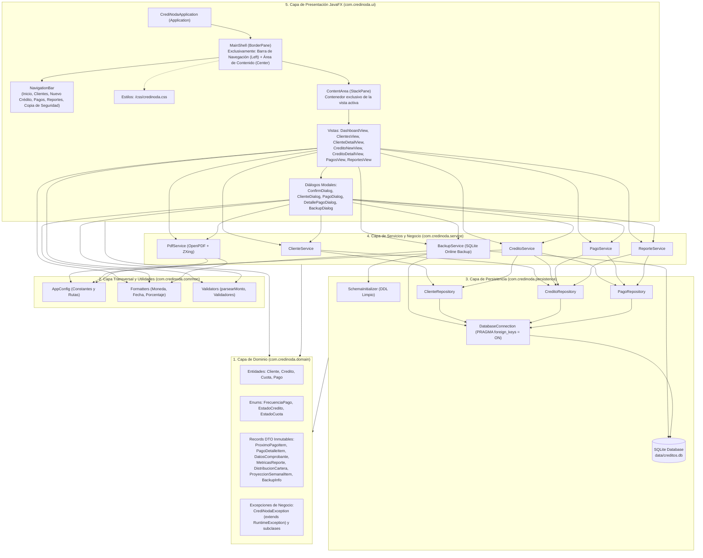

# Roadmap de Desarrollo y Arquitectura Objetivo: CrediNoda 2.0 (Java)

**Documento:** `ROADMAP_JAVA.md`  
**Proyecto:** CrediNoda 2.0  
**Stack Tecnológico:** Java 21 LTS | JavaFX 21 | SQLite JDBC | OpenPDF | ZXing | JUnit 5 & AssertJ | Maven  
**Autor:** Arquitecto de Software Senior  
**Fecha:** 16 de octubre de 2026  
**Referencia Base:** `PLAN_MIGRACION_CREDINODA_JAVA.md` (con excepción expresa de base de datos limpia desde cero)

---

## 1. Directriz y Excepción Crítica sobre la Base de Datos

1. **Base de Datos Limpia desde Cero:**  
   CrediNoda 2.0 **NO** migra, copia ni mantiene compatibilidad con los datos ni esquemas obsoletos de la base de datos real (`creditos.db`) del proyecto anterior en Python. La aplicación arrancará con una base de datos SQLite completamente limpia, generada en su totalidad por su propio componente `SchemaInitializer`.
2. **Esquema Relacional Definitivo:**  
   Se eliminan todas las tareas de migración retrospectiva (como sentencias `ALTER TABLE` para agregar columnas en bases de datos viejas). En Java, la tabla `cuotas` nace directamente con la columna `en_mora INTEGER NOT NULL DEFAULT 0` en su sentencia `CREATE TABLE IF NOT EXISTS`.
3. **Preservación Relacional y Financiera:**  
   Se conservan intactas las 4 tablas relacionales (`clientes`, `creditos`, `cuotas`, `pagos`), la integridad referencial obligatoria (`PRAGMA foreign_keys = ON`), el tratamiento matemático de centavos mediante `BigDecimal` (`RoundingMode.HALF_UP`) y el subsistema de copias de seguridad/restauración en caliente (`BackupService`), operando de manera exclusiva sobre las bases de datos generadas por la aplicación Java.

---

## 2. Resumen de la Arquitectura Objetivo

CrediNoda 2.0 se estructura bajo una **Arquitectura en 5 Capas Estrictas** bajo el paquete raíz `com.credinoda`, garantizando desacoplamiento, alta cohesión y testeabilidad automatizada:

### Especificación de Capas:

1. **`domain` (`com.credinoda.domain`):**
   - **`model`:** Entidades POJO/inmutables (`Cliente`, `Credito`, `Cuota`, `Pago`) y enumeraciones con nombres canónicos (`FrecuenciaPago`, `EstadoCredito`, `EstadoCuota`). `Cuota` implementa el cálculo dinámico de `etiquetaEstado()` ("PENDIENTE (EN MORA)", "PARCIAL (EN MORA)", "PAGADA", etc.).
   - **`dto`:** Registros (`record`) inmutables tipados que reemplazan los diccionarios sin tipar de Python (`ProximoPagoItem`, `PagoDetalleItem`, `DatosComprobante`, `MetricasReporte`, `DistribucionCartera`, `ProyeccionSemanalItem`, `BackupInfo`).
   - **`exception`:** Jerarquía de excepciones de dominio no chequeadas donde `CrediNodaException` hereda de `RuntimeException`, evitando sobrecargar las firmas de métodos con `throws` y facilitando rollback transaccional limpio.
2. **`common` (`com.credinoda.common`):**
   - Componentes transversales completamente desacoplados de la UI: `AppConfig` (constantes de negocio como tasa por defecto del 12%, frecuencias y resolución de rutas dinámicas), `Formatters` (formateo monetario exacto `$1.000.000` / `$113.333,33`, fechas `dd/mm/YYYY` y porcentajes sin acoplamiento a librerías gráficas), y `Validators` (analizador sintáctico robusto `parsearMonto()` tolerante a múltiples variantes de miles y decimales).
3. **`persistence` (`com.credinoda.persistence`):**
   - `DatabaseConnection`: Administra la conexión JDBC hacia SQLite activando mandatoriamente `PRAGMA foreign_keys = ON`.
   - `SchemaInitializer`: Crea desde cero las 4 tablas relacionales (`clientes`, `creditos`, `cuotas`, `pagos`) con tipos exactos `TEXT` para `BigDecimal` y `LocalDate`, con `cuotas.en_mora` nativo.
   - `repository`: `ClienteRepository`, `CreditoRepository`, `PagoRepository`, encargados del mapeo relacional estricto con `PreparedStatement`.
4. **`service` (`com.credinoda.service`):**
   - Orquesta los casos de uso del sistema: `ClienteService`, `CreditoService`, `PagoService`, `ReporteService`, `PdfService` (OpenPDF + ZXing) y `BackupService` (copias de seguridad en caliente y restauración segura con respaldo preventivo). Prohibido importar paquetes de JavaFX en esta capa.
5. **`ui` (`com.credinoda.ui`):**
   - Diseñado estrictamente según el principio de minimalismo de la Sección I.2 del plan maestro: la ventana principal `MainShell` contiene **únicamente dos regiones**:
     - **Barra de Navegación Persistente (`NavigationBar`):** Región lateral izquierda (220px) con acceso exclusivo a las 6 opciones reales del sistema (`Inicio`, `Clientes`, `Nuevo Crédito`, `Pagos`, `Reportes` y `Copia de Seguridad`).
     - **Área de Contenido Dinámica (`ContentArea`):** Ocupa el 100% del espacio restante para desplegar la vista activa (`DashboardView`, `ClientesView`, `ClienteDetailView`, `CreditoNewView`, `CreditoDetailView`, `PagosView`, `ReportesView`).
   - **Regla Estructural de Oro:** No existen paneles secundarios, ni barras de estado inferiores fijas, ni encabezados globales persistentes fuera del área de contenido. Las alertas se manejan mediante un banner flotante temporal (`ToastNotification`).

---

## 3. Matriz de Casos de Uso, Reglas de Negocio y Vectores de Prueba

| Caso de Uso (CU) | Regla de Negocio (RN) | Vectores de Prueba Clave | Fase del Roadmap |
| :--- | :--- | :--- | :---: |
| `CU-001` (Registrar nuevo cliente) `CU-002` (Buscar clientes) `CU-003` (Actualizar cliente) `CU-004` (Ficha y créditos del cliente) | `RN-001` (Obligatoriedad y sanitización trim) `RN-002` (Unicidad documento de identidad) `RN-003` (Búsqueda parcial LIKE nombre o doc) | Validación campos vacíos y duplicidad en BD | **Fases 1, 2, 3, 6** |
| `CU-005` (Simular crédito) `CU-006` (Otorgar crédito y plan cuotas) | `RN-004` (Interés simple mensual: $I = C \times i \times t$) `RN-005` (Frecuencia: Semanal x4, Quincenal x2) `RN-006` (Cuota base y ajuste centavos última cuota) `RN-007` (Fechas de vencimiento +7 y +15 días) | `VP-001`, `VP-002`, `VP-003` (Interés simple) `VP-004`, `VP-005` (Ajuste centavos última cuota) `VP-006` (Proyección fechas vencimiento) | **Fases 1, 2, 3, 6** |
| `CU-007` (Detalle crédito y saldos) `CU-008` (Detección automática mora) | `RN-008` (Criterio mora: vencida y no pagada; preserva estado ACTIVO; etiqueta calculada) `RN-010` (Saldos por agregación dinámica) `RN-011` (Transición cuotas y crédito a PAGADO) | `VP-007` (Abonos y liquidación cuota) `VP-008` (Prevención sobrepago centavos) Pruebas de cambio de día y arranque | **Fases 1, 2, 3, 5, 6** |
| `CU-009` (Registrar pago total/parcial) `CU-010` (Historial general de pagos) `CU-011` (Comprobante PDF y QR) | `RN-009` (Validación pagos y bloqueo sobrepago) `RN-012` (Estructura recibo REC-xxxxx y QR) `RN-015` (Parseo montos multiformato) `RN-016` (Filtro inteligente de pagos numérico/texto) | `VP-009` (Datos comprobante y % avance crédito) `VP-013` (Parseo flexible de montos) `VP-014` (Formato moneda exacto) | **Fases 1, 2, 3, 4, 6** |
| `CU-012` (Dashboard Inicio) | `RN-013` (Métricas exclusivas de cartera ACTIVA y 10 próximas cuotas pendientes/parciales) | Validación con créditos pagados vs activos | **Fases 2, 3, 6** |
| `CU-013` (Reportes financieros y KPIs) | `RN-014` (10 KPIs, ganancia líquida prorrateada, morosidad, distribución de cartera, series semanales) | `VP-010` (Ganancia líquida y margen) `VP-011` (Morosidad con vencidos) `VP-012` (Rangos temporales ISO) | **Fases 1, 2, 4, 6** |
| `CU-014` (Crear backup rápido/personal) `CU-015` (Validar y restaurar backup) | `RN-017` (Backup online SQLite y orden cronológico) `RN-018` (Validación triple: mágica, integridad, 4 tablas; respaldo preventivo pre_restauracion) | Ciclo integral: backup $\to$ borrado $\to$ validación $\to$ restauración en caliente | **Fases 2, 4, 6, 7** |

---

## 4. Roadmap de Desarrollo Paso a Paso (7 Fases)

### Fase 1: Cimientos del Proyecto, Modelo de Dominio, DTOs, Excepciones y Utilidades Transversales
- **Objetivo:** Configurar el proyecto Maven con Java 21 LTS y JavaFX 21, implementar todas las entidades de dominio, enumeraciones, jerarquía de excepciones de negocio no chequeadas, records DTO tipados, y utilidades de validación y formateo monetario completamente desacopladas de la UI.
- **Archivos exactos a crear:**
  - `pom.xml` (Java 21, JavaFX 21, SQLite JDBC, OpenPDF, ZXing, JUnit 5 Jupiter, AssertJ)
  - `src/main/java/com/credinoda/common/AppConfig.java`
  - `src/main/java/com/credinoda/common/Formatters.java`
  - `src/main/java/com/credinoda/common/Validators.java`
  - `src/main/java/com/credinoda/domain/model/Cliente.java`
  - `src/main/java/com/credinoda/domain/model/Credito.java`
  - `src/main/java/com/credinoda/domain/model/Cuota.java`
  - `src/main/java/com/credinoda/domain/model/Pago.java`
  - `src/main/java/com/credinoda/domain/model/FrecuenciaPago.java`
  - `src/main/java/com/credinoda/domain/model/EstadoCredito.java`
  - `src/main/java/com/credinoda/domain/model/EstadoCuota.java`
  - `src/main/java/com/credinoda/domain/dto/ProximoPagoItem.java`
  - `src/main/java/com/credinoda/domain/dto/PagoDetalleItem.java`
  - `src/main/java/com/credinoda/domain/dto/DatosComprobante.java`
  - `src/main/java/com/credinoda/domain/dto/MetricasReporte.java`
  - `src/main/java/com/credinoda/domain/dto/DistribucionCartera.java`
  - `src/main/java/com/credinoda/domain/dto/ProyeccionSemanalItem.java`
  - `src/main/java/com/credinoda/domain/dto/BackupInfo.java`
  - `src/main/java/com/credinoda/domain/exception/CrediNodaException.java`
  - `src/main/java/com/credinoda/domain/exception/ClienteNoEncontradoException.java`
  - `src/main/java/com/credinoda/domain/exception/CreditoNoEncontradoException.java`
  - `src/main/java/com/credinoda/domain/exception/CuotaNoEncontradaException.java`
  - `src/main/java/com/credinoda/domain/exception/PagoInvalidoException.java`
  - `src/main/java/com/credinoda/domain/exception/MontoInvalidoException.java`
  - `src/main/java/com/credinoda/domain/exception/DatosInvalidosException.java`
  - `src/main/java/com/credinoda/domain/exception/PdfServiceException.java`
  - `src/main/java/com/credinoda/domain/exception/BackupException.java`
  - `src/test/java/com/credinoda/common/FormattersTest.java`
  - `src/test/java/com/credinoda/common/ValidatorsTest.java`
  - `src/test/java/com/credinoda/domain/model/CuotaTest.java`
- **Casos de uso y Reglas de negocio cubiertas:**
  - Base transversal para `CU-001` a `CU-015`.
  - `RN-001` (Obligatoriedad de texto y trim).
  - `RN-005` (Enums de periodicidad).
  - `RN-008` (Lógica de etiqueta calculada en `Cuota.etiquetaEstado()`).
  - `RN-015` (Parseo flexible de entradas monetarias y formateo condicional de moneda).
- **Vectores de prueba y Tests JUnit 5:**
  - `VP-013`: 33 casos válidos y 11 inválidos de parseo numérico en `ValidatorsTest`.
  - `VP-014`: Formateo de moneda exacto (`$1.000.000`, `$113.333,33`, `$0`) en `FormattersTest`.
  - `CuotaTest`: Validación de transiciones de `etiquetaEstado()` ante combinaciones de `enMora` y `EstadoCuota`.
- **Tareas de la fase:**
  - [x] Configurar `pom.xml` con dependencias Maven (Java 21, JavaFX 21, SQLite JDBC, OpenPDF, ZXing, JUnit 5, AssertJ).
  - [x] Implementar la jerarquía de excepciones de negocio en `com.credinoda.domain.exception` heredando de `RuntimeException`.
  - [x] Crear las entidades del modelo en `com.credinoda.domain.model` (`Cliente`, `Credito`, `Cuota`, `Pago`) y enums asociados.
  - [x] Crear los registros DTO inmutables en `com.credinoda.domain.dto`.
  - [x] Implementar `AppConfig` con parámetros globales inmutables.
  - [x] Implementar `Validators` con algoritmo `parsearMonto()` tolerante a miles/decimales.
  - [x] Implementar `Formatters` con formateo contable estricto para moneda, fecha y porcentajes.
  - [x] Desarrollar y ejecutar suites de pruebas unitarias (`FormattersTest`, `ValidatorsTest`, `CuotaTest`).
- **Criterio de finalización:** Compilación limpia del proyecto (`mvn compile`) y 100% de tests unitarios pasando en verde (`mvn test`). (Completada: 51/51 tests en verde).

---

### Fase 2: Capa de Persistencia SQLite Limpia y Repositorios JDBC
- **Objetivo:** Implementar la conexión SQLite con integridad referencial activa (`PRAGMA foreign_keys = ON`), el inicializador del esquema relacional DDL limpio desde cero (con las 4 tablas definitivas, `cuotas.en_mora` nativo, sin lógica de migración para BDs de Python), y los repositorios JDBC con mapeo exacto de `BigDecimal` y `LocalDate`.
- **Archivos exactos a crear:**
  - `src/main/java/com/credinoda/persistence/DatabaseConnection.java`
  - `src/main/java/com/credinoda/persistence/SchemaInitializer.java`
  - `src/main/java/com/credinoda/persistence/repository/ClienteRepository.java`
  - `src/main/java/com/credinoda/persistence/repository/CreditoRepository.java`
  - `src/main/java/com/credinoda/persistence/repository/PagoRepository.java`
  - `src/test/java/com/credinoda/persistence/DatabaseConnectionTest.java`
  - `src/test/java/com/credinoda/persistence/SchemaInitializerTest.java`
  - `src/test/java/com/credinoda/persistence/repository/ClienteRepositoryTest.java`
  - `src/test/java/com/credinoda/persistence/repository/CreditoRepositoryTest.java`
  - `src/test/java/com/credinoda/persistence/repository/PagoRepositoryTest.java`
- **Casos de uso y Reglas de negocio cubiertas:**
  - Persistencia para `CU-001`, `CU-002`, `CU-003`, `CU-006`, `CU-007`, `CU-008`, `CU-009`, `CU-010`, `CU-012`.
  - `RN-002` (Restricción UNIQUE sobre `clientes.documento`).
  - `RN-003` (Búsqueda general `WHERE nombre LIKE ? OR documento LIKE ?`).
  - `RN-008` (Sentencia masiva optimizada de actualización de mora en BD).
  - `RN-010` (Agregación dinámica de sumas pagadas en cuotas y créditos).
  - `RN-016` (Consultas JOIN de auditoría ordenadas cronológicamente para historial).
- **Vectores de prueba y Tests JUnit 5:**
  - `DatabaseConnectionTest`: Verificación de conexión abierta y `PRAGMA foreign_keys = 1`.
  - `SchemaInitializerTest`: Inicialización de esquema limpio en memoria y verificación de integridad estructural DDL de las 4 tablas con `en_mora` incorporado.
  - `ClienteRepositoryTest`: CRUD completo de clientes, unicidad y búsqueda parcial.
  - `CreditoRepositoryTest`: Inserción de crédito y cuotas, actualización de estados, `actualizarMoraCuotas` y `obtenerCuotasPendientes(10)`.
  - `PagoRepositoryTest`: Registro de pagos, sumatorias y `obtenerDetallePago(pagoId)`.
- **Tareas de la fase:**
  - [x] Implementar `DatabaseConnection` asegurando la ejecución obligatoria de `PRAGMA foreign_keys = ON`.
  - [x] Implementar `SchemaInitializer` para aprovisionar las 4 tablas (`clientes`, `creditos`, `cuotas`, `pagos`) con `cuotas.en_mora INTEGER NOT NULL DEFAULT 0` nativo.
  - [x] Implementar `ClienteRepository` con consultas preparadas (`crear`, `obtenerPorId`, `obtenerPorDocumento`, `buscarGeneral`, `actualizar`, `listarTodos`).
  - [x] Implementar `CreditoRepository` (`crear`, `crearCuota`, `obtenerPorId`, `obtenerPorCliente`, `obtenerCuotasPorCredito`, `actualizarEstado`, `actualizarMoraCuotas`, `obtenerCuotasPendientes`).
  - [x] Implementar `PagoRepository` (`crear`, `obtenerPorCuota`, `obtenerTotalPagadoCuota`, `obtenerTotalPagadoCredito`, `listarTodosConDetalle`, `obtenerDetallePago`).
  - [x] Desarrollar pruebas unitarias de persistencia en SQLite `:memory:` y archivos temporales aislados.
- **Criterio de finalización:** Esquema limpio creado y validado al 100% en pruebas automatizadas sobre bases de datos en memoria y temporales de Java. Cero dependencia de datos de Python. (Completada: 75/75 tests en verde).

---

### Fase 3: Capa de Servicios Core (`ClienteService`, `CreditoService`, `PagoService`)
- **Objetivo:** Implementar la lógica financiera y transaccional central: alta y modificación de clientes con sanitización y unicidad, simulación y creación atómica de créditos con ajuste exacto de centavos en la última cuota, sincronización idempotente de mora, y registro de pagos parciales/totales con prevención de sobrepago.
- **Archivos exactos a crear:**
  - `src/main/java/com/credinoda/service/ClienteService.java`
  - `src/main/java/com/credinoda/service/CreditoService.java`
  - `src/main/java/com/credinoda/service/PagoService.java`
  - `src/test/java/com/credinoda/service/ClienteServiceTest.java`
  - `src/test/java/com/credinoda/service/CreditoServiceTest.java`
  - `src/test/java/com/credinoda/service/PagoServiceTest.java`
  - `src/test/java/com/credinoda/service/MoraCuotasTest.java`
- **Casos de uso y Reglas de negocio cubiertas:**
  - Casos de uso: `CU-001`, `CU-002`, `CU-003`, `CU-004`, `CU-005`, `CU-006`, `CU-007`, `CU-008`, `CU-009`, `CU-010`.
  - Reglas de negocio:
    - `RN-001` (Obligatoriedad y recorte de espacios en datos de clientes).
    - `RN-002` (Validación de unicidad de documento antes de insertar o editar).
    - `RN-004` (Fórmula de interés simple mensual con `RoundingMode.HALF_UP`).
    - `RN-005` (Factores fijos: semanal 4, quincenal 2 cuotas/mes).
    - `RN-006` (Cuota base y ajuste de residuos en la última cuota para garantizar $\sum cuotas == total\_pagar$).
    - `RN-007` (Proyección de vencimientos cada 7 días en semanal y cada 15 días en quincenal).
    - `RN-008` (Mora calculada: cuota vencida no pagada; preservación de `ACTIVO` en crédito y extinción de mora al pagar).
    - `RN-009` (Validación estricta de abonos, prevención de sobrepago por 1 centavo y libertad de selección de cuota no pagada).
    - `RN-010` (Cálculo de saldos inmutables por resta de abonos acumulados).
    - `RN-011` (Transición de cuota a `PARCIAL` o `PAGADA`, y crédito a `PAGADO` cuando todas las cuotas están saldadas).
    - `RN-012` (Estructuración del DTO `DatosComprobante` con saldos antes/después).
- **Vectores de prueba y Tests JUnit 5:**
  - `VP-001`: Interés simple a 1 mes (`$1.000.000` al 12% $\to$ `$120.000,00`, total `$1.120.000,00`).
  - `VP-002`: Interés simple a 3 meses (`$1.000.000` al 12% $\to$ `$360.000,00`, total `$1.360.000,00`).
  - `VP-003`: Interés simple a 6 meses (`$500.000` al 12% $\to$ `$360.000,00`, total `$860.000,00`).
  - `VP-004`: Ajuste de centavos semanal 12 cuotas (`$100.000` $\to$ C1-C11 por `11333.33` y C12 por `11333.37`).
  - `VP-005`: Ajuste de centavos semanal 12 cuotas (`$1.000.000` $\to$ C1-C11 por `113333.33` y C12 por `113333.37`).
  - `VP-006`: Fechas de vencimiento con deltas exactos de 7 y 15 días calendario.
  - `VP-007`: Secuencia de abonos parciales sobre cuota y liquidación final.
  - `VP-008`: Prevención de sobrepago por un centavo adicional (`11333.34` rechazado).
  - Suites completas: `ClienteServiceTest`, `CreditoServiceTest`, `PagoServiceTest` y `MoraCuotasTest`.
- **Tareas de la fase:**
  - [x] Implementar `ClienteService` (creación, actualización con validación de documento repetido, consulta y búsqueda).
  - [x] Implementar `CreditoService` (cálculo de interés simple, generación atómica transaccional de cuotas con ajuste residual, saldo pendiente, determinación de estado del crédito y sincronización masiva de mora).
  - [x] Implementar `PagoService` (registro de pagos totales/parciales con validaciones de sobrepago, transición de estados y generación de datos consolidados para recibo).
  - [x] Escribir y validar las pruebas unitarias y de integración de servicios con JUnit 5 y AssertJ en SQLite en memoria.
- **Criterio de finalización:** Superación al centavo de los vectores `VP-001` a `VP-008` y 100% de pruebas en verde en las 4 suites de servicios core. (Completada: 120/120 tests en verde).

---

### Fase 4: Servicios Especializados (`ReporteService`, `PdfService`, `BackupService`)
- **Objetivo:** Implementar la analítica financiera (filtros de tiempo, 10 KPIs, ganancia líquida proporcional y distribución de cartera), la maquetación de comprobantes de pago en PDF tamaño carta con código QR incrustado (OpenPDF + ZXing), y el sistema de copias de seguridad en caliente y restauración segura con validación triple y respaldo preventivo.
- **Archivos exactos a crear:**
  - `src/main/java/com/credinoda/service/ReporteService.java`
  - `src/main/java/com/credinoda/service/PdfService.java`
  - `src/main/java/com/credinoda/service/BackupService.java`
  - `src/test/java/com/credinoda/service/ReporteServiceTest.java`
  - `src/test/java/com/credinoda/service/PdfServiceTest.java`
  - `src/test/java/com/credinoda/service/BackupServiceTest.java`
- **Casos de uso y Reglas de negocio cubiertas:**
  - Casos de uso: `CU-011` (Generar, visualizar y exportar PDF con QR), `CU-013` (Reportes financieros, KPIs y distribución), `CU-014` (Crear copia de seguridad rápida/personalizada), `CU-015` (Validar y restaurar copia de seguridad en caliente).
  - Reglas de negocio:
    - `RN-012` (Maquetación y cálculos de recibo PDF `REC-xxxxx` y código QR con metadatos de cobranza).
    - `RN-014` (Fórmulas de 10 KPIs, morosidad `saldo_vencido / capital_prestado`, ganancia líquida prorrateada `intereses_cobrados`, margen de ganancia, clasificación de cartera y series semanales hasta 8 bloques).
    - `RN-017` (Respaldo consistente en caliente de páginas SQLite, extensión `.db` y listado ordenado cronológicamente).
    - `RN-018` (Validación triple de archivos de respaldo: cabecera binaria `SQLite format 3\x00`, `PRAGMA integrity_check == ok` y presencia de las 4 tablas; respaldo preventivo `pre_restauracion` automático antes de restaurar).
- **Vectores de prueba y Tests JUnit 5:**
  - `VP-009`: Comprobante PDF con saldos antes/después y avance de amortización del crédito (`19.7%`).
  - `VP-010`: Ganancia líquida prorrateada (`intereses_cobrados = 25000.00`, margen `9.09%`).
  - `VP-011`: Tasa de morosidad con crédito vencido (`110.00%`).
  - `VP-012`: Rangos temporales ISO para `ESTA_SEMANA` y `ESTE_MES`.
  - `PdfServiceTest`: Creación de PDF en memoria/disco con cabecera `%PDF-`, sanitización de caracteres en nombre de archivo e incrustación de matriz QR.
  - `BackupServiceTest`: Respaldo rápido, respaldo en ruta personalizada, rechazo de archivos corruptos o sin tablas de CrediNoda, y ciclo completo de restauración con creación de `pre_restauracion_*.db`.
- **Tareas de la fase:**
  - [x] Implementar `ReporteService` con resolución de rangos predefinidos, cálculo de KPIs financieros exactos, clasificación de cartera en 3 bolsas y proyección semanal.
  - [x] Implementar `PdfService` con OpenPDF y generador de matriz QR con ZXing en memoria.
  - [x] Implementar `BackupService` utilizando `VACUUM INTO` o backup nativo de SQLite, validación triple y restauración atómica con respaldo preventivo.
  - [x] Desarrollar y ejecutar suites de pruebas de reportes, PDFs y respaldos en `@TempDir`.
- **Criterio de finalización:** Aprobación del 100% de vectores `VP-009` a `VP-012`, generación exitosa de documentos PDF con QR válido y pruebas de backup/restauración ejecutadas limpiamente. (Completada: 137/137 tests en verde).

---

### Fase 5: Estructura Base JavaFX (`MainShell`), Enrutamiento y Componentes Reutilizables
- **Objetivo:** Construir el armazón estructural de JavaFX respetando estrictamente la directriz de la Sección I.2: la ventana principal `MainShell` se compone **únicamente de la Barra de Navegación Persistente y el Área de Contenido Dinámica**, sin paneles secundarios ni encabezados fijos globales. Implementar el enrutador reactivo con control de versiones (`dataVersion`), la hoja de estilos `credinoda.css` y los componentes reutilizables.
- **Archivos exactos a crear:**
  - `src/main/java/com/credinoda/Main.java` (punto de entrada bootstrap)
  - `src/main/java/com/credinoda/ui/CrediNodaApplication.java` (clase principal JavaFX)
  - `src/main/java/com/credinoda/ui/navigation/NavigationBar.java` (barra persistente con las 6 opciones reales)
  - `src/main/java/com/credinoda/ui/navigation/ViewRouter.java` (coordinador de vistas y caché por `dataVersion`)
  - `src/main/java/com/credinoda/ui/navigation/NavAction.java`
  - `src/main/java/com/credinoda/ui/components/SectionHeader.java`
  - `src/main/java/com/credinoda/ui/components/MetricCard.java`
  - `src/main/java/com/credinoda/ui/components/ToastNotification.java` (notificación flotante no bloqueante)
  - `src/main/java/com/credinoda/ui/components/ConfirmDialog.java`
  - `src/main/resources/css/credinoda.css` (estilos nativos JavaFX `-fx-*`)
  - `src/main/resources/assets/icon.png`
  - `src/test/java/com/credinoda/ui/ViewRouterTest.java`
  - `src/test/java/com/credinoda/ui/components/MetricCardTest.java`
- **Casos de uso y Reglas de negocio cubiertas:**
  - Shell estructural para `CU-001` a `CU-015`.
  - Navegación exclusiva entre las 6 opciones del sistema: `Inicio`, `Clientes`, `Nuevo Crédito`, `Pagos`, `Reportes`, y acción de `Copia de Seguridad`.
  - `RN-008` (Verificación de cambio de día al alternar vistas e incremento de `dataVersion`).
  - Restricción I.2: Cero paneles laterales secundarios o encabezados fijos globales fuera del área de contenido dinámica.
- **Vectores de prueba y Tests JUnit 5:**
  - `ViewRouterTest`: Registro, navegación, alternancia fluida de nodos en `ContentArea`, invalidación de caché ante mutación de datos.
  - Verificación de ventana principal: Inicial `1200x700`, mínima `1000x600`, BorderPane con Left=NavigationBar y Center=ContentArea.
- **Tareas de la fase:**
  - [ ] Crear la hoja de estilos `credinoda.css` con variables y clases semánticas para botones, tarjetas, tablas y badges.
  - [ ] Implementar `NavigationBar` (VBox de 220px) con marca, 5 botones de navegación y botón de acción de respaldo anclado al fondo.
  - [ ] Implementar `ViewRouter` con mapa de vistas en memoria y control de invalidación por `dataVersion`.
  - [ ] Implementar componentes visuales: `SectionHeader`, `MetricCard`, `ToastNotification` y `ConfirmDialog`.
  - [ ] Implementar `CrediNodaApplication` orquestando la inicialización de SQLite, servicios y la carga del `MainShell`.
  - [ ] Crear tests unitarios del enrutador y componentes.
- **Criterio de finalización:** La ventana principal abre en `1200x700` con `NavigationBar` y `ContentArea` como únicas regiones permanentes, permitiendo alternar vistas limpiamente sin parpadeos ni ventanas adicionales.

---

### Fase 6: Vistas de Módulos JavaFX, Diálogos Modales y Gráficos Nativos
- **Objetivo:** Desarrollar dentro del área de contenido las 7 pantallas funcionales de la aplicación y los 4 diálogos modales restantes, integrando `TableView` de JavaFX, gráficos nativos vectoriales (`BarChart` y `PieChart`), formularios reactivos y conectores a los servicios.
- **Archivos exactos a crear:**
  - `src/main/java/com/credinoda/ui/views/DashboardView.java`
  - `src/main/java/com/credinoda/ui/views/ClientesView.java`
  - `src/main/java/com/credinoda/ui/views/ClienteDetailView.java`
  - `src/main/java/com/credinoda/ui/views/CreditoNewView.java`
  - `src/main/java/com/credinoda/ui/views/CreditoDetailView.java`
  - `src/main/java/com/credinoda/ui/views/PagosView.java`
  - `src/main/java/com/credinoda/ui/views/ReportesView.java`
  - `src/main/java/com/credinoda/ui/components/ClienteDialog.java`
  - `src/main/java/com/credinoda/ui/components/PagoDialog.java`
  - `src/main/java/com/credinoda/ui/components/DetallePagoDialog.java`
  - `src/main/java/com/credinoda/ui/components/BackupDialog.java`
  - `src/test/java/com/credinoda/ui/views/DashboardViewTest.java`
  - `src/test/java/com/credinoda/ui/views/PagosViewFilterTest.java`
- **Casos de uso y Reglas de negocio cubiertas:**
  - `CU-001`, `CU-002`, `CU-003`, `CU-004` en `ClientesView`, `ClienteDetailView` y `ClienteDialog`.
  - `CU-005`, `CU-006` en `CreditoNewView`.
  - `CU-007`, `CU-008` en `CreditoDetailView` con badges de mora `(EN MORA)`.
  - `CU-009` en `PagoDialog` con prellenado automático de saldo y generación opcional de PDF.
  - `CU-010`, `CU-011` en `PagosView` con filtro manual (`RN-016`) y modal `DetallePagoDialog`.
  - `CU-012` en `DashboardView` con 3 tarjetas de cartera activa (`RN-013`) y tabla de 10 próximos cobros.
  - `CU-013` en `ReportesView` con selectores temporales, 10 tarjetas métricas, `BarChart` y `PieChart` Donut.
  - `CU-014`, `CU-015` en `BackupDialog` (respaldo rápido, selector de destino y restauración con confirmación).
- **Vectores de prueba y Tests JUnit 5:**
  - `DashboardViewTest`: Validación de tarjetas ignorando créditos liquidados.
  - `PagosViewFilterTest`: Validación de heurística de búsqueda manual (numérica `#4` vs `4`, texto o recibo `REC-xxxxx`, y limpieza).
- **Tareas de la fase:**
  - [ ] Implementar `DashboardView` con métricas de cartera activa y tabla de cuotas próximas.
  - [ ] Implementar `ClientesView` y `ClienteDetailView` conectadas a `ClienteDialog`.
  - [ ] Implementar `CreditoNewView` con simulador reactivo y confirmación de creación.
  - [ ] Implementar `CreditoDetailView` con resumen, métricas, plan de cuotas y lanzador de `PagoDialog`.
  - [ ] Implementar `PagosView` con filtro manual inteligente y modal `DetallePagoDialog`.
  - [ ] Implementar `ReportesView` con controles segmentados, entradas de fecha, tarjetas y gráficos vectoriales nativos de JavaFX.
  - [ ] Implementar `BackupDialog` con respaldo en un clic, guardado personalizado y restauración en caliente.
  - [ ] Desarrollar y ejecutar tests de controladores y filtros.
- **Criterio de finalización:** Todas las vistas y diálogos son 100% operativos de extremo a extremo desde JavaFX. Gráficos vectoriales y tablas responsivas funcionando sin fallos ni bloqueos en el hilo de UI.

---

### Fase 7: Pruebas de Integración End-to-End (E2E) con Base de Datos Limpia y Empaquetado Nativo
- **Objetivo:** Ejecutar la suite integral de pruebas End-to-End validando el ciclo de vida completo de préstamos, cobranzas, emisión de recibos PDF y copias de seguridad sobre una base de datos limpia creada por Java. Configurar el empaquetado nativo para Windows (`jpackage` / `javafx-maven-plugin`).
- **Archivos exactos a crear:**
  - `src/test/java/com/credinoda/it/CrediNodaE2ETest.java`
  - Configuración final de plugins de distribución en `pom.xml` (`javafx-maven-plugin`, `jpackage`)
  - `README.md` del proyecto Java con instrucciones de compilación, ejecución y empaquetado.
- **Casos de uso y Reglas de negocio cubiertas:**
  - Cobertura completa e integrada de `CU-001` a `CU-015` y `RN-001` a `RN-018`.
- **Vectores de prueba y Tests JUnit 5:**
  - `CrediNodaE2ETest`:
    - *Escenario E2E 1:* Alta de cliente $\to$ otorgamiento de crédito con ajuste de centavos $\to$ pagos parciales $\to$ comprobante PDF con QR $\to$ liquidación total $\to$ crédito pasa a `PAGADO`.
    - *Escenario E2E 2:* Creación de créditos con fecha anterior $\to$ detección de mora $\to$ verificación en Dashboard y Reportes (`tasa_morosidad`) $\to$ pago con recuperación.
    - *Escenario E2E 3:* Población de datos $\to$ backup rápido $\to$ borrado intencional de registros $\to$ restauración en caliente $\to$ verificación de consistencia íntegra.
- **Tareas de la fase:**
  - [ ] Implementar la suite `CrediNodaE2ETest` ejecutando los 3 escenarios maestros sobre SQLite en memoria y directorios temporales limpios.
  - [ ] Configurar el plugin de empaquetado en `pom.xml` para generar la imagen de ejecución portable y/o instalador de Windows (`jpackage`).
  - [ ] Verificar que la aplicación arranque de forma autónoma con sus carpetas locales `data/`, `backups/` y `comprobantes/`.
  - [ ] Redactar el `README.md` del proyecto Java con comandos de construcción y ejecución.
- **Criterio de finalización (Ajustado según excepción):** 100% de pruebas E2E aprobadas en verde (`mvn verify`) operando exclusivamente sobre bases de datos creadas por Java. Construcción exitosa del ejecutable nativo empaquetado. Cero pruebas ni dependencias sobre la base de datos de Python.

---

## 5. Resumen de Criterios de Aceptación Globales

- [ ] **Arquitectura e Integridad Visual:**
  - Ventana principal estructurada **únicamente** por la Barra de Navegación Persistente (220px) y el Área de Contenido Dinámica.
  - Sin encabezados globales permanentes, paneles laterales secundarios ni pies de página fijos.
  - Estilizado profesional con `credinoda.css` y responsividad desde `1000x600` en adelante.
- [ ] **Lógica de Negocio y Finanzas:**
  - Precisión matemática absoluta con `BigDecimal` y `RoundingMode.HALF_UP` en todos los cálculos de interés y cuotas.
  - Ajuste residual exacto en la última cuota garantizando $\sum cuotas == total\_pagar$.
  - Detección y visualización estricta de mora (`(EN MORA)`) sin alterar el estado `ACTIVO` del crédito ni el balance nominal de la cuota.
  - Bloqueo de sobrepagos por cualquier importe superior al saldo de la cuota.
- [ ] **Documentos y Resguardos:**
  - Generación de comprobantes PDF tamaño carta con OpenPDF y código QR con metadatos escaneables vía ZXing.
  - Creación de backups en caliente y restauración segura con validación triple y respaldo preventivo `pre_restauracion_*.db`.
- [ ] **Independencia de Datos y Testeo:**
  - Base de datos SQLite completamente limpia y nueva desde cero, sin migraciones de esquemas viejos ni lectura de `creditos.db` de Python.
  - 100% de la suite de pruebas JUnit 5 en verde (`mvn test` y `mvn verify`).
