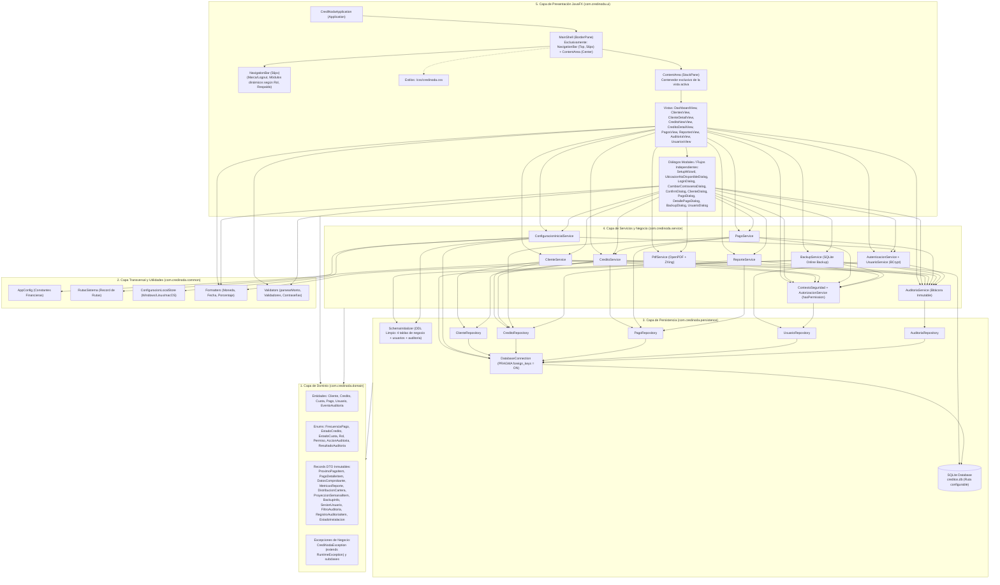

# Roadmap de Desarrollo y Arquitectura Objetivo: CrediNoda 2.0 (Java)

**Documento:** `ROADMAP_JAVA.md`  
**Proyecto:** CrediNoda 2.0  
**Stack Tecnológico:** Java 21 LTS | JavaFX 21 | SQLite JDBC | OpenPDF | ZXing | JUnit 5 & AssertJ | Maven  
**Autor:** Arquitecto de Software Senior  
**Fecha:** 16 de octubre de 2026  
**Referencia Base:** `PLAN_MIGRACION_CREDINODA_JAVA.md` (con excepción expresa de base de datos limpia desde cero)

---

## 1. Directriz y Excepción Crítica sobre la Base de Datos

1. **Base de Datos Limpia desde Cero:**  
   CrediNoda 2.0 **NO** migra, copia ni mantiene compatibilidad con los datos ni esquemas obsoletos de la base de datos real (`creditos.db`) del proyecto anterior en Python. La aplicación arrancará con una base de datos SQLite completamente limpia, generada en su totalidad por su propio componente `SchemaInitializer`.
2. **Esquema Relacional Definitivo:**  
   Se eliminan todas las tareas de migración retrospectiva (como sentencias `ALTER TABLE` para agregar columnas en bases de datos viejas). En Java, la tabla `cuotas` nace directamente con la columna `en_mora INTEGER NOT NULL DEFAULT 0` en su sentencia `CREATE TABLE IF NOT EXISTS`.
3. **Preservación Relacional y Financiera:**  
   Se conservan intactas las 4 tablas relacionales (`clientes`, `creditos`, `cuotas`, `pagos`), la integridad referencial obligatoria (`PRAGMA foreign_keys = ON`), el tratamiento matemático de centavos mediante `BigDecimal` (`RoundingMode.HALF_UP`) y el subsistema de copias de seguridad/restauración en caliente (`BackupService`), operando de manera exclusiva sobre las bases de datos generadas por la aplicación Java.

---

## 2. Resumen de la Arquitectura Objetivo

CrediNoda 2.0 se estructura bajo una **Arquitectura en 5 Capas Estrictas** bajo el paquete raíz `com.credinoda`, garantizando desacoplamiento, alta cohesión y testeabilidad automatizada:

### Especificación de Capas:

1. **`domain` (`com.credinoda.domain`):**
   - **`model`:** Entidades POJO/inmutables (`Cliente`, `Credito`, `Cuota`, `Pago`, `Usuario`, `EventoAuditoria`) y enumeraciones con nombres canónicos (`FrecuenciaPago`, `EstadoCredito`, `EstadoCuota`, `Rol`, `Permiso`, `AccionAuditoria`, `ResultadoAuditoria`). `Cuota` implementa el cálculo dinámico de `etiquetaEstado()`.
   - **`dto`:** Registros (`record`) inmutables tipados (`ProximoPagoItem`, `PagoDetalleItem`, `DatosComprobante`, `MetricasReporte`, `DistribucionCartera`, `ProyeccionSemanalItem`, `BackupInfo`, `SesionUsuario`, `FiltroAuditoria`, `RegistroAuditoriaItem`, `EstadoInstalacion`, `ResultadoValidacionUbicacion`).
   - **`exception`:** Jerarquía de excepciones de dominio no chequeadas donde `CrediNodaException` hereda de `RuntimeException` (`ClienteNoEncontradoException`, `CreditoNoEncontradoException`, `AutenticacionException`, `UsuarioBloqueadoException`, `AccesoDenegadoException`, `ConfiguracionException`, etc.).
2. **`common` (`com.credinoda.common`):**
   - Componentes transversales completamente desacoplados de la UI: `AppConfig` (parámetros financieros inmutables), `RutasSistema` (record de rutas dinámicas), `ConfiguracionLocalStore` (persistencia multiplataforma en Windows `%APPDATA%`, Linux `~/.config` y macOS con soporte de override `-Dcredinoda.config.dir` para tests), `Formatters` (formateo contable exacto) y `Validators` (parseo tolerante de montos, validación de contraseñas y validación de carpetas operativas).
3. **`persistence` (`com.credinoda.persistence`):**
   - `DatabaseConnection`: Administra la conexión JDBC hacia SQLite con `PRAGMA foreign_keys = ON` inyectando la ruta dinámica de la base de datos.
   - `SchemaInitializer`: Crea desde cero las tablas relacionales (`clientes`, `creditos`, `cuotas`, `pagos`, `usuarios`, `auditoria`) e índices optimizados, con triggers de inmutabilidad sobre la bitácora de auditoría.
   - `repository`: `ClienteRepository`, `CreditoRepository`, `PagoRepository`, `UsuarioRepository` y `AuditoriaRepository` con `PreparedStatement`.
4. **`service` (`com.credinoda.service`):**
   - Orquesta los casos de uso del sistema: `ClienteService`, `CreditoService`, `PagoService`, `ReporteService`, `PdfService`, `BackupService`, `AutenticacionService` (BCrypt costo 12), `UsuarioService`, `AutorizacionService` (`hasPermission`/`requirePermission`), `AuditoriaService` (registro atómico en transacciones) y `ConfiguracionInicialService`. Prohibido importar paquetes de JavaFX en esta capa.
5. **`ui` (`com.credinoda.ui`):**
   - Diseñado estrictamente según la Sección I.2 del plan de migración y el diseño Stitch: la ventana principal `MainShell` contiene **únicamente dos regiones**:
     - **Barra de Navegación Persistente (`NavigationBar`):** Superior horizontal (56px) con bloque de marca interactivo (cierre de sesión al pulsar), menú horizontal de módulos según el rol del usuario autenticado, y botón de acción de respaldo a la derecha.
     - **Área de Contenido Dinámica (`ContentArea`):** Ocupa el 100% del espacio restante para desplegar la vista activa (`DashboardView`, `ClientesView`, `ClienteDetailView`, `CreditoNewView`, `CreditoDetailView`, `PagosView`, `ReportesView`, `AuditoriaView`, `UsuariosView`).
   - Flujos modales independientes: `SetupWizard` (primer arranque), `LoginDialog` (autenticación previa), `BackupDialog`, `ClienteDialog`, `PagoDialog`, etc. Las alertas se manejan mediante el banner flotante temporal (`ToastNotification`).

---

## 3. Matriz de Casos de Uso, Reglas de Negocio y Vectores de Prueba

| Caso de Uso (CU) | Regla de Negocio (RN) | Vectores de Prueba Clave | Fase del Roadmap |
| :--- | :--- | :--- | :---: |
| `CU-001` (Registrar nuevo cliente) `CU-002` (Buscar clientes) `CU-003` (Actualizar cliente) `CU-004` (Ficha y créditos del cliente) | `RN-001` (Obligatoriedad y sanitización trim) `RN-002` (Unicidad documento de identidad) `RN-003` (Búsqueda parcial LIKE nombre o doc) | Validación campos vacíos y duplicidad en BD | **Fases 1, 2, 3, 6** |
| `CU-005` (Simular crédito) `CU-006` (Otorgar crédito y plan cuotas) | `RN-004` (Interés simple mensual: $I = C \times i \times t$) `RN-005` (Frecuencia: Semanal x4, Quincenal x2) `RN-006` (Cuota base y ajuste centavos última cuota) `RN-007` (Fechas de vencimiento +7 y +15 días) | `VP-001`, `VP-002`, `VP-003` (Interés simple) `VP-004`, `VP-005` (Ajuste centavos última cuota) `VP-006` (Proyección fechas vencimiento) | **Fases 1, 2, 3, 6** |
| `CU-007` (Detalle crédito y saldos) `CU-008` (Detección automática mora) | `RN-008` (Criterio mora: vencida y no pagada; preserva estado ACTIVO; etiqueta calculada) `RN-010` (Saldos por agregación dinámica) `RN-011` (Transición cuotas y crédito a PAGADO) | `VP-007` (Abonos y liquidación cuota) `VP-008` (Prevención sobrepago centavos) Pruebas de cambio de día y arranque | **Fases 1, 2, 3, 5, 6** |
| `CU-009` (Registrar pago total/parcial) `CU-010` (Historial general de pagos) `CU-011` (Comprobante PDF y QR) | `RN-009` (Validación pagos y bloqueo sobrepago) `RN-012` (Estructura recibo REC-xxxxx y QR) `RN-015` (Parseo montos multiformato) `RN-016` (Filtro inteligente de pagos numérico/texto) | `VP-009` (Datos comprobante y % avance crédito) `VP-013` (Parseo flexible de montos) `VP-014` (Formato moneda exacto) | **Fases 1, 2, 3, 4, 6** |
| `CU-012` (Dashboard Inicio) | `RN-013` (Métricas exclusivas de cartera ACTIVA y 10 próximas cuotas pendientes/parciales) | Validación con créditos pagados vs activos | **Fases 2, 3, 6** |
| `CU-013` (Reportes financieros y KPIs) | `RN-014` (10 KPIs, ganancia líquida prorrateada, morosidad, distribución de cartera, series semanales) | `VP-010` (Ganancia líquida y margen) `VP-011` (Morosidad con vencidos) `VP-012` (Rangos temporales ISO) | **Fases 1, 2, 4, 6** |
| `CU-014` (Crear backup rápido/personal) `CU-015` (Validar y restaurar backup) | `RN-017` (Backup online SQLite y orden cronológico) `RN-018` (Validación triple: mágica, integridad, 4 tablas; respaldo preventivo pre_restauracion) | Ciclo integral: backup $\to$ borrado $\to$ validación $\to$ restauración en caliente | **Fases 2, 4, 6, 7** |
| `CU-016` (Configurar ubicación de datos y respaldos en primer inicio) `CU-017` (Recuperar ubicación de datos no disponible) | `RN-019` (Configuración externa multiplataforma en AppData/XDG, escritura atómica) `RN-020` (Validación de carpetas: permisos, advertencia estricta contra BD activa en la nube, soporte de Google Drive Desktop para respaldos) `RN-021` (Nunca recrear en silencio una BD ausente en la ruta configurada) | `VP-015` (Primer arranque $\to$ Setup Wizard; segundo arranque $\to$ Login directo) `VP-016` (Ruta inaccesible no genera BD vacía) `VP-017` (Validación de carpetas y reutilización de BD existente) | **Fases 6.2, 7** |
| `CU-018` (Iniciar y cerrar sesión) `CU-019` (Gestionar usuarios y roles) `CU-020` (Cambiar contraseña) | `RN-022` (Credenciales BCrypt costo 12, política de contraseñas) `RN-023` (Bloqueo tras 5 intentos fallidos por 15 minutos, mensaje genérico) `RN-024` (Matriz rol-permiso: Administrador completo vs. Operador restringido a cobranza y créditos preexistentes) `RN-025` (Invariante: siempre $\ge 1$ Administrador activo; baja lógica) `RN-026` (Doble capa: validación mandatoria en service y ocultamiento en UI; logout en marca de Navbar) | `VP-018` (Hash y verificación BCrypt) `VP-019` (Bloqueo y desbloqueo temporal) `VP-020` (Acceso denegado según matriz de roles) `VP-021` (Protección del último administrador) | **Fases 6.3, 7** |
| `CU-021` (Consultar bitácora de auditoría) | `RN-027` (Bitácora inmutable protegida por triggers SQLite) `RN-028` (Evento atómico en la misma transacción JDBC de negocio) `RN-029` (Restauración de respaldos preserva intactos usuarios y auditoría) | `VP-022` (Pago auditado atómicamente; rollback sin eventos) `VP-023` (UPDATE/DELETE sobre auditoría rechazados por triggers) `VP-024` (Restauración preserva usuarios y bitácora) | **Fases 6.4, 7** |

---

## 4. Roadmap de Desarrollo Paso a Paso (7 Fases)

### Fase 1: Cimientos del Proyecto, Modelo de Dominio, DTOs, Excepciones y Utilidades Transversales
- **Objetivo:** Configurar el proyecto Maven con Java 21 LTS y JavaFX 21, implementar todas las entidades de dominio, enumeraciones, jerarquía de excepciones de negocio no chequeadas, records DTO tipados, y utilidades de validación y formateo monetario completamente desacopladas de la UI.
- **Archivos exactos a crear:**
  - `pom.xml` (Java 21, JavaFX 21, SQLite JDBC, OpenPDF, ZXing, JUnit 5 Jupiter, AssertJ)
  - `src/main/java/com/credinoda/common/AppConfig.java`
  - `src/main/java/com/credinoda/common/Formatters.java`
  - `src/main/java/com/credinoda/common/Validators.java`
  - `src/main/java/com/credinoda/domain/model/Cliente.java`
  - `src/main/java/com/credinoda/domain/model/Credito.java`
  - `src/main/java/com/credinoda/domain/model/Cuota.java`
  - `src/main/java/com/credinoda/domain/model/Pago.java`
  - `src/main/java/com/credinoda/domain/model/FrecuenciaPago.java`
  - `src/main/java/com/credinoda/domain/model/EstadoCredito.java`
  - `src/main/java/com/credinoda/domain/model/EstadoCuota.java`
  - `src/main/java/com/credinoda/domain/dto/ProximoPagoItem.java`
  - `src/main/java/com/credinoda/domain/dto/PagoDetalleItem.java`
  - `src/main/java/com/credinoda/domain/dto/DatosComprobante.java`
  - `src/main/java/com/credinoda/domain/dto/MetricasReporte.java`
  - `src/main/java/com/credinoda/domain/dto/DistribucionCartera.java`
  - `src/main/java/com/credinoda/domain/dto/ProyeccionSemanalItem.java`
  - `src/main/java/com/credinoda/domain/dto/BackupInfo.java`
  - `src/main/java/com/credinoda/domain/exception/CrediNodaException.java`
  - `src/main/java/com/credinoda/domain/exception/ClienteNoEncontradoException.java`
  - `src/main/java/com/credinoda/domain/exception/CreditoNoEncontradoException.java`
  - `src/main/java/com/credinoda/domain/exception/CuotaNoEncontradaException.java`
  - `src/main/java/com/credinoda/domain/exception/PagoInvalidoException.java`
  - `src/main/java/com/credinoda/domain/exception/MontoInvalidoException.java`
  - `src/main/java/com/credinoda/domain/exception/DatosInvalidosException.java`
  - `src/main/java/com/credinoda/domain/exception/PdfServiceException.java`
  - `src/main/java/com/credinoda/domain/exception/BackupException.java`
  - `src/test/java/com/credinoda/common/FormattersTest.java`
  - `src/test/java/com/credinoda/common/ValidatorsTest.java`
  - `src/test/java/com/credinoda/domain/model/CuotaTest.java`
- **Casos de uso y Reglas de negocio cubiertas:**
  - Base transversal para `CU-001` a `CU-015`.
  - `RN-001` (Obligatoriedad de texto y trim).
  - `RN-005` (Enums de periodicidad).
  - `RN-008` (Lógica de etiqueta calculada en `Cuota.etiquetaEstado()`).
  - `RN-015` (Parseo flexible de entradas monetarias y formateo condicional de moneda).
- **Vectores de prueba y Tests JUnit 5:**
  - `VP-013`: 33 casos válidos y 11 inválidos de parseo numérico en `ValidatorsTest`.
  - `VP-014`: Formateo de moneda exacto (`$1.000.000`, `$113.333,33`, `$0`) en `FormattersTest`.
  - `CuotaTest`: Validación de transiciones de `etiquetaEstado()` ante combinaciones de `enMora` y `EstadoCuota`.
- **Tareas de la fase:**
  - [x] Configurar `pom.xml` con dependencias Maven (Java 21, JavaFX 21, SQLite JDBC, OpenPDF, ZXing, JUnit 5, AssertJ).
  - [x] Implementar la jerarquía de excepciones de negocio en `com.credinoda.domain.exception` heredando de `RuntimeException`.
  - [x] Crear las entidades del modelo en `com.credinoda.domain.model` (`Cliente`, `Credito`, `Cuota`, `Pago`) y enums asociados.
  - [x] Crear los registros DTO inmutables en `com.credinoda.domain.dto`.
  - [x] Implementar `AppConfig` con parámetros globales inmutables.
  - [x] Implementar `Validators` con algoritmo `parsearMonto()` tolerante a miles/decimales.
  - [x] Implementar `Formatters` con formateo contable estricto para moneda, fecha y porcentajes.
  - [x] Desarrollar y ejecutar suites de pruebas unitarias (`FormattersTest`, `ValidatorsTest`, `CuotaTest`).
- **Criterio de finalización:** Compilación limpia del proyecto (`mvn compile`) y 100% de tests unitarios pasando en verde (`mvn test`). (Completada: 51/51 tests en verde).

---

### Fase 2: Capa de Persistencia SQLite Limpia y Repositorios JDBC
- **Objetivo:** Implementar la conexión SQLite con integridad referencial activa (`PRAGMA foreign_keys = ON`), el inicializador del esquema relacional DDL limpio desde cero (con las 4 tablas definitivas, `cuotas.en_mora` nativo, sin lógica de migración para BDs de Python), y los repositorios JDBC con mapeo exacto de `BigDecimal` y `LocalDate`.
- **Archivos exactos a crear:**
  - `src/main/java/com/credinoda/persistence/DatabaseConnection.java`
  - `src/main/java/com/credinoda/persistence/SchemaInitializer.java`
  - `src/main/java/com/credinoda/persistence/repository/ClienteRepository.java`
  - `src/main/java/com/credinoda/persistence/repository/CreditoRepository.java`
  - `src/main/java/com/credinoda/persistence/repository/PagoRepository.java`
  - `src/test/java/com/credinoda/persistence/DatabaseConnectionTest.java`
  - `src/test/java/com/credinoda/persistence/SchemaInitializerTest.java`
  - `src/test/java/com/credinoda/persistence/repository/ClienteRepositoryTest.java`
  - `src/test/java/com/credinoda/persistence/repository/CreditoRepositoryTest.java`
  - `src/test/java/com/credinoda/persistence/repository/PagoRepositoryTest.java`
- **Casos de uso y Reglas de negocio cubiertas:**
  - Persistencia para `CU-001`, `CU-002`, `CU-003`, `CU-006`, `CU-007`, `CU-008`, `CU-009`, `CU-010`, `CU-012`.
  - `RN-002` (Restricción UNIQUE sobre `clientes.documento`).
  - `RN-003` (Búsqueda general `WHERE nombre LIKE ? OR documento LIKE ?`).
  - `RN-008` (Sentencia masiva optimizada de actualización de mora en BD).
  - `RN-010` (Agregación dinámica de sumas pagadas en cuotas y créditos).
  - `RN-016` (Consultas JOIN de auditoría ordenadas cronológicamente para historial).
- **Vectores de prueba y Tests JUnit 5:**
  - `DatabaseConnectionTest`: Verificación de conexión abierta y `PRAGMA foreign_keys = 1`.
  - `SchemaInitializerTest`: Inicialización de esquema limpio en memoria y verificación de integridad estructural DDL de las 4 tablas con `en_mora` incorporado.
  - `ClienteRepositoryTest`: CRUD completo de clientes, unicidad y búsqueda parcial.
  - `CreditoRepositoryTest`: Inserción de crédito y cuotas, actualización de estados, `actualizarMoraCuotas` y `obtenerCuotasPendientes(10)`.
  - `PagoRepositoryTest`: Registro de pagos, sumatorias y `obtenerDetallePago(pagoId)`.
- **Tareas de la fase:**
  - [x] Implementar `DatabaseConnection` asegurando la ejecución obligatoria de `PRAGMA foreign_keys = ON`.
  - [x] Implementar `SchemaInitializer` para aprovisionar las 4 tablas (`clientes`, `creditos`, `cuotas`, `pagos`) con `cuotas.en_mora INTEGER NOT NULL DEFAULT 0` nativo.
  - [x] Implementar `ClienteRepository` con consultas preparadas (`crear`, `obtenerPorId`, `obtenerPorDocumento`, `buscarGeneral`, `actualizar`, `listarTodos`).
  - [x] Implementar `CreditoRepository` (`crear`, `crearCuota`, `obtenerPorId`, `obtenerPorCliente`, `obtenerCuotasPorCredito`, `actualizarEstado`, `actualizarMoraCuotas`, `obtenerCuotasPendientes`).
  - [x] Implementar `PagoRepository` (`crear`, `obtenerPorCuota`, `obtenerTotalPagadoCuota`, `obtenerTotalPagadoCredito`, `listarTodosConDetalle`, `obtenerDetallePago`).
  - [x] Desarrollar pruebas unitarias de persistencia en SQLite `:memory:` y archivos temporales aislados.
- **Criterio de finalización:** Esquema limpio creado y validado al 100% en pruebas automatizadas sobre bases de datos en memoria y temporales de Java. Cero dependencia de datos de Python. (Completada: 75/75 tests en verde).

---

### Fase 3: Capa de Servicios Core (`ClienteService`, `CreditoService`, `PagoService`)
- **Objetivo:** Implementar la lógica financiera y transaccional central: alta y modificación de clientes con sanitización y unicidad, simulación y creación atómica de créditos con ajuste exacto de centavos en la última cuota, sincronización idempotente de mora, y registro de pagos parciales/totales con prevención de sobrepago.
- **Archivos exactos a crear:**
  - `src/main/java/com/credinoda/service/ClienteService.java`
  - `src/main/java/com/credinoda/service/CreditoService.java`
  - `src/main/java/com/credinoda/service/PagoService.java`
  - `src/test/java/com/credinoda/service/ClienteServiceTest.java`
  - `src/test/java/com/credinoda/service/CreditoServiceTest.java`
  - `src/test/java/com/credinoda/service/PagoServiceTest.java`
  - `src/test/java/com/credinoda/service/MoraCuotasTest.java`
- **Casos de uso y Reglas de negocio cubiertas:**
  - Casos de uso: `CU-001`, `CU-002`, `CU-003`, `CU-004`, `CU-005`, `CU-006`, `CU-007`, `CU-008`, `CU-009`, `CU-010`.
  - Reglas de negocio:
    - `RN-001` (Obligatoriedad y recorte de espacios en datos de clientes).
    - `RN-002` (Validación de unicidad de documento antes de insertar o editar).
    - `RN-004` (Fórmula de interés simple mensual con `RoundingMode.HALF_UP`).
    - `RN-005` (Factores fijos: semanal 4, quincenal 2 cuotas/mes).
    - `RN-006` (Cuota base y ajuste de residuos en la última cuota para garantizar $\sum cuotas == total\_pagar$).
    - `RN-007` (Proyección de vencimientos cada 7 días en semanal y cada 15 días en quincenal).
    - `RN-008` (Mora calculada: cuota vencida no pagada; preservación de `ACTIVO` en crédito y extinción de mora al pagar).
    - `RN-009` (Validación estricta de abonos, prevención de sobrepago por 1 centavo y libertad de selección de cuota no pagada).
    - `RN-010` (Cálculo de saldos inmutables por resta de abonos acumulados).
    - `RN-011` (Transición de cuota a `PARCIAL` o `PAGADA`, y crédito a `PAGADO` cuando todas las cuotas están saldadas).
    - `RN-012` (Estructuración del DTO `DatosComprobante` con saldos antes/después).
- **Vectores de prueba y Tests JUnit 5:**
  - `VP-001`: Interés simple a 1 mes (`$1.000.000` al 12% $\to$ `$120.000,00`, total `$1.120.000,00`).
  - `VP-002`: Interés simple a 3 meses (`$1.000.000` al 12% $\to$ `$360.000,00`, total `$1.360.000,00`).
  - `VP-003`: Interés simple a 6 meses (`$500.000` al 12% $\to$ `$360.000,00`, total `$860.000,00`).
  - `VP-004`: Ajuste de centavos semanal 12 cuotas (`$100.000` $\to$ C1-C11 por `11333.33` y C12 por `11333.37`).
  - `VP-005`: Ajuste de centavos semanal 12 cuotas (`$1.000.000` $\to$ C1-C11 por `113333.33` y C12 por `113333.37`).
  - `VP-006`: Fechas de vencimiento con deltas exactos de 7 y 15 días calendario.
  - `VP-007`: Secuencia de abonos parciales sobre cuota y liquidación final.
  - `VP-008`: Prevención de sobrepago por un centavo adicional (`11333.34` rechazado).
  - Suites completas: `ClienteServiceTest`, `CreditoServiceTest`, `PagoServiceTest` y `MoraCuotasTest`.
- **Tareas de la fase:**
  - [x] Implementar `ClienteService` (creación, actualización con validación de documento repetido, consulta y búsqueda).
  - [x] Implementar `CreditoService` (cálculo de interés simple, generación atómica transaccional de cuotas con ajuste residual, saldo pendiente, determinación de estado del crédito y sincronización masiva de mora).
  - [x] Implementar `PagoService` (registro de pagos totales/parciales con validaciones de sobrepago, transición de estados y generación de datos consolidados para recibo).
  - [x] Escribir y validar las pruebas unitarias y de integración de servicios con JUnit 5 y AssertJ en SQLite en memoria.
- **Criterio de finalización:** Superación al centavo de los vectores `VP-001` a `VP-008` y 100% de pruebas en verde en las 4 suites de servicios core. (Completada: 120/120 tests en verde).

---

### Fase 4: Servicios Especializados (`ReporteService`, `PdfService`, `BackupService`)
- **Objetivo:** Implementar la analítica financiera (filtros de tiempo, 10 KPIs, ganancia líquida proporcional y distribución de cartera), la maquetación de comprobantes de pago en PDF tamaño carta con código QR incrustado (OpenPDF + ZXing), y el sistema de copias de seguridad en caliente y restauración segura con validación triple y respaldo preventivo.
- **Archivos exactos a crear:**
  - `src/main/java/com/credinoda/service/ReporteService.java`
  - `src/main/java/com/credinoda/service/PdfService.java`
  - `src/main/java/com/credinoda/service/BackupService.java`
  - `src/test/java/com/credinoda/service/ReporteServiceTest.java`
  - `src/test/java/com/credinoda/service/PdfServiceTest.java`
  - `src/test/java/com/credinoda/service/BackupServiceTest.java`
- **Casos de uso y Reglas de negocio cubiertas:**
  - Casos de uso: `CU-011` (Generar, visualizar y exportar PDF con QR), `CU-013` (Reportes financieros, KPIs y distribución), `CU-014` (Crear copia de seguridad rápida/personalizada), `CU-015` (Validar y restaurar copia de seguridad en caliente).
  - Reglas de negocio:
    - `RN-012` (Maquetación y cálculos de recibo PDF `REC-xxxxx` y código QR con metadatos de cobranza).
    - `RN-014` (Fórmulas de 10 KPIs, morosidad `saldo_vencido / capital_prestado`, ganancia líquida prorrateada `intereses_cobrados`, margen de ganancia, clasificación de cartera y series semanales hasta 8 bloques).
    - `RN-017` (Respaldo consistente en caliente de páginas SQLite, extensión `.db` y listado ordenado cronológicamente).
    - `RN-018` (Validación triple de archivos de respaldo: cabecera binaria `SQLite format 3\x00`, `PRAGMA integrity_check == ok` y presencia de las 4 tablas; respaldo preventivo `pre_restauracion` automático antes de restaurar).
- **Vectores de prueba y Tests JUnit 5:**
  - `VP-009`: Comprobante PDF con saldos antes/después y avance de amortización del crédito (`19.7%`).
  - `VP-010`: Ganancia líquida prorrateada (`intereses_cobrados = 25000.00`, margen `9.09%`).
  - `VP-011`: Tasa de morosidad con crédito vencido (`110.00%`).
  - `VP-012`: Rangos temporales ISO para `ESTA_SEMANA` y `ESTE_MES`.
  - `PdfServiceTest`: Creación de PDF en memoria/disco con cabecera `%PDF-`, sanitización de caracteres en nombre de archivo e incrustación de matriz QR.
  - `BackupServiceTest`: Respaldo rápido, respaldo en ruta personalizada, rechazo de archivos corruptos o sin tablas de CrediNoda, y ciclo completo de restauración con creación de `pre_restauracion_*.db`.
- **Tareas de la fase:**
  - [x] Implementar `ReporteService` con resolución de rangos predefinidos, cálculo de KPIs financieros exactos, clasificación de cartera en 3 bolsas y proyección semanal.
  - [x] Implementar `PdfService` con OpenPDF y generador de matriz QR con ZXing en memoria.
  - [x] Implementar `BackupService` utilizando `VACUUM INTO` o backup nativo de SQLite, validación triple y restauración atómica con respaldo preventivo.
  - [x] Desarrollar y ejecutar suites de pruebas de reportes, PDFs y respaldos en `@TempDir`.
- **Criterio de finalización:** Aprobación del 100% de vectores `VP-009` a `VP-012`, generación exitosa de documentos PDF con QR válido y pruebas de backup/restauración ejecutadas limpiamente. (Completada: 137/137 tests en verde).

---

### Fase 5: Estructura Base JavaFX (`MainShell`), Enrutamiento y Componentes Reutilizables
- **Objetivo:** Construir el armazón estructural de JavaFX respetando estrictamente la directriz de la Sección I.2: la ventana principal `MainShell` se compone **únicamente de la Barra de Navegación Persistente y el Área de Contenido Dinámica**, sin paneles secundarios ni encabezados fijos globales. Implementar el enrutador reactivo con control de versiones (`dataVersion`), la hoja de estilos `credinoda.css` y los componentes reutilizables.
- **Archivos exactos a crear:**
  - `src/main/java/com/credinoda/Main.java` (punto de entrada bootstrap)
  - `src/main/java/com/credinoda/ui/CrediNodaApplication.java` (clase principal JavaFX)
  - `src/main/java/com/credinoda/ui/navigation/NavigationBar.java` (barra persistente con las 6 opciones reales)
  - `src/main/java/com/credinoda/ui/navigation/ViewRouter.java` (coordinador de vistas y caché por `dataVersion`)
  - `src/main/java/com/credinoda/ui/navigation/NavAction.java`
  - `src/main/java/com/credinoda/ui/components/SectionHeader.java`
  - `src/main/java/com/credinoda/ui/components/MetricCard.java`
  - `src/main/java/com/credinoda/ui/components/ToastNotification.java` (notificación flotante no bloqueante)
  - `src/main/java/com/credinoda/ui/components/ConfirmDialog.java`
  - `src/main/java/com/credinoda/ui/components/StageIconHelper.java` (utilidad de ícono del sistema)
  - `src/main/resources/css/credinoda.css` (estilos nativos JavaFX `-fx-*`)
  - `src/main/resources/assets/Credinoda.png` (ícono oficial 256x256 transparente con bordes redondeados)
  - `src/main/resources/assets/Credinoda.ico` (ícono Windows multi-resolución 16..256px transparente)
  - `src/test/java/com/credinoda/ui/ViewRouterTest.java`
  - `src/test/java/com/credinoda/ui/components/MetricCardTest.java`
- **Casos de uso y Reglas de negocio cubiertas:**
  - Shell estructural para `CU-001` a `CU-015`.
  - Navegación exclusiva entre las 6 opciones del sistema: `Inicio`, `Clientes`, `Nuevo Crédito`, `Pagos`, `Reportes`, y acción de `Copia de Seguridad`.
  - `RN-008` (Verificación de cambio de día al alternar vistas e incremento de `dataVersion`).
  - Restricción I.2: Cero paneles laterales secundarios o encabezados fijos globales fuera del área de contenido dinámica.
- **Vectores de prueba y Tests JUnit 5:**
  - `ViewRouterTest`: Registro, navegación, alternancia fluida de nodos en `ContentArea`, invalidación de caché ante mutación de datos.
  - Verificación de ventana principal: Inicial `1200x700`, mínima `1000x600`, BorderPane con Top=NavigationBar (Navbar horizontal) y Center=ContentArea.
- **Tareas de la fase:**
  - [x] Crear la hoja de estilos `credinoda.css` con variables y clases semánticas para botones, tarjetas, tablas y badges.
  - [x] Implementar `NavigationBar` (Navbar superior horizontal `HBox` de 56px) con marca, 5 botones de navegación y botón de acción de respaldo a la derecha.
  - [x] Implementar `ViewRouter` con mapa de vistas en memoria y control de invalidación por `dataVersion`.
  - [x] Implementar componentes visuales: `SectionHeader`, `MetricCard`, `ToastNotification` y `ConfirmDialog`.
  - [x] Implementar `CrediNodaApplication` orquestando la inicialización de SQLite, servicios y la carga del `MainShell`.
  - [x] Crear tests unitarios del enrutador y componentes.
- **Criterio de finalización:** La ventana principal abre en `1200x700` con `NavigationBar` (Navbar superior horizontal) y `ContentArea` como únicas regiones permanentes, permitiendo alternar vistas limpiamente sin parpadeos ni ventanas adicionales. (Completada: 148/148 tests en verde).

---

### Fase 6: Vistas de Módulos JavaFX, Diálogos Modales y Gráficos Nativos
- **Objetivo:** Desarrollar dentro del área de contenido las 7 pantallas funcionales de la aplicación y los 4 diálogos modales restantes, integrando `TableView` de JavaFX, gráficos nativos vectoriales (`BarChart` y `PieChart`), formularios reactivos y conectores a los servicios.
- **Archivos exactos a crear:**
  - `src/main/java/com/credinoda/ui/views/DashboardView.java`
  - `src/main/java/com/credinoda/ui/views/ClientesView.java`
  - `src/main/java/com/credinoda/ui/views/ClienteDetailView.java`
  - `src/main/java/com/credinoda/ui/views/CreditoNewView.java`
  - `src/main/java/com/credinoda/ui/views/CreditoDetailView.java`
  - `src/main/java/com/credinoda/ui/views/PagosView.java`
  - `src/main/java/com/credinoda/ui/views/ReportesView.java`
  - `src/main/java/com/credinoda/ui/components/ClienteDialog.java`
  - `src/main/java/com/credinoda/ui/components/PagoDialog.java`
  - `src/main/java/com/credinoda/ui/components/DetallePagoDialog.java`
  - `src/main/java/com/credinoda/ui/components/BackupDialog.java`
  - `src/test/java/com/credinoda/ui/views/DashboardViewTest.java`
  - `src/test/java/com/credinoda/ui/views/PagosViewFilterTest.java`
- **Casos de uso y Reglas de negocio cubiertas:**
  - `CU-001`, `CU-002`, `CU-003`, `CU-004` en `ClientesView`, `ClienteDetailView` y `ClienteDialog`.
  - `CU-005`, `CU-006` en `CreditoNewView`.
  - `CU-007`, `CU-008` en `CreditoDetailView` con badges de mora `(EN MORA)`.
  - `CU-009` en `PagoDialog` con prellenado automático de saldo y generación opcional de PDF.
  - `CU-010`, `CU-011` en `PagosView` con filtro manual (`RN-016`) y modal `DetallePagoDialog`.
  - `CU-012` en `DashboardView` con 3 tarjetas de cartera activa (`RN-013`) y tabla de 10 próximos cobros.
  - `CU-013` en `ReportesView` con selectores temporales, 10 tarjetas métricas, `BarChart` y `PieChart` Donut.
  - `CU-014`, `CU-015` en `BackupDialog` (respaldo rápido, selector de destino y restauración con confirmación).
- **Vectores de prueba y Tests JUnit 5:**
  - `DashboardViewTest`: Validación de tarjetas ignorando créditos liquidados.
  - `PagosViewFilterTest`: Validación de heurística de búsqueda manual (numérica `#4` vs `4`, texto o recibo `REC-xxxxx`, y limpieza).
- **Tareas de la fase:**
  - [x] Implementar `DashboardView` con métricas de cartera activa y tabla de cuotas próximas.
  - [x] Implementar `ClientesView` y `ClienteDetailView` conectadas a `ClienteDialog`.
  - [x] Implementar `CreditoNewView` con simulador reactivo y confirmación de creación.
  - [x] Implementar `CreditoDetailView` con resumen, métricas, plan de cuotas y lanzador de `PagoDialog`.
  - [x] Implementar `PagosView` con filtro manual inteligente y modal `DetallePagoDialog`.
  - [x] Implementar `ReportesView` con controles segmentados, entradas de fecha, tarjetas y gráficos vectoriales nativos de JavaFX.
  - [x] Implementar `BackupDialog` con respaldo en un clic, guardado personalizado y restauración en caliente.
  - [x] Desarrollar y ejecutar tests de controladores y filtros.
- **Criterio de finalización:** Todas las vistas y diálogos son 100% operativos de extremo a extremo desde JavaFX. Gráficos vectoriales y tablas responsivas funcionando sin fallos ni bloqueos en el hilo de UI. (Completada: 153/153 tests en verde).

---

### Fase 6.1: Modernización y Enriquecimiento Analítico de Gráficos Nativos en ReportesView (Prioridad Próxima Sesión)
- **Objetivo:** Rediseñar visual y funcionalmente los gráficos analíticos de `ReportesView.java` para que dejen de usar estilos y colores genéricos de JavaFX Modena, dotándolos de un diseño institucional SaaS, interactividad con Tooltips detallados, semántica financiera estricta y formato monetario compacto en ejes.
- **Archivos a modificar / crear:**
  - `src/main/resources/css/credinoda.css` (Estilos específicos para `.chart`, series de barras, sectores de pastel/dona y leyendas institucionales).
  - `src/main/java/com/credinoda/ui/views/ReportesView.java` (Formateador compacto de eje Y `$500k / $1M`, Donut Chart con centro informativo, Tooltips con desglose contable y badges de cumplimiento).
  - `src/test/java/com/credinoda/ui/views/ReportesViewTest.java` (Pruebas unitarias de controladores, actualización de series y asignación de Tooltips).
- **Alcance y Mejoras Funcionales:**
  - **Gráfico de Barras (Recaudo vs. Proyección Semanal):**
    - Eje Y con escala monetaria compacta abreviada (`$0`, `$500k`, `$1M`, `$1.5M`).
    - Eje X con nombres descriptivos de bloques semanales (`Semana 1: dd/mm - dd/mm`).
    - Tooltips enriquecidos al pasar el cursor sobre cada barra (Período, Tipo, Monto exacto formateado y porcentaje de avance).
    - Paleta institucional: Verde esmeralda (`#21865A`) para lo recaudado y gris azulado/pizarra (`#64748B`) para lo proyectado.
    - Badge superior en tarjeta con tasa global de efectividad de cobranza (`% Cumplimiento`).
  - **Gráfico Donut (Distribución de Cartera):**
    - Transformación visual a Donut Chart con círculo central flotante que muestre el total de créditos y capital total en cartera.
    - Semántica financiera estricta de colores: Verde esmeralda institucional (`#166534`) para cartera *Al Día*, rojo preventivo (`#B91C1C`) para cartera *En Mora* y azul pizarra (`#2563EB`) para *Saldados*.
    - Indicación de porcentaje de participación exacto por categoría (`Al Día: 3 (100%)`).
    - Tooltips enriquecidos por sector con detalle de créditos y saldo expuesto.
  - **Estructura y Tipografía del Módulo:**
    - Estilo centralizado para `.card-title` en `credinoda.css` para evitar el colapso visual de cabeceras de gráficos.
    - Ajuste de espaciados y alturas mínimas para evitar recortes verticales en las tarjetas KPI y gráficos al redimensionar.
- **Tareas de la fase:**
  - [x] Añadir en `credinoda.css` las clases de estilo completas para JavaFX Charts, series de barras, sectores Donut y `.card-title`.
  - [x] Implementar el formateador de eje Y monetario abreviado (`$500k`, `$1M`) en el `BarChart` de `ReportesView.java`.
  - [x] Implementar la instalación dinámica de `Tooltip` en barras y porciones de torta/dona con información detallada de montos y porcentajes.
  - [x] Transformar `PieChart` a Donut Chart con centro de resumen numérico (`Total Créditos`) y colores semánticos (verde/rojo/azul).
  - [x] Incorporar badges de cumplimiento y resumen ejecutivo en las cabeceras de las tarjetas de gráficos.
  - [x] Desarrollar suite de pruebas unitarias en `ReportesViewTest.java` y verificar 100% verde en `mvn test`.
- **Criterio de Aceptación:** Ambos gráficos describen con total claridad y riqueza informativa la cartera y el recaudo semanal, con paleta institucional verde/rojo/azul, Tooltips interactivos y visualización impecable sin desbordes ni elementos cortados. (Completada: 169/169 tests en verde).

---

### Fase 6.2: Configuración Híbrida Multiplataforma, Rutas Dinámicas y Asistente de Configuración Inicial (Setup Wizard con Google Drive Desktop)
- **Rama:** `feature/fase-6.2-setup-wizard-rutas`
- **Objetivo:** Desacoplar la aplicación de rutas fijas relativas (`user.dir/data`, `user.dir/backups`) e implementar un resolvedor de configuración multiplataforma nativo (Windows `%APPDATA%\CrediNoda`, Linux `~/.config/credinoda`, macOS `~/Library/Application Support/CrediNoda`). Diseñar el Asistente de Configuración Inicial (Setup Wizard) para primer arranque, permitiendo seleccionar la carpeta de la base de datos local y la carpeta de respaldos (con soporte nativo para sincronización transparente con Google Drive para Escritorio), evitando la corrupción de datos y recreaciones silenciosas de bases de datos.
- **Archivos exactos a crear:**
  - `src/main/java/com/credinoda/common/RutasSistema.java` (record inmutable de rutas operativas)
  - `src/main/java/com/credinoda/common/ConfiguracionLocalStore.java` (persistencia multiplataforma en Properties con soporte de override `-Dcredinoda.config.dir` para JUnit)
  - `src/main/java/com/credinoda/domain/dto/EstadoInstalacion.java` (enum: `NO_CONFIGURADO`, `UBICACION_NO_DISPONIBLE`, `SIN_ADMINISTRADOR`, `LISTO`)
  - `src/main/java/com/credinoda/domain/dto/ResultadoValidacionUbicacion.java`
  - `src/main/java/com/credinoda/domain/exception/ConfiguracionException.java`
  - `src/main/java/com/credinoda/service/ConfiguracionInicialService.java`
  - `src/main/java/com/credinoda/ui/setup/SetupWizard.java` (interfaz visual del asistente independiente del MainShell)
  - `src/main/java/com/credinoda/ui/setup/UbicacionNoDisponibleDialog.java`
  - `src/test/java/com/credinoda/common/ConfiguracionLocalStoreTest.java`
  - `src/test/java/com/credinoda/service/ConfiguracionInicialServiceTest.java`
- **Archivos a modificar:**
  - `src/main/java/com/credinoda/common/AppConfig.java` (retirar constantes de rutas estáticas y `ensureDirectoriesExist()`; conservar parámetros financieros)
  - `src/main/java/com/credinoda/common/Validators.java` (añadir validación de permisos de escritura y detección de carpetas en la nube)
  - `src/main/java/com/credinoda/persistence/DatabaseConnection.java` y `SchemaInitializer.java` (retirar sobrecargas sin argumentos ligadas a AppConfig)
  - `src/main/java/com/credinoda/service/BackupService.java` y `PdfService.java` (recibir rutas desde `RutasSistema`)
  - `src/main/java/com/credinoda/ui/CrediNodaApplication.java` (máquina de estados de arranque e `initializeBackend(RutasSistema)`)
  - `src/main/java/com/credinoda/ui/components/BackupDialog.java` (mostrar la ruta de respaldos configurada en lugar de ruta hardcodeada)
- **Casos de uso y Reglas de negocio cubiertas:**
  - `CU-016` (Configurar ubicación de datos y respaldos en primer inicio) y `CU-017` (Recuperar ubicación de datos no disponible).
  - `RN-019`: Configuración externa persistente por estación de trabajo (`credinoda.properties`), con escritura atómica y soporte multiplataforma.
  - `RN-020`: Validación rigurosa de carpetas (prueba real de escritura/borrado); alerta preventiva y explícita si la base de datos *activa* se ubica en carpetas sincronizadas en tiempo real (OneDrive, Dropbox, Drive); integración de carpeta de respaldos diseñada para sincronización con Google Drive para Escritorio. Reutilización inteligente si ya existe una base `creditos.db` válida.
  - `RN-021`: Si la base de datos configurada no está disponible al iniciar (disco desconectado o carpeta movida), **nunca** se recrea una base de datos vacía en silencio; se presenta `UbicacionNoDisponibleDialog`.
- **Vectores de prueba y Tests JUnit 5:**
  - `VP-015`: Primer arranque sin properties $\to$ estado `NO_CONFIGURADO` y lanzamiento de Setup Wizard; segundo arranque $\to$ lectura directa y estado `LISTO`.
  - `VP-016`: Configuración persistente válida pero `creditos.db` eliminado $\to$ estado `UBICACION_NO_DISPONIBLE` sin generar archivo `.db` en blanco.
  - `VP-017`: Validación de carpetas protegidas (rechazo de `Program Files`), prueba de escritura y validación de base existente reutilizable con `BackupService.validarArchivoBackup`.
  - `ConfiguracionLocalStoreTest`: Lectura/escritura multiplataforma, soporte de espacios y caracteres especiales en rutas, manejo de properties corruptos y override por propiedad de sistema `-Dcredinoda.config.dir`.
- **Tareas de la fase:**
  - [x] Implementar `RutasSistema` y `ConfiguracionLocalStore` con estrategia multiplataforma nativa (Windows `%APPDATA%`, Linux `~/.config`, macOS `Application Support`) y override de testing.
  - [x] Implementar validación de carpetas en `Validators.java` (escritura/borrado de archivo testigo, detección de carpetas sincronizadas).
  - [x] Refactorizar `AppConfig` eliminando rutas relativas fijas y actualizando firmas dependientes en persistencia y servicios.
  - [x] Implementar `ConfiguracionInicialService` gestionando el flujo del asistente, creación automática de carpetas (`Files.createDirectories`) y reutilización de bases preexistentes.
  - [x] Desarrollar `SetupWizard` en JavaFX con pasos guiados: Bienvenida $\to$ Selección de carpeta para BD local $\to$ Selección de carpeta de respaldos (Google Drive) $\to$ Resumen y confirmación.
  - [x] Desarrollar `UbicacionNoDisponibleDialog` con opciones de Reintentar, Reubicar o Salir.
  - [x] Refactorizar el arranque de `CrediNodaApplication` para verificar el estado de instalación antes de cargar el `MainShell`.
  - [x] Actualizar `BackupDialog` para reflejar visualmente la carpeta real de respaldos configurada.
  - [x] Desarrollar y ejecutar la suite completa de pruebas unitarias (`ConfiguracionLocalStoreTest`, `ConfiguracionInicialServiceTest`).
- **Criterio de finalización:** 100% de tests en verde (`mvn test`), arranque con Setup Wizard en entornos limpios, arranques posteriores leyendo rutas externas dinámicas, cero recreación silenciosa de bases ausentes y compatibilidad verificada en rutas con espacios. (Completada: 182/182 tests en verde).

---

### Fase 6.3: Usuarios, Autenticación BCrypt, Roles y Autorización Centralizada (`hasPermission` / `requirePermission`)
- **Rama:** `feature/fase-6.3-autenticacion-roles`
- **Objetivo:** Incorporar la gestión de usuarios e inicio de sesión seguro mediante BCrypt (costo 12), gobernando el acceso al sistema bajo una matriz de roles estricta: `ADMINISTRADOR` (acceso integral, auditoría, respaldos) vs. `OPERADOR` (enfoque en cobranza y créditos a clientes preexistentes, sin crear ni editar clientes, sin auditoría ni respaldos). Incluir el cierre de sesión interactivo al pulsar el bloque de marca en la Navbar y adaptar `MetricCardTest.java` para validar el renderizado de botones según el rol activo.
- **Archivos exactos a crear:**
  - `src/main/java/com/credinoda/domain/model/Usuario.java`
  - `src/main/java/com/credinoda/domain/model/Rol.java` (enum: `ADMINISTRADOR`, `OPERADOR`)
  - `src/main/java/com/credinoda/domain/model/Permiso.java` (enum granular de operaciones)
  - `src/main/java/com/credinoda/domain/dto/SesionUsuario.java` (record de sesión autenticada)
  - `src/main/java/com/credinoda/domain/exception/AutenticacionException.java`
  - `src/main/java/com/credinoda/domain/exception/UsuarioBloqueadoException.java`
  - `src/main/java/com/credinoda/domain/exception/AccesoDenegadoException.java`
  - `src/main/java/com/credinoda/persistence/repository/UsuarioRepository.java`
  - `src/main/java/com/credinoda/service/PasswordHasher.java` y `BCryptPasswordHasher.java`
  - `src/main/java/com/credinoda/service/ContextoSeguridad.java` (sesión activa estática/hilo con soporte `sistema()` para compatibilidad)
  - `src/main/java/com/credinoda/service/Autorizador.java` y `AutorizacionService.java` (`hasPermission`, `requirePermission`)
  - `src/main/java/com/credinoda/service/AutenticacionService.java`
  - `src/main/java/com/credinoda/service/UsuarioService.java`
  - `src/main/java/com/credinoda/ui/auth/LoginDialog.java`
  - `src/main/java/com/credinoda/ui/auth/CambiarContrasenaDialog.java`
  - `src/main/java/com/credinoda/ui/components/PermissionGuard.java`
  - `src/main/java/com/credinoda/ui/components/UsuarioDialog.java`
  - `src/main/java/com/credinoda/ui/views/UsuariosView.java`
  - `src/test/java/com/credinoda/persistence/repository/UsuarioRepositoryTest.java`
  - `src/test/java/com/credinoda/service/BCryptPasswordHasherTest.java`
  - `src/test/java/com/credinoda/service/AutenticacionServiceTest.java`
  - `src/test/java/com/credinoda/service/AutorizacionServiceTest.java`
  - `src/test/java/com/credinoda/service/UsuarioServiceTest.java`
- **Archivos a modificar:**
  - `pom.xml` (declarar dependencia autorizada `at.favre.lib:bcrypt:0.10.2`)
  - `src/main/java/com/credinoda/persistence/SchemaInitializer.java` (aprovisionar DDL limpio de tabla `usuarios`)
  - `src/main/java/com/credinoda/common/Validators.java` (añadir validador de contraseñas seguras)
  - `src/main/java/com/credinoda/service/ClienteService.java`, `CreditoService.java`, `PagoService.java`, `BackupService.java`, `ReporteService.java` (incorporar validaciones `requirePermission`)
  - `src/main/java/com/credinoda/ui/setup/SetupWizard.java` (añadir paso de creación del Administrador inicial)
  - `src/main/java/com/credinoda/ui/navigation/NavAction.java` (incorporar clave `ROUTE_USUARIOS` sin alterar enums canónicos)
  - `src/main/java/com/credinoda/ui/navigation/NavigationBar.java` (gestión dinámica de visibilidad de botones según rol y acción de clic en bloque de marca para logout)
  - `src/main/java/com/credinoda/ui/navigation/ViewRouter.java` (guardia de rutas y limpieza de caché `clearCache()` al cerrar sesión)
  - `src/main/java/com/credinoda/ui/CrediNodaApplication.java` (orquestar flujo de Login previo a MainShell)
  - `src/main/java/com/credinoda/ui/views/ClientesView.java` y `ClienteDetailView.java` (ocultar botones de crear y editar en rol Operador)
  - `src/main/java/com/credinoda/ui/views/CreditoNewView.java` (ocultar botón `+` de cliente nuevo en rol Operador)
  - `src/test/java/com/credinoda/ui/components/MetricCardTest.java` (actualizar prueba para contemplar el renderizado dinámico de la Navbar para Administrador con Auditoría vs. Operador)
- **Casos de uso y Reglas de negocio cubiertas:**
  - `CU-018` (Iniciar y cerrar sesión), `CU-019` (Gestionar usuarios y roles), `CU-020` (Cambiar contraseña).
  - `RN-022`: Contraseñas almacenadas exclusivamente con BCrypt (costo 12, sal aleatoria nativa).
  - `RN-023`: Bloqueo automático de cuenta tras 5 intentos fallidos consecutivos por 15 minutos (mensaje genérico no revelador).
  - `RN-024`: Matriz de roles tipada en código: Administrador (acceso total a 7 botones y acciones de edición) vs. Operador (acceso a 5 botones, enfocado exclusivamente en cobrar y otorgar crédito a clientes preexistentes).
  - `RN-025`: Invariante de seguridad: siempre debe existir al menos un Administrador activo en el sistema; baja lógica de usuarios (`activo = 0`).
  - `RN-026`: Autorización en dos capas (servicio mandatorio con `requirePermission` + interfaz visual complementaria con `hasPermission` y cierre de sesión seguro desde la marca `CrediNoda 2.0`).
- **Vectores de prueba y Tests JUnit 5:**
  - `VP-018`: Verificación y resistencia de hash BCrypt ($2b$12$...); verificación exitosa de clave válida y rechazo de clave errónea.
  - `VP-019`: Bloqueo temporal por intentos fallidos recurrentes y recuperación automática con reloj simulado.
  - `VP-020`: Verificación de matriz de autorización: rechazo de mutaciones no autorizadas en servicios y deshabilitación en controladores.
  - `VP-021`: Bloqueo estricto contra degradación o desactivación del último administrador activo del sistema.
  - Actualización de `MetricCardTest`: verificación de renderizado de opciones según el rol autenticado.
- **Tareas de la fase:**
  - [x] Declarar `at.favre.lib:bcrypt` en `pom.xml` y validar resolución en el build de Maven.
  - [x] Crear entidades y enums de seguridad (`Usuario`, `Rol`, `Permiso`, `SesionUsuario`, excepciones de seguridad).
  - [x] Aprovisionar la tabla `usuarios` en `SchemaInitializer` con restricciones y tipos exactos.
  - [x] Implementar `UsuarioRepository` con mapeo JDBC estricto.
  - [x] Implementar `BCryptPasswordHasher` e incorporar reglas de validación en `Validators.java`.
  - [x] Implementar `ContextoSeguridad` y `AutorizacionService` con API `hasPermission` / `requirePermission`.
  - [x] Implementar `AutenticacionService` (login, control de bloqueo, tracking de último acceso, logout) y `UsuarioService`.
  - [x] Instrumentar la capa de servicios con llamadas a `requirePermission(...)`.
  - [x] Actualizar `SetupWizard` con el paso mandatorio de alta del primer usuario Administrador.
  - [x] Implementar `LoginDialog` y `CambiarContrasenaDialog` como ventanas modales previas al montaje del `MainShell`.
  - [x] Habilitar el cierre de sesión interactivo al hacer clic en el bloque de marca `CrediNoda 2.0` de `NavigationBar` con diálogo modal de confirmación.
  - [x] Implementar `NavigationBar.aplicarPermisos(Rol)` y el guardia de rutas en `ViewRouter` con invalidación de caché `clearCache()`.
  - [x] Aplicar `PermissionGuard` en `ClientesView`, `ClienteDetailView` y `CreditoNewView` (ocultar edición y alta de clientes para Operador).
  - [x] Desarrollar `UsuariosView` y `UsuarioDialog` accesible exclusivamente para el Administrador.
  - [x] Adaptar `MetricCardTest.java` para verificar la Navbar en rol Administrador y Operador.
  - [x] Desarrollar y ejecutar las suites de pruebas de seguridad y repositorios.
- **Criterio de finalización:** 100% de tests en verde (`mvn test`), acceso a la ventana principal condicionado a login previo con credenciales BCrypt válidas, restricciones de UI operativas para Operador, logout interactivo funcionando en la marca y protección estricta en capa service. (Completada: 210/210 tests en verde).

---

### Fase 6.4: Módulo de Auditoría Centralizado y Bitácora Inmutable
- **Rama:** `feature/fase-6.4-auditoria`
- **Objetivo:** Implementar la infraestructura de auditoría centralizada que registre de manera atómica, consistente e inmutable los eventos sensibles del sistema (quién, qué entidad, fecha, hora, detalle del cambio y resultado), blindada contra alteraciones mediante triggers SQLite, e integrada en una vista de consulta analítica (`AuditoriaView`) para el Administrador.
- **Archivos exactos a crear:**
  - `src/main/java/com/credinoda/domain/model/EventoAuditoria.java`
  - `src/main/java/com/credinoda/domain/model/AccionAuditoria.java` (catálogo exhaustivo de eventos)
  - `src/main/java/com/credinoda/domain/model/ResultadoAuditoria.java` (enum: `EXITO`, `FALLO`, `DENEGADO`)
  - `src/main/java/com/credinoda/domain/dto/FiltroAuditoria.java`
  - `src/main/java/com/credinoda/domain/dto/RegistroAuditoriaItem.java`
  - `src/main/java/com/credinoda/persistence/repository/AuditoriaRepository.java`
  - `src/main/java/com/credinoda/service/AuditoriaService.java` (con soporte transaccional y fallback `NO_OP`)
  - `src/main/java/com/credinoda/ui/views/AuditoriaView.java` (vista con filtros por fecha, usuario, entidad y acción)
  - `src/test/java/com/credinoda/persistence/repository/AuditoriaRepositoryTest.java`
  - `src/test/java/com/credinoda/service/AuditoriaServiceTest.java`
  - `src/test/java/com/credinoda/service/AuditoriaIntegracionTest.java`
- **Archivos a modificar:**
  - `src/main/java/com/credinoda/persistence/SchemaInitializer.java` (DDL de tabla `auditoria` e instalación de triggers `trg_auditoria_no_update` y `trg_auditoria_no_delete`)
  - `src/main/java/com/credinoda/service/ClienteService.java` (auditar creación y actualización antes $\to$ después)
  - `src/main/java/com/credinoda/service/CreditoService.java` (auditar otorgamiento de créditos y sincronización de mora)
  - `src/main/java/com/credinoda/service/PagoService.java` (auditar cobranzas y amortizaciones atómicamente)
  - `src/main/java/com/credinoda/service/PdfService.java` (auditar generación y reimpresión de comprobantes PDF)
  - `src/main/java/com/credinoda/service/BackupService.java` (auditar creación y restauración; formalizar preservación de usuarios y auditoría en restauraciones)
  - `src/main/java/com/credinoda/service/AutenticacionService.java` y `AutorizacionService.java` (auditar logins, bloqueos y accesos denegados)
  - `src/main/java/com/credinoda/ui/navigation/NavAction.java` (incorporar clave `ROUTE_AUDITORIA`)
  - `src/main/java/com/credinoda/ui/navigation/NavigationBar.java` (incorporar botón `Auditoría` visible para Administrador)
  - `src/main/java/com/credinoda/ui/CrediNodaApplication.java` (registrar vista `AuditoriaView` en ViewRouter)
  - `src/main/java/com/credinoda/ui/views/PagosView.java` (ajustar subtítulo "Auditoría de transacciones" a "Historial de transacciones" para evitar colisión de términos)
- **Casos de uso y Reglas de negocio cubiertas:**
  - `CU-021` (Consultar bitácora de auditoría).
  - `RN-027`: Bitácora inmutable append-only protegida por triggers de base de datos; cada evento almacena timestamp ISO, usuario, acción, entidad, detalle de valores modificados, resultado y estación de trabajo.
  - `RN-028`: Atomicidad transaccional: los eventos sobre créditos y pagos se insertan dentro de la misma transacción JDBC; ante fallos de negocio, la auditoría realiza rollback junto con la operación. Eventos de acceso o denegación se confirman de forma independiente.
  - `RN-029`: La restauración de respaldos reemplaza exclusivamente las 4 tablas de negocio, preservando intactos los registros de usuarios y la bitácora de auditoría de la base activa, registrando el evento de restauración.
- **Vectores de prueba y Tests JUnit 5:**
  - `VP-022`: Persistencia atómica de pagos y créditos con auditoría (verificación de rollback conjunto ante excepciones de negocio).
  - `VP-023`: Rechazo de sentencias `UPDATE` y `DELETE` sobre la tabla `auditoria` disparado por triggers SQLite con lanzamiento de `SQLException`.
  - `VP-024`: Ciclo de restauración de base de datos verificando la preservación intacta de cuentas de usuario y el historial previo de auditoría.
  - `AuditoriaIntegracionTest`: Trazabilidad completa de acciones desde la UI hacia la bitácora de persistencia.
- **Tareas de la fase:**
  - [x] Diseñar el modelo de auditoría (`EventoAuditoria`, `AccionAuditoria`, `ResultadoAuditoria`, DTOs de filtro y reporte).
  - [x] Aprovisionar en `SchemaInitializer` la tabla `auditoria` y los triggers de inmutabilidad `trg_auditoria_no_update` y `trg_auditoria_no_delete`.
  - [x] Implementar `AuditoriaRepository` con soporte para inserciones dentro de transacciones activas y consultas multi-filtro.
  - [x] Implementar `AuditoriaService` con generador de detalles comparativos (antes $\to$ después), captura de contexto de usuario y reloj inyectable.
  - [x] Instrumentar llamadas de auditoría en `ClienteService`, `CreditoService`, `PagoService`, `PdfService`, `BackupService`, `AutenticacionService` y `AutorizacionService`.
  - [x] Garantizar formalmente en `BackupService.restaurarBackup` la preservación de las tablas `usuarios` y `auditoria` con suite de prueba dedicada.
  - [x] Implementar `AuditoriaView` con controles de filtrado por rango de fechas, usuario, acción y entidad, tabla reactiva y visualización de detalle expandible.
  - [x] Añadir acceso a `AuditoriaView` en la `NavigationBar` para el rol `ADMINISTRADOR`.
  - [x] Clarificar la nomenclatura en `PagosView.java` hacia "Historial de transacciones".
  - [x] Desarrollar y validar suites de pruebas unitarias y de integración de auditoría.
- **Criterio de finalización:** 100% de tests en verde (`mvn test`), bitácora inmutable protegida por triggers, transacciones financieras auditadas de manera atómica, restauración segura preservando registros de auditoría y vista analítica operativa en JavaFX. (Completada: 234/234 tests en verde).

---

### Fase 7: Pruebas de Integración End-to-End (E2E) con Base de Datos Limpia y Empaquetado Nativo
- **Rama:** `feature/fase-7-e2e-packaging`
- **Objetivo:** Ejecutar la suite integral de pruebas End-to-End validando el ciclo de vida completo de préstamos, cobranzas, emisión de recibos PDF, copias de seguridad vinculadas a Google Drive, control de roles de usuario y trazabilidad de auditoría. Configurar el empaquetado nativo para Windows (`jpackage` / `javafx-maven-plugin`).
- **Archivos exactos a crear:**
  - `src/test/java/com/credinoda/it/CrediNodaE2ETest.java`
  - Configuración final de plugins de distribución en `pom.xml` (`javafx-maven-plugin`, `jpackage`)
  - `README.md` del proyecto Java con instrucciones de compilación, ejecución y empaquetado.
- **Casos de uso y Reglas de negocio cubiertas:**
  - Cobertura completa e integrada de `CU-001` a `CU-021` y `RN-001` a `RN-029`.
- **Vectores de prueba y Tests JUnit 5:**
  - `CrediNodaE2ETest`:
    - *Escenario E2E 1:* Alta de cliente $\to$ otorgamiento de crédito con ajuste de centavos $\to$ pagos parciales $\to$ comprobante PDF con QR $\to$ liquidación total $\to$ crédito pasa a `PAGADO`.
    - *Escenario E2E 2:* Creación de créditos con fecha anterior $\to$ detección de mora $\to$ verificación en Dashboard y Reportes (`tasa_morosidad`) $\to$ pago con recuperación.
    - *Escenario E2E 3:* Población de datos $\to$ backup rápido en carpeta sincronizable $\to$ borrado intencional de registros $\to$ restauración en caliente $\to$ verificación de consistencia íntegra preservando usuarios y auditoría.
    - *Escenario E2E 4:* Flujo de Primer Inicio en entorno limpio $\to$ Setup Wizard completa rutas dinámicas y crea Administrador inicial $\to$ Login directo $\to$ reinicio que lee la configuración sin reabrir el asistente.
    - *Escenario E2E 5:* Sesión de Operador registra pago (auditado) $\to$ intenta acceder a restauración o auditoría (denegado y auditado) $\to$ Administrador ingresa y consulta la bitácora verificando la autoría exacta.
- **Tareas de la fase:**
  - [ ] Implementar la suite `CrediNodaE2ETest` ejecutando los 5 escenarios maestros sobre SQLite en memoria y directorios temporales aislados (`-Dcredinoda.config.dir`).
  - [ ] Configurar el plugin de empaquetado en `pom.xml` para generar la imagen de ejecución portable y/o instalador de Windows (`jpackage`).
  - [ ] Verificar que la aplicación empaquetada arranque de forma autónoma usando las ubicaciones de datos y respaldos definidas en el Asistente de Configuración (sin escrituras en el directorio de instalación).
  - [ ] Redactar el `README.md` del proyecto Java con comandos de construcción, configuración de Google Drive para escritorio y ejecución.
- **Criterio de finalización:** 100% de pruebas E2E aprobadas en verde (`mvn verify`), ejecutable nativo generado limpiamente y validación comercial multiplataforma completada.

---

## 5. Resumen de Criterios de Aceptación Globales

- [ ] **Arquitectura e Integridad Visual:**
  - Ventana principal estructurada **únicamente** por la Barra de Navegación Persistente superior horizontal de 56px (`Top`) y el Área de Contenido Dinámica (`Center`).
  - Sin encabezados globales permanentes, paneles laterales secundarios ni pies de página fijos.
  - Cierre de sesión seguro e intuitivo disponible al pulsar en el bloque de marca `CrediNoda 2.0` de la Navbar.
  - Estilizado profesional con `credinoda.css` y responsividad desde `1000x600` en adelante.
- [ ] **Lógica de Negocio y Finanzas:**
  - Precisión matemática absoluta con `BigDecimal` y `RoundingMode.HALF_UP` en todos los cálculos de interés y cuotas.
  - Ajuste residual exacto en la última cuota garantizando $\sum cuotas == total\_pagar$.
  - Detección y visualización estricta de mora (`(EN MORA)`) sin alterar el estado `ACTIVO` del crédito ni el balance nominal de la cuota.
  - Bloqueo de sobrepagos por cualquier importe superior al saldo de la cuota.
- [ ] **Seguridad, Roles y Control de Acceso:**
  - Contraseñas almacenadas exclusivamente con BCrypt (costo 12).
  - Control de acceso en dos capas (`Autorizador.requirePermission` en capa de negocio y `hasPermission` en interfaz gráfica).
  - Matriz de permisos tipada: Administrador con control total vs. Operador restringido a cobranza y créditos a preexistentes.
  - Bloqueo preventivo por intentos fallidos recurrentes.
- [ ] **Trazabilidad y Auditoría:**
  - Bitácora inmutable protegida por triggers de base de datos contra `UPDATE` y `DELETE`.
  - Registro atómico de eventos financieros en la misma transacción de persistencia.
  - Restauración segura de copias de seguridad preservando intactas las cuentas de usuario y el histórico de auditoría.
- [ ] **Instalación, Portabilidad y Respaldos:**
  - Configuración externa multiplataforma (`credinoda.properties` en AppData/XDG) desacoplada de rutas de instalación.
  - Setup Wizard guiado para primer arranque con validación de carpetas y advertencia contra bases de datos activas en la nube.
  - Soporte transparente para sincronización de respaldos con Google Drive para Escritorio.
  - Protección estricta contra recreación silenciosa de bases de datos ausentes.
- [ ] **Calidad Automatizada del Código:**
  - 100% de la suite de pruebas JUnit 5 en verde (`mvn test` y `mvn verify`) sin relajación ni supresión de aserciones.

